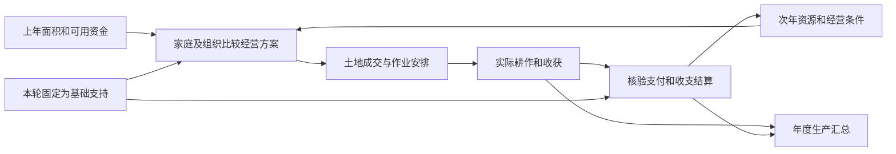

# 农户粮经兼种与补贴效应：全国模型源码审阅快照

**审阅对象**：在已有农业经营模型中允许农户只改变部分粮食面积后，农户是否选择兼种，以及这一选择能否通过同户调查检验。代码、配置和汇总对应种子103、109，各自的新旧规则基础支持运行，2011年至2013年。此次提交的是行为检验，不是三项补贴政策的比较结果。

先读[本轮稿件](review/01_本轮工作稿.md)、[设计](review/02_实验设计与复算.md)、[同户决策对账](review/09_同户决策汇总/README.md)和[数据与指标口径](data/变量与样本说明.md)。四次运行共12个生产年度。2011年可靠匹配562户，调查有340户兼种，新规则两条路径为106户、103户；2012年527户中相应为276户、32户、44户。两次调查均按年度播种口径。三项政策的运行状态见[政策表](review/04_政策比较状态.csv)，空白不是零。

### 从研究问题找到代码和证据

|研究对象|实际代码入口|参数、输出与检验|
|---|---|---|
|家庭保留原粮经组合、局部调整或退出经营|[家庭播前预算](agents/farmer_agent.py)的 expected_fixed_rule_account；[方案选择](core/fixed_rule_runtime.py)的 choose_action_income|2010年份额初始化，10个百分点的离散备选和50元/经营亩惯性是模型设定。同户备选、选择、实际种植不能混为一谈。见[行为检验](review/03_同户行为检验.csv)。|
|土地从原经营者转出并由其他家庭、合作社或企业承接|[土地清算](modules/land_clearing_house.py)的 clear_market；[经营者退出处理](modules/population_dynamics_v2.py)的 _process_agent_exit|成交与用途分别记录。模型年度退出行动不是调查失访；600户、合计60家组织是基期配置，不是全国企业抽样比例。本轮没有验证企业进入率。|
|农业生产与支付|[农业企业及合作社](agents/enterprise_agent.py)的 harvest_and_settle；[申请、核验和支付](core/p3_project_payments.py)的 submit、verify、pay|以实际生产量和实付金额核算；混种定位不到地块时仅保留家庭合计。见[年度收支](review/05_基础年度账.csv)。|
|政府是否切换政策|[政府策略](agents/government_agent.py)与[本轮运行入口](scripts/run_national_household_portfolio.py)的 run|本次入口把政府动作固定为基础支持，不训练。奖励输出不是政府学到了策略的证据。|

**三层空间框架的读法。** 主体、地块和交易关系是微观模拟对象；合同、服务和支付是年内执行过程；区域或系统指标来自实际生产和收支汇总。这不等于已经验证了事件时间模型或另有一个独立的系统动力学模型。模拟坐标不是调查地理坐标。将来若在年末用汇总量驱动政府调整，只应影响下一期政策，不能在上层重复计算粮食产量。本轮未为三层框架更改底层代码。

### 版本与复核

- 每个实验的生效配置在 experiments/。私人机器输入路径替换为相对占位路径，数值参数未变。源文件清单 source_manifest.csv 区分运行时有哈希记录的源码和为阅读、测试提供的配套代码；两列哈希不同表示公开副本移除了本地路径。代码附件另有[两次历史版本间的差异](review/10_代码附件/01_版本核对与可验证差异.md)。
- 审阅汇总文件的校验和在 review/文件校验.csv。可用 `python -m pytest -q tests/test_household_crop_portfolio.py` 检查家庭规则的构造算例。正式路径的同户复算还需要获授权的固定观察点数据、原冻结队列和实验输入，不随仓库发布。
- 这是全国家庭行为专题的独立快照。它不包含开发仓库历史、其他论文、受限微观数据、逐户日志或个人空间位置。审阅请引用分支所指提交的完整 SHA。
