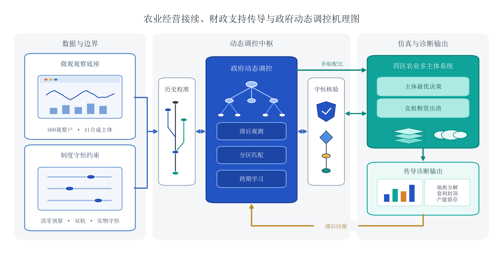

# 农业经营接续下种粮补贴传导与动态调控研究

**摘要**：**目的** 揭示公共财政支持经农户退耕、土地竞租、要素约束与跨区粮贸发生传导分化的微观机理，明确有限预算稳定转化为持续粮食产能的制度边界与动态调控规律。**方法** 基于全国农村固定观察点 2009—2015 年 600 户同户跟踪调查与 2010 年个体截面，配以分账核算的 41 个合成规模经营主体，在 2010 年前校准与双边实物守恒框架下构建双层多主体农业经济仿真系统，检验流动性剥离、地租“价格—面积”分解、村社协调与双轨租期、订单套利封顶及共同清零预算下动态学习的长期效应。**结果** 纳入户主老龄、外出务工退耕惯性与租金抵补口粮机制后，2015 年播种户数偏差由 15.63 个百分点降至 5.89 个百分点，粮产误差降至 1.53%，农机服务使东北抛荒率保持在 0.66%；等实支口径下，规模补贴纯单价资本化率达 62.24%（每百元增粮 16.14 kg），生产托管将资本化率压降至 15.89% 且效率达 46.41 kg/百元；叠加村社协调可使托管八年增产至 849.34 t、闲置减少 60.9%；订单改按实种 400 kg/亩封顶后跨省套利减少 59.5%；纳入有偿三年连片整治后，极端随机树跨期强化学习自适应识别出“第 2、5、8 年”脉冲序列，八年增产 902.01 t（75.68 kg/百元），分别高出静态区域最优与全国固定方案 238.27 t 和 389.92 t。**结论** 推动农业财政支持由直接补贴租地规模转向物化托管降本、村社连片脉冲整治、实种封顶防漏与分区精准动态匹配，可提升有限财政资源的粮食转化效率。

**关键词**：农业经营接续；种粮补贴传导；地租资本化；农机生产托管；跨省订单粮套利；多主体农业仿真；政府动态调控

## 一、前言

财政支农资金能否转化为实打实的粮食生产能力，并不单纯取决于补贴总盘子的大小，更取决于资金进入农村微观经营体系后经过怎样的组织链条与市场价格传导。在加快建设农业强国与端牢中国饭碗的宏观要求下[1-3]，我国已形成涵盖耕地地力保护补贴、实际种粮农民补贴、农业社会化服务补助及地方订单粮食价外奖励的综合扶持体系。然而，长期微观观测表明，同样的财政投入在不同区域往往呈现出截然不同的经济归宿：在耕地资源紧缺或流转竞争激烈的地区，直接按承接面积发放的现金补贴极易在土地竞租中转化为流转租金上涨[4-7]；在青壮年劳力外流而土地成方连片度不足的农区，零散地块因交易协商成本偏高难以顺利接续[8]；而在毗邻省区存在稳定粮价梯度的沿海销区，宽松核定的订单加价政策还会诱发跨省买粮顶抵的财政套利。回答“有限公共财政支持在何种条件下保留为粮食生产能力、在何种条件下主要改变地租分配或发生传导耗散”，既是重塑农业补贴结构的关键政策问题，也是需要厘清微观传导边界的基础科学问题。

既有研究大多在局部均衡或静态框架下考察单项农业政策效果，难以在同一账本内打通农户退耕、土地竞租、要素替代与跨区粮贸之间的跨期反馈，亦难以公平评估政府动态调控的真实边界。传统计量实证受制于外生政策变异与观测时段，多聚焦补贴对单期种植决策或局部租金的净影响；早期多主体农业模型则常依赖主观预设的行为规则，难以抵御政策变化时的理性重配置偏误。为兼顾微观测算真实性与政策演化内生性，本研究在实证数学规划[9]与国际主流农业多主体建模规范[10-12]基础上吸收群体智能优化思想[13]，使家庭农场、农民合作社、农业企业与普通承包农户共享同一盈利性与资金可行性账本，并进一步引入数据高效的拟合动作价值迭代及极端随机树批量强化学习方法[14-16]，检验中央与地方在仅观测滞后公开宏观区情与严守年度预算清零约束下的跨期政策优化边界。

立足于我国“大国小农”与代际经营接续并存的现实结构，本文依托农业农村部全国农村固定观察点 2009—2015 年 600 户同户跟踪调查与 2010 年个体成员截面构建实证底座，依次回答四项递进问题：第一，老龄化、稳定外出务工与租金抵补口粮如何决定家庭退出自耕与土地供给释放，从而约束农业经营接续的微观测算精度；第二，播前与产后种粮直补、适度规模承接补贴、农机生产托管补助和封顶订单奖励如何在同一盈利性与春耕流动性方程中分化出截然不同的地租资本化与增粮效率；第三，村集体连片协调、长短双轨流转契约以及按实种面积核定的省际订单封顶机制，在多大程度上疏通流转堵点并抑制跨省买粮套利漏损；第四，分别考察仅依赖年度补贴的基础环境与纳入有偿多年期村社连片整治的跨期环境，检验自适应政府决策学习相对现实固定规则、透明阈值规则、事后静态区域最优对照及单期短视寻优的真实增效来源与边界条件。

## 二、农业经营接续的现实基础与补贴传导症结

### （一）固定观察点样本经营接续的实证特征

全国农村固定观察点 2010—2015 年同户跟踪调查揭示了“播种户数持续减少而样本总产粮稳中有升”的结构转型特征。2010 年基期有效可比的 600 户固定观察点农户横跨我国四大农业区域（东、中、西、东北依次为 141 户、173 户、185 户和 101 户），实有经营物理耕地总计 5 277.5 亩（1 亩 ≈ 666.7 m²，四区分别为 699.5 亩、958.4 亩、1 208.8 亩和 2 410.8 亩），其中具备市场流转交易条件的可流转面积为 4 009.2 亩。各区域禀赋差异悬殊：东部地区户均耕地不足 5 亩、非农务工机会成本高且经济作物竞争突出；中部与西部地区土地细碎化程度高，近半数耕作者长期兼种粮食与经济作物；东北地区户均耕地达 23.87 亩，规模连片潜力大，但家庭青壮年外流使机械耕作与收割高度依赖外部农机作业服务市场。

五年连续跟踪记录表明，推动耕地从老龄化小农手中顺利流向接续主体并维持粮食产出的关键在于非农退出渠道与社会化农机可及性。在 2011—2015 年可比样本期间（有效同户样本量介于 532 户至 569 户之间），参与农业播种的调查农户由 2011 年的 539 户逐步下降至 2015 年的 445 户，粮经兼种户同步由 293 户缩减至 207 户，但样本粮食总产量则由 2 143.36 t 稳步上升至 2 381.24 t。当高龄户主或长年外出务工家庭能够顺利转出承包地收取地租、并在本地粮食市场购买成品口粮替代高劳动强度的微规模自种时[17]，零散耕地才得以摆脱“口粮锁定”进入接续流通池；而在东北等户均规模较大地区，商业化农机作业服务与雇工市场则是防止青壮年外流后发生耕地季节性抛荒的核心支撑。

### （二）有限财政支持传导分化的四重制度症结

#### 1. 土地流转竞租抬价与补贴地租资本化

向规模流转面积倾斜的现金补贴在耕地供给刚性约束下容易通过竞价市场转化为地租上涨，而非沉淀在粮食生产端[4-7]。当地方补贴以流转承接物理面积为发放依据时，边际支付意愿本就更高的家庭农场、农业企业与合作社在竞租同一批挂牌地块时会将预期补贴贴现入出价之中，进而拉升整个子市场的均衡地租[18]。此外，观测总租金变化同时混杂“单位租金上涨”与“在租面积扩张”两条渠道；唯有采用价格—面积对称分解并在同一年度两套政策情景均发生成交的同地块交集上核算单价差异，方能准确剥离被土地转出方吸收的纯地租资本化份额。

#### 2. 播前春耕流动性约束与种粮比较收益制约

涉农资金的发放时点与货币可替代性决定了现金支持能否真正绕开地租溢价通道。调查农户与中小家庭农场在春耕期间面临化肥、良种、农药垫支及农机预付款项的刚性现金约束。在遵从货币可替代性的财务逻辑下，播前兑付的现金直补汇入统一春耕流动资金池，在满足最低自有履约本金约束的前提下，既缓解了备耕现金缺口，也会同时增强主体参与竞租与雇工的支付能力；相反，生产托管补助按实际田间机械作业量直接冲抵服务费用、依法不得挪作地租支付，因而具备在不推高均衡地租条件下缓解农忙用工瓶颈与改善种粮相对收益的独特制度属性[8,19]。

#### 3. 村社连片交易摩擦与流转合同期限错配

散户地块的碎片化谈判障碍与流转合约期限两难权衡，直接制约了农业经营接续的真实成交效率。在缺少集体组织介入的分散交易市场上，希望退出的老龄小农所释放的零散地块即便租金要价合理，也常因对接搜寻与多户签约协商成本过高而流拍闲置[20]。与此同时，现实农村并存的短期口头约定与多年期书面流转合同各有利弊：一年期短租赋予主体极强的逐年规模弹性，却导致年际重新撮合过程中的闲置流失偏高；多年长租虽有效压缩了匹配摩擦，却在主体遭遇季节性资金或用工紧约束时，放大了已签约在租但无法足额实播的“在租未播”风险。

#### 4. 毗邻省际价差驱动的订单粮跨区套利风险

当局部订单粮食价外奖补与宽松交售额度叠加毗邻省区粮价梯度时，跨省买粮套取财政补贴将成为破坏地方产粮效率的显著漏损通道。近年来，浙江、福建等主销省份先后实施每千克 0.24—0.60 元的地方订单粮食收购价外奖励政策[21-22]。在相邻产销省份同季稻谷或小麦存在稳定产地价差，且公路短途调运成本与交易经纪摩擦之和低于两省价差与补贴总额的条件下，一旦订单额度沿用与承包总面积挂钩的宽松核定口径，部分拥有交售资质的经营主体就可能在利润最大化动机驱使下从毗邻产粮大省低价购入商品粮顶抵本省订单额度，在不增加本地实物粮产的前提下套走稀缺财政资金。

## 三、多主体农业经济仿真与动态调控模型构建

### （一）多主体微观架构与数据校准口径

为在同一套经严格检验的微观账本上比较四重制度传导机理，本文构建了涵盖实证调查底座、双层动态调控中枢、四区农业多主体系统与传导诊断输出的耦合仿真架构（见图1）。系统内的决策主体按经济身份明确划分为五类：①600 户固定观察点调查农户，各自携带基期真实土地产权面积、常住农业劳动力与非农外出天数、户主年龄、历史粮食播种偏好、机械作业费承受水平及主食口粮刚性需求，目标是在年度资金与劳力边界内最大化家计综合净收益，并可自主选择自耕保留、扩租、部分转出、全面退出自种转租收租或闲置抛荒；②与 600 户调查家庭严格分账的 41 个合成规模经营主体（包括 23 个家庭农场、15 个农民合作社与 3 家农业企业），基于各区观察点中位数与规模化要素成本文献系数生成且不赋予任何额外单产技术加成，其中家庭农场保留两名家庭农劳力，合作社依托连片服务摊薄农机作业费并承担合作社管理费，农业企业 100% 雇工且当连续两年资本净回报低于 -5% 或现金断裂时退出市场；③承担零散地块统筹归并的村集体协调组织；④负责核验订单额度并执行省际商品余粮双向结算的区域粮食收储与贸易代理；⑤在年度预算上限内按年决策区域政策配比的政府调控主体。

系统参数设定遵循清晰的经验溯源边界：全部农产品产地价格、经济作物亩产值、农机作业服务费、物质要素成本、家庭口粮消费量、户主年龄与外出务工天数均取自农业农村部全国农村固定观察点 2009—2010 年家庭调查表及 2010 年个体成员截面，统一按居民消费价格指数平减折算至 2024 年价格口径；气候风险（覆盖正常年景、轻度减产、中重度减产与增产年景的四档随机年景分布）、基于基期种植比例反解的边际成本曲率及老龄退耕重启门槛均严格限定利用 2010 年及以前信息校准，杜绝使用 2011 年及以后数据反调生产或退出参数；各级补贴上限与比例直接对接现行农业财政政策文件[21-22]。

*注：实证微观测算底座来源于农业农村部全国农村固定观察点 2009—2010 年 600 户家庭调查表及 2010 年个体成员截面（东、中、西、东北四区分别覆盖 141 户、173 户、185 户与 101 户，基期实有经营物理面积 5 277.5 亩、可流转面积 4 009.2 亩），并与 41 个合成规模经营主体（23 个家庭农场、15 个农业合作社与 3 家农业企业）分账独立核算；统计校准窗口严格限定于 2010 年及以前历史观测期。*

### （二）融入非分离劳动与退耕惯性的农户经营最优化

在一个农业生产年度内，每类经营主体在既定已承接或自留耕地面积、可用春耕流动性资金以及分季节可支配家庭劳力约束下，求解兼顾食物自给与现金收益的种植最优化问题。目标函数综合核算三部分真实账目：第一，严格分离调查农户优先留足家庭主食需求的实物口粮价值与余粮、经济作物的市场现金销售收入，并依据非分离农户模型价格带理论设定 15% 的农村口粮零售—产地购销价差[23]；第二，单列经审计核实的逐作物农机作业服务费及三段式边际劳动机会成本（农闲保留工日、非农竞争窗口工日与付费外雇工日），在不虚构分工序省工天数的基础上真实刻画生产托管补助对机械服务价格的边际减免效应；第三，在基期观察种植结构处通过一阶最优性条件引入一阶齐次凹二次边际成本曲率[9]，确保零播种面积成为合法均衡解且粮经兼种比例具备微观平滑响应，防止近线性规划导致耕作结构剧烈震荡。

在此共同优化方程内，系统依托 2010 年个体截面实测外流天数与户主年龄建立两项内生退耕与接续机制，以破解既有微观模型中兼业小农“微利不退”的常见失真问题。一方面，当高龄户主或稳定外出务工家庭上一期已退出农业自耕并将土地释出后，次年重新购置整备农具与返乡组织生产的固定重启门槛有效抑制了低效微耕的反复回流；另一方面，转出土地收取的地租收入与稳定外出非农工资收入可按本地零售粮价直接折抵家庭基本口粮需求，从而打通兼业户“以租买粮”退出小块零散种植的市场通道。所有耕作面积调整、留耕或退出行为均严格源自同一收益与可行性约束最优化，不设规则外的强制扣减分支。

### （三）土地流转双轨竞租出清与省际双边实物守恒规则

每年农季播种前，土地流转市场按“先在履旧约、再新签竞租、流拍可条件复耕”的时序出清。所有潜在转出方依据退出自种的净边际收益与预期地租报出保留底价；意愿扩耕户与规模经营主体则依据新增地块前后最优计划净剩余的增量影子价格[10]，扣除报价折减与单次合并签约协商成本后形成竞争出价，在可分租与不可分整包规则下按双边议价机制逐笔出清并实时扣减买方可用营运资金与工日。针对流转合同期限与集体介入机制，系统按调查农户一年期、家庭农场与农民合作社三年期、农业企业四年期设定双轨异质合约期限结构[20,24]，并以开关对比村集体连片统筹对交易摩擦、统筹农机节约与接续稳定性的影响；依据货币可替代性原理，播前现金直补与规模承接补贴统一进入春耕流动资金池共同接受最低自有履约本金约束。

为严密检验毗邻省际订单粮套利机制，系统依托 600 户样本在十一个主要粮食省区的真实分布与 2009—2010 年同作物产销省观察价差，构建覆盖六个销区省、八条定向毗邻省界的双边实物粮贸子系统。六个销区涵盖河北（29 户）、江苏（25 户）、福建（23 户）、广东（22 户）、山东（12 户）与浙江（7 户），五个产区涵盖安徽（43 户）、河南（33 户）、湖北（30 户）、江西（28 户）与湖南（10 户），共同计入产区商品余粮总供给核算（其中形成直接跨省调运通道的包括河南入河北、河南入山东、安徽入江苏、江西与安徽入浙江、江西入福建以及江西与湖南入广东）。系统每步结算强制核验四项双边实物与财政闭合关系：销区购入用于顶抵订单的总重量严格等于毗邻产区实际商品余粮池的扣减总重量；任一产区被跨省调出的粮食严格不超过当期扣除农户自留口粮后的实际余粮余额；全国跨省购销调剂严禁凭空创造新增粮食产量；各地实付补贴与流转统筹费严格不超过共同预算上限。

### （四）共同预算下政府跨期政策学习与双情境公平评价框架

在政府调控层，本文构建同一环境、同一硬预算与同等滞后公开观测约束下的严格公平对比架构。中央与地方联合增量支农预算统一锁定为每年 15.000 万元（八年主动周期累计共同预算上限 120.000 万元），严格遵从《中华人民共和国预算法》当年预算当年核销清零、不跨年度留存结转的规定；政府决策主体无法读取微观农户不可观测生产率或类型标签，仅接收上一年度末汇总生成的区域滞后公开指标。

为全面界定政策学习在短期与跨期制度中的适用边界，实验并行评估两类制度深度情景：**基础情景**限定政府每年从 30 种区域财政工具配置方案（涵盖普惠播前/产后直补、播前/产后规模承接补贴、农机生产托管补助、封顶订单粮食奖励及东、中、西、东北四区倾斜组合）中进行年度选配，仅观测 17 维滞后公共状态特征，采用岭回归拟合动作价值迭代（贴现因子取 0.96，目标兼顾累计增产与每十万元财政实支 0.02 的适度成本权重）[14]；**跨期拓展情景**进一步依据《农村土地经营权流转管理办法》[24]第 31 条关于流转服务机构可依规收取合理组织协调费用的现实规定，在动作空间扩展纳入“有偿三年期村社连片整治”选项（36 种方案），每次触发连片整治须从当年 15.000 万元清零总预算中实时实扣 10.500 万元整治组织费（折合 26.2 元/可流转亩，不引入任何未经校核的全区免费单产外溢），剩余资金方可用于当年直接农作补贴，但可连续三个农年压低四区流转匹配摩擦与连片机耕成本。相应地，政府滞后公开观测扩展至 28 维（增补年份进度、组织池剩余年限比例及区域多年期租约占比与违约退回率）；针对小样本高维状态下常规神经网络易受有限种子噪声过拟合的局限，拓展情景采用样本外更稳健的交叉拟合双动作价值极端随机树集成[15]与同条件线性岭回归消融开展受控对照。两类情景均实行开发集（12 种子）、训练集（32 种子）与独立评价集（48 种子）三重隔离，于第 6 年末分叉检验第 7—8 年全面停补后的产能留存，并将跨期动态调控同时对比两类现实行政基准（全国统一固定配发、简单透明阈值规则）、经开发集事后遍历选出的静态区域最优对照，以及共用全部状态特征的单期短视寻优策略。

## 四、多情景模拟测算与政策效应评估

### （一）五年递推历史拟合验证与机制消融检验

将 2010 年基期 600 户样本与 41 个合成规模主体投入系统后，在不接入任何后期真实年度信息调节参数的条件下连续五年自主演化至 2015 年，能够稳健复现全国固定观察点“在耕户数下降而总产保持稳增”的核心宏观分化事实（见表1与图2）。与此同时，分年度单步条件预测显示，2011—2015 年各期粮食总播种面积相对预测误差依次稳定在 1.43%、1.89%、4.46%、8.39% 和 10.36%，验证了底层盈利性与要素规划结构在微观层面具备稳健的一步响应捕捉能力。

*注：历史实测参照值来源于农业农村部全国农村固定观察点 2010—2015 年 600 户同户跟踪调查表及 2010 年个体成员截面；改进完整方案与未含个体退耕的基础对照均基于 20 个独立随机种子五年连续递推测算得到，四组机制消融对照均基于 8 个独立随机种子五年连续递推测算得到。*

**表1 2011—2015 年固定观察点同户五年连续递推历史拟合与机制消融检验结果**

| 验证口径与消融设置 | 随机种子数 | 2015 年播种户数 / 户 | 参与率绝对偏差均值 / 百分点 | 2015 年粮经兼种户数 / 户 | 兼种比例偏差 / 百分点 | 2015 年总产粮 / t | 粮产相对误差 / % | 2015 年东北抛荒率 / % |
|---|---|---|---|---|---|---|---|---|
| 调查实测参照（可比 534 户） | — | 445.00 | — | 207.00 | — | 2 381.24 | — | — |
| 基础对照方案（未含个体表退耕） | 20 | 528.45 | 15.63 | 257.65 | 9.49 | 2 308.15 | 3.07 | 0.55 |
| 改进完整方案（含个体退出与抵粮） | 20 | 476.45 | 5.89 | 196.10 | 2.12 | 2 344.69 | 1.53 | 0.66 |
| 消融一：取消退耕返耕门槛 | 8 | 480.12 | 6.58 | 196.25 | 2.01 | 2 371.25 | 0.42 | 0.70 |
| 消融二：取消租金抵补口粮采购 | 8 | 509.62 | 12.10 | 203.00 | 0.89 | 2 313.69 | 2.84 | 0.94 |
| 消融三：取消凹二次成本曲率 | 8 | 477.00 | 5.99 | 91.25 | 21.68 | 2 359.17 | 0.93 | 0.52 |
| 消融四：取消市场化农机作业服务与雇工 | 8 | 486.25 | 7.72 | 146.38 | 11.35 | 2 331.69 | 2.08 | 10.69 |

*注：2011 年与 2012 年调查实测播种户数分别为 539 户和 495 户（总产粮 2 143.36 t 与 2 179.03 t），改进完整方案同期 20 个随机种子均值分别为 541.60 户（参与率绝对偏差均值 0.46 个百分点，产粮 2 131.35 t）与 494.50 户（偏差 0.41 个百分点，产粮 2 092.55 t）；消融二同步关闭预期租金更新机制以完整剥离外租口粮替代渠道。数据来源于农业农村部全国农村固定观察点 2009—2015 年跟踪调查表及本项目多主体农业经济仿真系统测算结果。*

四组对照与消融实验清晰分离出小农退出惯性、作物平滑曲率及农机社会化服务在维系农业接续中的各自贡献。若缺少个体年龄与外出退耕校准，2015 年仍滞留小规模耕作的模拟户数高达 528.45 户（偏高 15.63 个百分点），而融入退出惯性与“以租买粮”渠道后，2015 年在耕户数显著收敛至 476.45 户（偏差收窄至 5.89 个百分点），兼种户偏差亦由 9.49 个百分点压减至 2.12 个百分点，总产粮相对误差降至 1.53%。机制消融进一步证实：抽离“租金抵补口粮采购”后（消融二），小农受口粮自保锁定而滞留微耕，参与偏差立刻反弹至 12.10 个百分点；抽离凹二次边际成本曲率后（消融三），尽管总粮产近乎不变，兼种户数却暴跌至 91.25 户（偏差扩大至 21.68 个百分点），说明线性收益假设无法解释我国农村普遍的粮经复合种植模式；抽离社会化农机作业服务与雇工替代后（消融四），户均耕地达 23.87 亩的东北农区在 2015 年抛荒率由 0.66% 激增至 10.69%（扩大至完整情景的 16.2 倍），从反面确立了农机服务市场在北方大宗产区稳耕稳产中的支柱地位。

### （二）春耕流动性效应与地租资本化分解

#### 1. 春耕资金时间价值与货币可替代性效应

补贴注入时点的微小差异通过缓解春耕备耕现金紧约束能够撬动可观的粮食增量，但货币可替代性决定了现金直补同时也会外溢至土地竞租市场。固定基准情景全部土地租约以完全剥离市场重配扰动的 48 个随机种子配对试验显示，播前兑付种粮直补八年累计实现增产 329.36 t（95% 置信区间为 [325.11, 333.61] t），显著高于产后兑付方案的 316.97 t（[312.83, 321.11] t），仅提前打通春耕现金周转即可净释放 12.39 t 增量粮食。当重启内生竞租市场并遵循真实资金流动性池规律（允许播前款项在满足自有履约本金约束下进入竞租支付）后，播前规模承接补贴相对无补贴基线的八年总租金增量达到 30.92 万元，较“人为隔离现金不可付租”假想口径高出 4.81 万元；与之截然相反，农机生产托管补助因按实发生机械作业凭证扣减费用、天然阻断竞租挪用通道，在可替代性与禁付租两种会计设定下的租金差额严格保持为 0.00 万元（相对基线均为 -0.88 万元）。

#### 2. 租金变化的“价格—面积”对称分解与等实支效率比较

在无增量支持基线世界中，样本体系八年累计收获粮食 18 448.85 t，年均流转土地 780.60 亩，市场均衡单位地租为 590.87 元/亩。分别考察全额封顶标准与同等实际财政支出（约 87 万元）两套口径下各主流支持工具的八年传导分化（见表2与图3）。

*注：图3(a) 展示各支持工具按全额上限标准连续投放八年的总租金“价格—面积”对称分解，红字标注纯单价地租资本化率；图3(b) 为约 87 万元等实支对照组（农机生产托管补助受真实农机作业发生量上限约束，等实支组实支为 78.54 万元）；同地块交集价差严格取两对照路径共同出租成交之同一地块的面积加权亩租均值差。数据来源于农业农村部全国农村固定观察点 2009—2010 年 600 户调查数据及本项目多主体农业经济仿真系统基于 48 个独立随机种子测算得到。*

**表2 主要财政支持工具的地租资本化分解与同等实际支出口径效率对比（48 个独立种子）**

| 支持工具与资金比较口径 | 八年实际财政支出 / 万元 | 八年累计粮食增产 / t | 单位实支增粮效率 /（kg/百元） | 纯单价地租资本化率 / % | 同地块交集均租价差 /（元/亩） |
|---|---|---|---|---|---|
| 播前种粮直补（全额标准） | 119.624 | +474.95 [464.28, 485.62] | 39.70 | 18.19 | +39.69 |
| 产后种粮直补（全额标准） | 119.654 | +484.38 [474.05, 494.71] | 40.48 | 16.50 | +33.90 |
| 播前规模承接补贴（全额标准） | 87.056 | +140.41 [131.43, 149.39] | 16.13 | 62.24 | +80.66 |
| 产后规模承接补贴（全额标准） | 86.037 | +124.22 [115.49, 132.94] | 14.44 | 60.03 | +74.93 |
| 农机生产托管补助（全额标准） | 95.179 | +433.40 [424.41, 442.40] | 45.54 | 15.30 | +27.63 |
| 封顶订单粮食奖励（全额标准） | 119.443 | +512.09 [500.94, 523.23] | 42.87 | 17.13 | +34.50 |
| 播前种粮直补（等实支比较） | 86.849 | +370.29 [360.60, 379.98] | 42.64 | 17.63 | +28.00 |
| 播前规模承接补贴（等实支比较） | 87.056 | +140.41 [131.43, 149.39] | 16.14 | 62.24 | +80.66 |
| 农机生产托管补助（等实支比较） | 78.539 | +364.51 [355.39, 373.63] | 46.41 | 15.89 | +23.50 |
| 封顶订单粮食奖励（等实支比较） | 86.706 | +392.62 [382.46, 402.78] | 45.28 | 16.63 | +24.75 |

*注：无财政支持基线八年累计总产粮为 18 448.85 t，年均成交流转面积 780.60 亩，均租 590.87 元/亩；方括号内为 48 个独立随机种子同条件配对 95% 置信区间；播前规模承接补贴在全额与等实支对照组为同一实验组别，两处单位实支增粮效率分别为按全样本总和比值口径（16.13）与按逐种子效率算术均值口径（16.14）。数据来源于农业农村部全国农村固定观察点 2009—2010 年 600 户调查数据及本项目多主体农业经济仿真系统基于 48 个独立随机种子测算得到。*

对称分解结果尖锐揭示了不同支持工具有着天壤之别的收益留存结构：第一，**直接挂钩规模租入面积的承接补贴有超过六成被流转地租涨价吸收**。播前与产后规模承接补贴全额标准下八年仅换回 140.41 t 和 124.22 t 增产，每百元实际支出增粮效率低至 16.13 kg 和 14.44 kg，却使同一地块交集均租骤升 80.66 元/亩和 74.93 元/亩（整体市场均租由 590.87 元/亩拉升至 678.37 元/亩），纯单价地租资本化率分别高达 62.24% 和 60.03%。第二，**面向实作业与实产环节的托管补助和封顶订单奖励实现了显著的“增产兼控租”双重红利**。在约 87 万元同等财政实际支出水平下，农机生产托管补助与封顶订单粮食奖励每百元增粮效率分别达 46.41 kg 与 45.28 kg（相当于播前规模承接补贴 16.14 kg/百元的 2.88 倍和 2.81 倍），同时将纯单价地租资本化率严格压降在 15.89% 和 16.63%，同地块交集租差收敛于 +23.50 元/亩与 +24.75 元/亩以内，确保公共资金主要留存用于抵补田间机械投入与稳固边际种粮利润。

### （三）村社连片协调、流转租期与省际订单粮套利封顶检验

#### 1. 村社连片协调与流转合同期限的动态权衡

基层细碎化地块的交易组织摩擦与合约期限安排深刻决定了财政工具最终能撬动多少净增产（见表3与图4(a)）。在缺少村集体连片介入的分散流转市场中，单用规模承接补贴八年仅增产 140.41 t，年均出现 32.62 亩因谈判错配而未能成交的闲置释放耕地，停补后第 7—8 年留存仅 25.24 t；一旦引入村集体将零散地块集中整理并连片打包发包，规模补贴的八年累计增产增至 721.98 t（增幅超过 4 倍），未成交闲置流失大幅缩减 63.8% 至 11.81 亩/年，停补留存同步增至 195.22 t。更为重要的是，若将村集体连片降阻分别与农机生产托管和封顶订单奖励联动配合，八年累计总增粮可分别提升至 849.34 t（未成交流失压减 60.9%，财政效率高居 91.90 kg/百元）和 952.61 t（未成交流失压减 59.7%，第 7—8 年停补留存高达 237.92 t），同时把严格年度易主种粮接续面积推升至 582.40—638.79 亩/年。流转合同期限对照进一步显示，全盘推行三年长租虽将未成交闲置压低至 17.80 亩/年，却把容易受当期要素制约的在租未播面积推高至 9.23 亩/年，并锁定多年经营权使年度有序接续降至 272.72 亩/年，印证了“核心片区稳长租、边际地块配短租”双轨机制的制度优越性。

*注：图4(a) 与表3基于 48 个独立随机种子对比双轨合约下村集体连片统筹及三类流转期限在四区总和上的效应；图4(b) 与表4基于同一 48 个种子及观察点 2009—2010 年十一个产销省份真实观测价差开展跨省买粮套利与双边实物守恒校验。数据来源于农业农村部全国农村固定观察点 2009—2010 年 600 户调查数据及本项目多主体农业经济仿真系统。*

**表3 村集体连片协调与流转合同期限动态权衡的全国总口径评估（48 个独立种子）**

| 实验情景与合约制度 | 八年全国总增产 / t | 八年实际财政支出 / 万元 | 单位实支增粮 /（kg/百元） | 严格年度易主接续 /（亩/年） | 未成交闲置释放 /（亩/年） | 年均在租未播 /（亩/年） | 第 7—8 年停补留存 / t |
|---|---|---|---|---|---|---|---|
| 规模补贴（双轨、无协调） | +140.41 [131.43, 149.39] | 87.056 | 16.13 | 489.40 | 32.62 | 7.78 | +25.24 [21.23, 29.25] |
| 规模补贴＋村社连片协调 | +721.98 [708.56, 735.40] | 93.839 | 76.94 | 638.79 | 11.81 | 11.20 | +195.22 [188.39, 202.05] |
| 生产托管（双轨、无协调） | +433.40 [424.41, 442.40] | 95.179 | 45.54 | 516.53 | 32.11 | 7.70 | +69.91 [65.85, 73.98] |
| 生产托管＋村社连片协调 | +849.34 [836.99, 861.68] | 92.416 | 91.90 | 600.27 | 12.57 | 8.75 | +214.50 [207.95, 221.05] |
| 封顶订单（双轨、无协调） | +512.09 [500.94, 523.23] | 119.443 | 42.87 | 483.53 | 32.59 | 7.83 | +94.46 [89.92, 99.00] |
| 封顶订单＋村社连片协调 | +952.61 [938.63, 966.59] | 119.472 | 79.74 | 582.40 | 13.14 | 8.80 | +237.92 [230.65, 245.19] |
| 区域组合（一年短租合约） | +438.11 [429.28, 446.93] | 95.122 | 46.06 | 581.86 | 37.42 | 6.02 | +72.40 [69.14, 75.66] |
| 区域组合（长短双轨合约） | +439.94 [431.21, 448.67] | 95.124 | 46.25 | 516.23 | 32.09 | 7.68 | +70.56 [66.61, 74.51] |
| 区域组合（三年长租合约） | +446.93 [432.77, 461.08] | 95.245 | 46.92 | 272.72 | 17.80 | 9.23 | +72.49 [66.91, 78.08] |

*注：表中无财政补贴对照在双轨合约、一年短租与三年长租下之年均未成交闲置释放分别为 35.48、41.19 与 19.98 亩/年，年均在租未播面积分别为 8.38、6.85 与 10.46 亩/年，严格年度易主种粮接续分别为 524.17、590.98 与 275.81 亩/年；各行增产与停补留存均对应同合约无补贴基线，区域组合指“东部封顶订单粮食奖励＋中西部与东北农机生产托管”。数据来源于农业农村部全国农村固定观察点 2009—2010 年 600 户调查数据及本项目多主体农业经济仿真系统基于 48 个独立随机种子测算得到。*

#### 2. 毗邻省际订单粮套利通道与实种核定封顶效果

在订单粮食收购价外奖励执行口径上，将交售配额由物理承包面积锚定转向实际核定种粮播种面积封顶，即可依托主体内生利润反应直接阻断过半跨省套利漏损（见表4与图4(b)）。当东部价外补贴率为零时，跨省套利与资金漏损自然保持为零；一旦开启 0.34—0.35 元/kg 的收购价外奖励并按承包物理面积 450 kg/亩发放宽松交售额度，东部销区八年本地粮食增量仅实现 76.14 t，而七条活跃跨省公路通道自毗邻产区 2 664.54 t 可调出余粮池累计跨省买入低价粮顶抵高达 604.15 t（95% 置信区间 [591.40, 616.91] t），白白消耗掉 15.324 万元（占订单加价支出的 25.97%），其中河南入河北 207.64 t、江西入广东 183.49 t 与江西入福建 109.77 t 构成跨省买粮主力通道（其余为安徽入江苏 46.60 t、江西入浙江 31.32 t、河南入山东 14.11 t 及湖南入广东 11.23 t）。即便公路运费在 0.09—0.18 元/kg 间大幅抬升，套利漏损仍居 24.45%—27.38% 高位。与之形成强烈对照的是，仅将交售配额收紧为“以当季实际核定种粮播种面积乘以 400 kg/亩封顶”，即可促使东部本地实际种粮增产增至宽松口径的 4.15 倍（达到 316.20 t），并同步把跨省买粮套利压减 59.5% 至 244.46 t（漏损占比腰斩至 11.74%）；叠加村社连片协调可继续将东部与中部增产同步放大至 383.04 t 和 153.86 t；若将该实种封顶规则推及全国四区执行，跨省套利规模即萎缩至 28.30 t（漏损占比仅余 0.65%）。所有情景下双边实物商品余粮扣减偏差始终严格闭合为 0.00 kg。

**表4 毗邻省际订单粮跨区购销套利与实种面积上限封顶检验（48 个独立种子）**

| 省际订单粮检验情景 | 东部销区八年增产 / t | 中部产区八年增产 / t | 跨省买粮顶抵套利量 / t | 套补资金漏损 / 万元 | 漏损占比 / % | 双边守恒误差 / kg |
|---|---|---|---|---|---|---|
| 零奖励 / 零加价基线（0.00 元/kg） | 0.00 [0.00, 0.00] | 0.00 | 0.00 [0.00, 0.00] | 0.000 | 0.00 | 0.00 |
| 东部宽松面积额度（450 kg/实有亩） | +76.14 [70.22, 82.06] | 0.00 | 604.15 [591.40, 616.91] | 15.324 | 25.97 | 0.00 |
| 东部实种面积上限（400 kg/播亩） | +316.20 [309.45, 322.95] | 0.00 | 244.46 [231.99, 256.92] | 6.887 | 11.74 | 0.00 |
| 东部从严实种上限（350 kg/播亩） | +317.17 [310.18, 324.15] | 0.00 | 213.20 [201.43, 224.97] | 6.244 | 10.59 | 0.00 |
| 东部实种上限（400）＋村社连片 | +383.04 [374.84, 391.24] | +153.86 | 238.53 [225.93, 251.13] | 6.641 | 11.31 | 0.00 |
| 全国统一推行宽松面积额度 | +44.24 [40.36, 48.11] | +59.06 | 97.73 [95.42, 100.05] | 2.151 | 1.81 | 0.00 |
| 全国统一推行实种上限（400） | +103.93 [100.05, 107.80] | +108.63 | 28.30 [26.84, 29.75] | 0.773 | 0.65 | 0.00 |
| 运价敏感性（单边运费 0.09 元/kg） | +37.37 [31.47, 43.27] | 0.00 | 637.41 [624.81, 650.01] | 16.147 | 27.38 | 0.00 |
| 运价敏感性（单边运费 0.18 元/kg） | +120.53 [114.76, 126.29] | 0.00 | 568.46 [555.65, 581.26] | 14.431 | 24.45 | 0.00 |

*注：跨省套利价格锚定观察点 2009—2010 年同作物产销省真实观测产地价折 2024 年口径（浙江稻谷 2.9113 元/kg、广东 2.7669 元/kg、江苏 2.7519 元/kg、福建与安徽 2.6466 元/kg、湖南 2.5935 元/kg、江西 2.5152 元/kg；河北小麦 2.6466 元/kg、山东 2.5972 元/kg、河南 2.5152 元/kg）；基期样本量为销区 118 户、产区 144 户；双边守恒误差为各期产区商品余粮池扣减总量与销区跨省买粮顶抵总量之差的绝对值，全体情景均严格为 0.00 kg。数据来源于农业农村部全国农村固定观察点 2009—2010 年 600 户调查数据及本项目多主体农业经济仿真系统基于 48 个独立随机种子测算得到。*

### （四）共同硬预算下政府跨期动态调控的两类制度边界

在每年 15.000 万元财政预算年底严格清零（八年累计封顶 120.000 万元）与仅读取滞后公开区情的同等条件下，48 个物理隔离留出种子的系统评估清晰揭示出“仅年度补贴”与“含有偿连片整治”两类制度场景中政府策略学习的差异化作用机理（见表5与图5）。

*注：图5(a) 对比基础情景（仅年度清零补贴，30 种方案）五类积极策略八年累计增产均值及 95% 置信区间；图5(b)—(d) 分别展示跨期拓展情景（允许从当年 15 万元清零预算中实付 10.5 万元开启三年期村社连片整治，共 36 种方案）下的八年累计增产、第 1—8 年逐年增产轨迹与脉冲时序、以及单位实支增粮效率和第 6 年末停补后第 7—8 年留存增量。数据来源于农业农村部全国农村固定观察点 2009—2010 年 600 户调查数据及本项目多主体农业经济仿真系统基于 48 个独立留出随机种子测算得到。*

**表5 共同硬预算约束下基础与跨期拓展两类情景政府调控综合绩效对比（48 个独立留出随机种子）**

| 制度情景与调控方案 | 八年总产粮 / t | 较基线八年增产 / t | 八年实际财政支出 / 万元 | 单位实支增粮 /（kg/百元） | 纯单价资本化率 / % | 严格年度易主接续 /（亩/年） | 第 7—8 年停补留存增量 / t |
|---|---|---|---|---|---|---|---|
| 无财政支持基线（对照） | 18 448.85 | 0.00 [0.00, 0.00] | 0.000 [0.000, 0.000] | — | 0.00 | 524.17 | 0.00 [0.00, 0.00] |
| 全国统一固定（封顶订单奖励） | 18 960.94 | +512.09 [500.94, 523.23] | 119.443 [119.416, 119.470] | 42.87 [41.94, 43.80] | 17.13 | 483.53 | +94.46 [89.92, 99.00] |
| 透明动态阈值规则（滞后切换） | 18 733.26 | +284.41 [271.65, 297.17] | 104.054 [103.525, 104.583] | 27.33 [26.07, 28.69] | 31.07 | 485.83 | +52.99 [48.63, 57.35] |
| 基础情景：事后区域最优对照 | 18 994.38 | +545.53 [535.32, 555.73] | 114.015 [113.930, 114.100] | 47.85 [46.96, 48.73] | 11.26 | 515.06 | +90.79 [86.34, 95.24] |
| 基础情景：单期短视寻优 | 19 000.90 | +552.05 [540.64, 563.47] | 116.036 [115.723, 116.350] | 47.58 [46.57, 48.60] | 14.66 | 523.30 | +92.75 [88.48, 97.02] |
| 基础情景：跨期强化学习 | 18 998.40 | +549.55 [538.46, 560.64] | 115.883 [115.665, 116.102] | 47.42 [46.46, 48.39] | 14.27 | 525.82 | +90.79 [86.98, 94.61] |
| 拓展情景：事后区域最优（年付整治） | 19 112.59 | +663.74 [651.66, 675.81] | 119.864 [119.846, 119.881] | 55.37 [54.37, 56.38] | 9.37 | 600.49 | +182.60 [176.06, 189.13] |
| 拓展情景：单期短视寻优（树集成） | 19 354.62 | +905.77 [891.45, 920.09] | 118.984 [118.912, 119.055] | 76.13 [74.92, 77.34] | 15.93 | 610.41 | +181.86 [175.26, 188.47] |
| 拓展情景：跨期学习（线性近似） | 19 348.33 | +899.47 [885.27, 913.68] | 118.657 [118.533, 118.781] | 75.80 [74.60, 77.02] | 15.32 | 608.95 | +178.91 [172.28, 185.53] |
| 拓展情景：跨期强化学习（树集成） | 19 350.86 | +902.01 [887.33, 916.69] | 119.186 [119.150, 119.222] | 75.68 [74.44, 76.93] | 15.65 | 607.61 | +180.89 [174.31, 187.46] |

*注：无财政支持基线第 7—8 年粮食总产量为 4 650.42 t，停补留存增量指第 6 年末平行停补分支下第 7—8 年较无支持基线的产量差额；所有方案均零断补回退且严格不超过年度 15.0 万元（八年累计 120.0 万元）硬预算上限；基础情景采用 17 维滞后区情与 30 项年度工具组合，拓展情景在此基础上纳入每次实扣 10.5 万元协调服务费的三年期村社连片整治（36 项方案、28 维滞后特征，交叉拟合双动作价值极端随机树在独立交叉折上的第 2—8 年平均样本外决定系数为 0.31—0.80，其中第 2 年达 0.8010）。数据来源于农业农村部全国农村固定观察点 2009—2010 年 600 户调查数据及本项目多主体农业经济仿真系统基于 48 个独立留出随机种子测算得到。*

两组情景并列对比清楚划定了政府决策学习在乡村农业系统中的真实增效来源与边界：

1. **在仅保留年度清零补贴而不存在多年期设施/组织门槛的基础情景下，政策学习的优势完全源于依据区域滞后信号实现的跨区分工具精准匹配，而跨期前瞻本身并未超越单期短视寻优。** 48 个留出种子上的配对检验显示，基础情景跨期学习方案（八年增产 549.55 t，实支 115.883 万元，效率 47.42 kg/百元）不仅显著优于全国统一固定订单奖励（多产 +37.47 t，95% 置信区间 [28.22, 46.71] t，同时节省支出 3.560 万元）和简单阈值动态规则（多产 +265.14 t，停补留存多 +37.80 t），且将纯单价资本化率压低至 14.27%；它根据四大区域滞后指标差异自发锁定“东部倾向直补托底、中西部与东北匹配农机托管、关键备耕季向中部倾注”的动态切换格局。然而，由于一年一核的财政工具缺乏跨年资产沉淀，该情景下贴现因子 0.96 的跨期学习与贴现因子 0.00 的单期短视寻优在统计上不可区分（八年增产配对差值为 -2.50 t，[-6.08, +1.08] t），亦与事后遍历选出的最佳静态区域组合表现接近（+4.02 t，[-2.69, +10.73] t）。
2. **一旦纳入具有多期续存属性但须在当年硬预算内高额预付的有偿三年期连片整治（拓展情景），自适应状态条件学习立即释放出巨大财政效率红利，全面超越所有静态固定组合与阈值规则。** 若固定每年均开启连片整治并重复扣除 10.5 万元组织协调费（即事后遍历选出的最佳静态区域固定方案），虽然八年累计增产达到 663.74 t、停补留存达 182.60 t，但每年近七成年度财政预算被协调费挤占，使单位实支增粮止步于 55.37 kg/百元。相比之下，以极端随机树批量拟合动作价值迭代为代表的状态条件跨期强化学习[15]在完全隔离的 48 个验证种子上取得了 **19 350.86 t** 的八年累计产粮与 **+902.01 t** 的净增产（95% 置信区间 [887.33, 916.69] t），财政效率提高至 **75.68 kg/百元**（48 个种子全均严守 119.186 万元实际支出，低于 120 万元封顶）：较全国统一固定多增产 **+389.92 t**（[376.02, 403.82] t），较透明动态规则多增产 **+617.60 t**（[602.20, 633.00] t），即便相较于经开发集事后优选出的最佳静态区域固定策略仍显著多增产 **+238.27 t**（[228.85, 247.70] t）并节省实际支出 0.678 万元。
3. **这种显著超越事后固定策略红利背后，是策略学习模型在微观经济机制上精确识别出的“第 2、5、8 年三年期整治脉冲节律”。** 在第 1 年基期老龄退耕与合同到期供给尚未全面释放时，学习模型优先把全部 15 万元用于“东部 7.5 万元订单奖励＋中西东北农机托管/播前兜底”缓解开局备耕紧约束；至第 2 年，随着小农退耕释放面积显著放大且组织池为空，策略精准切入“有偿三年期村社连片整治”激活低摩擦交易池；随后在第 3—4 年依托仍在有效期内的组织池节省协调费用，重新把全部 15 万元集中投向高收益实产补贴组合；待三年期满后的第 5 年与第 8 年再次自动触发连片整治续期。这一内生“三年脉冲周期”不仅累计节省了 52.5 万元本将重复消耗在连续购买组织池上的冗余协调费用，更使严格年度易主种粮接续保持在 607.61 亩/年高位。
4. **方法边界检验亦提供了两项极具参考价值的审慎结论：** 其一，在仅有数十个独立宏观演化轨道的微观仿真训练条件下，参数过多的无约束多层神经网络极易发生交叉折外推坍塌，而浅层极端随机树集成[15]在所有后续年份均保持严格正值的样本外交叉决定系数（第 2 年达 0.8010），与匹配线性岭回归消融（+899.47 t）收敛至一致的三年脉冲节律且消除了线性回归在中期的过拟合失真；其二，由于第 2 年起农村待接续地块存量扩大已令开启连片整治的**当年即期净增产**超越不整治对照，共用同状态观测的单期短视树集成（+905.77 t）同样自发触发第 2、5、8 年脉冲，并与跨期树集成高度接近（二者差值 -3.76 t，[-6.40, -1.12] t），说明在存在清晰“三年有效期组织状态信号”的财政结构中，**状态依赖条件反馈与周期节律匹配**构成了决定自适应政府成效的第一性来源。

## 五、对策建议

### （一）分区域重塑支农工具重心，遏制规模补贴地租资本化

针对直接挂钩租地规模的现金补贴诱发超过 60% 纯单价地租资本化（等实支每百元仅增粮 16.14 kg）的低效通道，财政涉农资金投向亟需实施结构性重构。在东部沿海高非农机会成本和经济作物收益竞争力强的地区，优先配置播前种粮直补与核实实种面积后的封顶订单粮食奖励，通过每百元 42.64—45.28 kg 的直接收益与流动资金托底稳定小农及新型主体的种粮边际倾向，将纯单价地租资本化率控制在 17% 左右；在中西部与东北等劳力外流显著的粮食大省，则应大幅提高农机社会化生产托管服务补助权重，凭借服务费按实作业扣减、天然不能挪作付租的制度设计将百元增粮效率提升至 46.41 kg 以上并有效抑制东北大规模抛荒。

### （二）畅通春耕融资与口粮兜底衔接，释放老龄小农碎片化土地

遵循农业家庭统一流动资金约束与“以租买粮”退出机理，宜把财政播前直补拨付时序与春耕农资信贷授信窗口深度对齐，尽早足额释放备耕资金的时间价值。针对高龄户主与长年稳定务工群体，地方在规范流转市场履约保障与按期足额兑付流转租金的同时，应进一步完善基层成品口粮流通服务体系，消除小农因担忧口粮零售购销价差而被迫维持低效率微耕的自种锁定，平顺扩大可持续流转供给规模。

### （三）统筹有偿三年期村社连片脉冲整治，健全长短双轨流转合同

充分吸收村社连片协调将托管与订单增产推高至 849.34 t 与 952.61 t、将闲置土地流失压降六成左右的机制经验，并正视地方财政年度预算硬约束下连年重复补贴村社协调费用造成的资金挤出教训，基层土地流转平台建设与连片整治补助应当彻底摆脱“撒胡椒面”式年均平摊做法，围绕家庭农场与农民合作社主流三年合约周期建立“三年一次脉冲立项整理＋中间年度集中补贴农机生产与粮食实种”的接续节奏；同时在契约形态上倡导“核心基地三至四年长租稳预期、边际散地一年短租随行就市”的双轨流转制度，防范全盘长租引发的承接主体在租未播滞压风险。

### （四）严核实种面积锁死订单封顶，建立基于区情反馈的动态调整机制

针对毗邻省区价差诱发的跨省买粮套利漏损，地方出台订单粮食价外奖励必须彻底废止以承包物理总面积为凭的宽松核额规则，严格建立“以当季实地或卫星核定之粮食作物播种面积为基准、按当地合理单产分品种每亩不高于 350—400 kg 核定交售配额”的封顶制度，从而无需增加复杂外部假设即可凭内在价格约束压减近六成套利漏损、将东部本地净增产放大四倍以上。在年度支农资金分配决策层面，依托乡镇农情直报形成覆盖耕种率、闲置率、在租率与春耕资金紧缺度的公开滞后指标体系，定期评估分区要素短板并动态执行与三年整治周期相配合的工具切换，即可在年度清零硬预算下稳定获得制度增效红利。

## 参考文献

[1] 宋洪远, 郑兆峰, 江帆, 等. 我国农业强国建设进展评价及对策建议[J]. 中国工程科学, 2024, 26(5): 166-177.
    Song H Y, Zheng Z F, Jiang F, et al. Boosting China's Strength in Agricultural Development: Progress Evaluation, Challenges, and Countermeasures[J]. Strategic Study of CAE, 2024, 26(5): 166-177.
[2] 梅旭荣, 张琳, 袁龙江, 等. 基于全产业链视角的粮食安全风险识别与管控策略[J]. 中国工程科学, 2023, 25(4): 39-49.
    Mei X R, Zhang L, Yuan L J, et al. Risk Identification and Control Strategies for Food Security Based on the Perspective of Whole Industrial Chain[J]. Strategic Study of CAE, 2023, 25(4): 39-49.
[3] 黄季焜, 解伟, 盛誉, 等. 全球农业发展趋势及2050年中国农业发展展望[J]. 中国工程科学, 2022, 24(1): 29-37.
    Huang J K, Xie W, Sheng Y, et al. Trends of Global Agriculture and Prospects of China's Agriculture Toward 2050[J]. Strategic Study of CAE, 2022, 24(1): 29-37.
[4] 钟甫宁, 顾和军, 纪月清. 农民角色分化与农业补贴政策的收入分配效应——江苏省农业税减免、粮食直补收入分配效应的实证研究[J]. 管理世界, 2008(5): 65-70, 76.
    Zhong F N, Gu H J, Ji Y Q. Role Differentiation of Farmers and Income Distribution Effect of Agricultural Subsidy Policy: An Empirical Study on Income Distribution Effect of Agricultural Tax Reduction and Grain Direct Subsidy in Jiangsu Province[J]. Journal of Management World, 2008(5): 65-70, 76.
[5] 黄季焜, 王晓兵, 智华勇, 等. 粮食直补和农资综合补贴对农业生产的影响[J]. 农业技术经济, 2011(1): 4-12.
    Huang J K, Wang X B, Zhi H Y, et al. Direct Subsidies for Grain and Comprehensive Subsidies for Agricultural Production Material and Their Impact on Agricultural Production[J]. Journal of Agrotechnical Economics, 2011(1): 4-12.
[6] KIRWAN B E. The incidence of U.S. agricultural subsidies on farmland rental rates[J]. Journal of Political Economy, 2009, 117(1): 138-164.
[7] LIN W S, HUANG J K. Impacts of agricultural incentive policies on land rental prices: New evidence from China[J]. Food Policy, 2021, 104: 102125.
[8] 罗必良. 论服务规模经营：从纵向分工到横向分工及连片专业化[J]. 中国农村经济, 2017(11): 2-16.
    Luo B L. Service Scale Management: Vertical Division of Labor, Horizontal Division of Labor and Specialization of Connected Farmland[J]. Chinese Rural Economy, 2017(11): 2-16.
[9] HOWITT R E. Positive mathematical programming[J]. American Journal of Agricultural Economics, 1995, 77(2): 329-342.
[10] HAPPE K, KELLERMANN K, BALMANN A. Agent-based analysis of agricultural policies: An illustration of the agricultural policy simulator AgriPoliS, its adaptation and behavior[J]. Ecology and Society, 2006, 11(1): 49.
[11] SCHREINEMACHERS P, BERGER T. An agent-based simulation model of human–environment interactions in agricultural systems[J]. Environmental Modelling & Software, 2011, 26(7): 845-859.
[12] GRIMM V, RAILSBACK S F, VINCENOT C E, et al. The ODD protocol for describing agent-based and other simulation models: A second update to improve clarity, replication, and structural realism[J]. Journal of Artificial Societies and Social Simulation, 2020, 23(2): 7.
[13] 吴文峻, 郑志明, 王怀民, 等. 群体智能及产业集群发展战略研究[J]. 中国工程科学, 2024, 26(1): 89-100.
    Wu W J, Zheng Z M, Wang H M, et al. Development Strategy of Collective Intelligence and Its Industrial Clusters[J]. Strategic Study of CAE, 2024, 26(1): 89-100.
[14] RIEDMILLER M. Neural fitted Q iteration — first experiences with a data efficient neural reinforcement learning method[C]//Proceedings of the 16th European Conference on Machine Learning (ECML 2005). Berlin: Springer, 2005: 317-328.
[15] ERNST D, GEURTS P, WEHENKEL L. Tree-based batch mode reinforcement learning[J]. Journal of Machine Learning Research, 2005, 6(18): 503-556.
[16] ZHENG S, TROTT A, SRINIVASA S, et al. The AI Economist: Taxation policy design via two-level deep multiagent reinforcement learning[J]. Science Advances, 2022, 8(18): eabk2607.
[17] 钟甫宁, 纪月清. 土地产权、非农就业机会与农户农业生产投资[J]. 经济研究, 2009(12): 43-51.
    Zhong F N, Ji Y Q. Land Rights, Non-farm Employment Opportunities and Farmers' Agricultural Investment[J]. Economic Research Journal, 2009(12): 43-51.
[18] 纪月清, 顾天竹, 陈奕山, 等. 从地块层面看农业规模经营——基于流转租金与地块规模关系的讨论[J]. 管理世界, 2017(7): 65-73.
    Ji Y Q, Gu T Z, Chen Y S, et al. Viewing Agricultural Scale Management from Land Plot Level: Based on the Discussion of the Relationship Between Transfer Rent and Land Plot Scale[J]. Journal of Management World, 2017(7): 65-73.
[19] 张露, 罗必良. 小农生产如何融入现代农业发展轨道？——来自中国小麦主产区的经验证据[J]. 经济研究, 2018(12): 144-160.
    Zhang L, Luo B L. How Can Small Farmers Be Incorporated into Modern Agricultural Development? Evidence from Wheat-Producing Areas of China[J]. Economic Research Journal, 2018(12): 144-160.
[20] 罗必良. 科斯定理：反思与拓展——兼论中国农地流转制度改革与选择[J]. 经济研究, 2017(11): 178-193.
    Luo B L. Rethinking and Extension of the Coase Theorem: Reform and Choice of Land Circulation Institutions in Rural China[J]. Economic Research Journal, 2017(11): 178-193.
[21] 浙江省粮食和物资储备局, 浙江省财政厅, 浙江省农业农村厅. 关于印发《浙江省省级储备粮订单管理办法（暂行）》的通知（浙粮〔2023〕19 号）[Z]. 2023.
    Zhejiang Provincial Food and Strategic Reserves Administration, Zhejiang Provincial Department of Finance, Department of Agriculture and Rural Affairs of Zhejiang Province. Notice on Issuing the Interim Measures for the Administration of Provincial Reserve Order Grain (Zheliang [2023] No. 19)[Z]. 2023.
[22] 福建省财政厅, 福建省粮食和物资储备局, 中国农业发展银行福建省分行. 关于印发《福建省地方储备订单粮食直接补贴管理办法（试行）》的通知（闽财建〔2020〕20 号）[Z]. 2020.
    Fujian Provincial Department of Finance, Fujian Provincial Food and Strategic Reserves Administration, Agricultural Development Bank of China Fujian Branch. Notice on Issuing the Trial Measures for Direct Subsidies on Local Reserve Order Grain (Mincaijian [2020] No. 20)[Z]. 2020.
[23] DE JANVRY A, FAFCHAMPS M, SADOULET E. Peasant household behaviour with missing markets: Some paradoxes explained[J]. The Economic Journal, 1991, 101(409): 1400-1417.
[24] 中华人民共和国农业农村部. 农村土地经营权流转管理办法（农业农村部令 2021 年第 1 号）[Z]. 2021.
    Ministry of Agriculture and Rural Affairs of the People's Republic of China. Measures for the Administration of the Transfer of Rural Land Management Rights (Decree No. 1 of 2021)[Z]. 2021.
