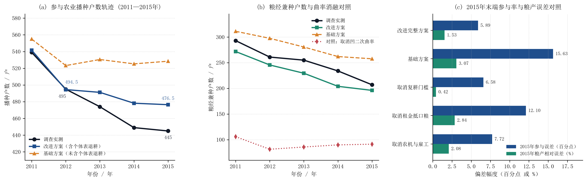
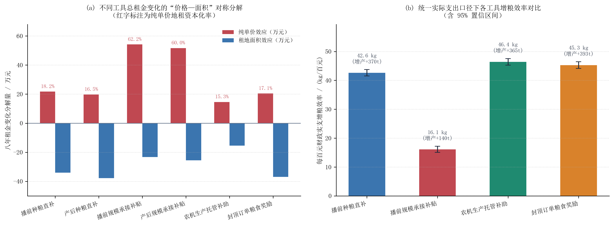
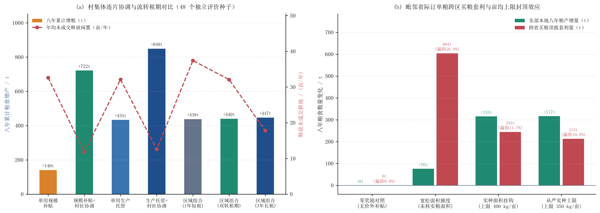
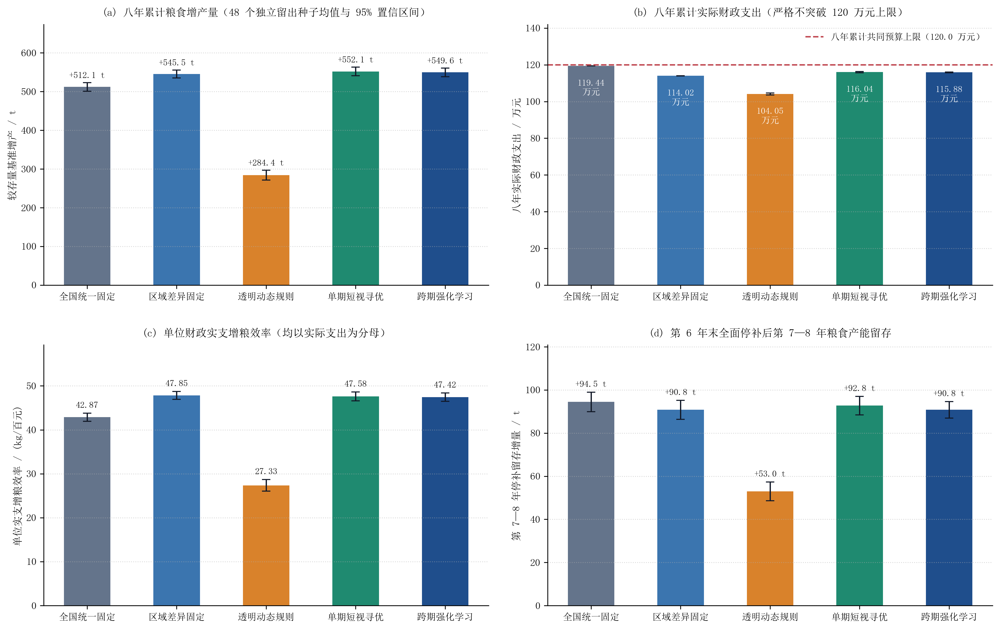

# 农业经营接续下种粮补贴传导与动态调控研究

**摘要**：**目的** 阐明有限公共财政支持进入农业经营体系后如何经由农户退出、土地流转竞租、生产要素约束与跨区粮贸交互发生传导分化，识别有限预算约束下支持政策转化为持续粮食生产能力的关键制度条件与动态调控边界。**方法** 基于农业农村部全国农村固定观察点 2009—2015 年 600 户同户跟踪调查数据与 2010 年个体成员截面，辅以基于区域观测中位数与规模经营成本系数构建的 41 个合成规模经营主体，利用严格不晚于 2010 年的个体外出务工天数、户主年龄及分作物农机作业服务费进行统计校准，构建覆盖家庭承包户、家庭农场、农业合作社、农业企业及地方政府的多主体农业经济仿真系统与引入一阶最优性条件的实证数学规划模型；设置五年递推验证、春耕流动性剥离、地租资本化分解、村社连片协调与流转租期对比、毗邻省际订单粮跨区套利双边实物守恒检验，以及共同年度清零硬预算下六类政府调控方案评估。**结果** 纳入个体老龄与外出退耕惯性及租金抵补口粮核算后，五年连续递推至 2015 年的播种户数偏差由 15.63 个百分点降至 5.89 个百分点，总粮产相对误差降至 1.53%，市场化农机作业服务与雇工替代有效抑制了东北地区耕地抛荒；同等实际支出口径下，规模化承接现金补贴的纯单价地租资本化率达 62.24%，每百元仅增粮 16.14 kg，而农机生产托管补助与封顶订单粮食奖励的纯单价地租资本化率分别为 15.89% 和 16.63%，每百元实际支出增粮分别达 46.41 kg 和 45.28 kg，单位财政增粮效率达到规模补贴的 2.88 倍和 2.81 倍；引入村社连片协调可将规模补贴与生产托管的八年累计增粮分别提升至 721.98 t 和 849.34 t，规模补贴下年均未成交闲置释放耕地减少 63.8%（生产托管减少 60.9%）；省际订单粮在宽松面积额度下诱发 604.15 t 跨省买粮套利，占订单加价支出的 25.97%，将额度严格锚定至实际核定种粮播种面积且每亩不高于 400 kg 后，东部本地增粮增至 316.20 t（达到宽松配额情景的 4.15 倍），跨省套利压减 59.5%；在共同年度清零预算下，基于岭回归正则化的拟合动作价值迭代策略与单期短视寻优、区域差异固定组合效果相当，但八年累计增粮较全国统一固定高出 37.47 t 且节省支出 3.560 万元。**结论** 推动种粮支持政策从单纯刺激规模扩张转向“物化托管降本、连片组织降阻、实种核定防漏与分区分季匹配”，能够有效抑制地租资本化与跨区套利漏损，将有限财政资源稳步沉淀为可持续粮食生产能力。

**关键词**：农业经营接续；种粮补贴传导；地租资本化；农机生产托管；跨省订单粮套利；多主体农业仿真；政府动态调控

## 一、前言

在保障国家粮食安全与推进农业强国建设的宏观背景下[1-3]，我国持续加大对种粮农民和新型农业经营主体的财政支持力度，逐步形成以耕地地力保护补贴、稻谷补贴、农机购置与应用补贴、农业社会化服务补助及地方产粮大县和订单粮食价外奖励为主体的多层次扶持政策体系。然而，从全国微观农户长期跟踪观测与地方政策实施实践来看，公共财政资源投入强度提高并不机械等价于粮食综合生产能力的等比例增长。同一笔财政资金进入基层农业经营体系后，①在部分区域有效稳定了双季稻、玉米和小麦的播种面积并缓释了老龄化退耕冲击；②在另一些区域则主要通过土地流转市场竞租推高单位地租，重塑家庭经营与规模经营主体之间的收益分配格局；③在毗邻省区粮价梯度与宽松额度管理下，还可能转化为跨区购粮套补漏损。因此，有限公共财政支持进入农村农业经营体系以后，究竟在何种生产组织、要素配置与制度执行条件下能够真正保留为可持续的粮食生产能力，又在何种条件下被地租资本化、主体间再分配或传导耗散所吸收，已成为当前农业经济政策评估与工程系统调控亟待回答的核心科学问题。

围绕农业补贴效应与经营规模转型，国内外学者开展了大量实证研究与政策模拟分析。经典实证文献多借助计量经济学方法识别补贴对农户种植意愿和地租的局部边际影响，但受限于观测周期与外生冲击识别条件，往往难以在同一微观账本下刻画财政资金从发放环节经由春耕资金约束、土地竞租出清、农机服务替代到收获后收入结算的完整跨期反馈链条；传统多主体仿真研究虽能够刻画异质性主体的交互行为，却常因依赖主观设定的固定启发式规则或缺乏调查微观测算校准，面临行为反应失真、难以有效评估政策变动后主体内生调适的不足。近年来，农业工程系统模拟研究逐步吸收引入一阶最优性条件的实证数学规划思想[4]，通过调查基期边际成本分布对农户多作物种植组合进行精确校准，并将其嵌入群体智能多主体跨年度演化市场[5]，同时结合拟合动作价值迭代等数据高效策略学习方法将地方政府的有限预算调控问题纳入序贯双层决策框架[6-7]，在保持微观成本约束透明的同时显著提升政策反事实推演的真实性。

立足于我国当前“大国小农”与代际经营接续并行演进的制度事实，本文以农业农村部全国农村固定观察点 2009—2015 年 600 户同户跟踪调查数据与 2010 年个体成员截面为实证底座，配以基于区域观测中位数与规模经营成本系数构建的 41 个合成新型农业经营主体，严格遵循不使后期历史信息反调前期生产或退出参数、不预设特定政策工具胜出、完全由内生优化导出行为响应的研究规范，构建多主体农业经济仿真系统与动态调控模型。研究重点回答四个层面的具体机制问题：其一，户主老龄化、稳定非农外出务工与租金抵补口粮等微观事实如何主导小农退耕与土地供给释放，从而决定农业经营接续的底盘稳定性；其二，规模化承接补贴、种粮普惠直补、农机生产托管补助与订单粮食价外奖励四类主要支持工具，如何在同一盈利性与要素约束方程下引发截然不同的土地竞租抬价、春耕资金缓解与增粮效率分化；其三，村集体连片协调、流转合同期限安排以及与实际核定种粮面积挂钩的跨省订单粮核验封顶机制，能够在多大程度上矫正流转摩擦与跨区买粮套利漏损；其四，在共同硬预算、年度资金清零及同等滞后公共信息约束下，基于跨期学习的政府动态调控相比传统固定组合、简单透明动态规则及单期短视寻优策略究竟能提供多大的真实增效空间，以及该增效边界的经济学来源何在。

## 二、农业经营接续的现实基础与补贴传导症结

### （一）固定观察点样本经营接续的实证特征

全国农村固定观察点 2009—2015 年跟踪调查清楚地呈现出我国农业经营接续面临的结构性张力。从 2010 年基期有效可比的 600 户固定观察点样本来看，调查样本横跨东部沿海产销平衡及主销区、中部粮食主产区、西部生态与特色农区以及东北黑土规模区四大农业区域（四区样本农户数分别为 141 户、173 户、185 户和 101 户），基期实有经营耕地总计 5 277.5 亩（1 亩 ≈ 666.7 m²，四区依次为 699.5 亩、958.4 亩、1 208.8 亩和 2 410.8 亩），其中具备市场流转交易条件的可流转面积为 4 009.2 亩；与调查农户严格分账的 41 个合成新型规模经营主体包含 23 个商业化家庭农场、15 个农业合作社以及 3 家农业企业。从区域要素禀赋分布观察，东部地区户均耕地不足 5 亩，非农务工工资水平高且经济作物竞争极为激烈；中西部地区土地细碎化显著且呈现广泛“粮经兼种”特征；东北地区户均耕地达到 23.87 亩左右，但家庭内生青壮年劳动力趋紧，高度依赖外部机械作业服务完成春耕整地与秋收脱粒。

在 2010—2015 年连续五年的同户跟踪期间，调查中可比有效农户数保持在 532 户至 569 户之间，呈现出“播种户数持续萎缩但总产粮保持稳中有升”的典型分化趋势：2011 年 569 户可比农户中有 539 户参与农业播种、293 户实行粮经兼种，总产粮 2 143.36 t；至 2015 年，534 户有效可比农户中参与农业播种的户数已下降至 445 户，粮经兼种户同步降至 207 户，但总产粮却微增至 2 381.24 t。上述微观轨迹揭示了两项容易被传统静态模型忽视的现实机制：一方面，户主老龄化与外出务工稳定性提高会形成显著的农业退出惯性，当农户能够通过转出土地收取现金地租并直接在本地市场购买口粮替代繁重自种劳动时，大量小微兼业地块才会真正退出小规模自种并进入市场接续池；另一方面，机械作业服务的市场化可及性是维系户均规模较大地区在青壮年外流条件下不出现大规模耕地抛荒的关键稳定器。

### （二）有限财政支持传导分化的四重制度症结

#### 1. 土地流转市场竞租抬价与补贴地租资本化

当财政补贴直接以规模流转面积为依据按亩发放时，虽然旨在激励新型农业经营主体扩规模、降成本，但在农地供给弹性有限、新型经营主体边际地租支付意愿更高的区域流转市场上，补贴收入往往通过租地竞价直接转化为土地承包方索要的高额单位租金。更为复杂的是，传统总租金变化中同时混杂了“单价上涨”与“租地面积扩大”两类效应，若不采用价格—面积对称分解方法并将对比严格限定在有无政策均发生成交的同地块交集上，极易高估或低估纯单价地租资本化的真实规模。因此，厘清不同支持工具究竟拉动了多少真实耕地接续、又有多少份额在竞租过程中以纯涨价形式转移给不种粮的转出方，是评价补贴财政效率的首要切入点。

#### 2. 播前春耕流动性约束与种粮收益结构约束

基层农户与初创型家庭农场在春耕备耕阶段普遍面临种肥农药垫支及农机预付现金流的硬约束。播前兑付的现金直补进入农户或承接主体的统一春耕流动性资金池，在满足最低自有履约本金约束的前提下既有助于缓解化肥、良种与机械作业的资金挤压，依据货币可替代性原则也必然同时支撑主体的支付地租与生产雇工能力。若将政策模拟简单设定在“人为禁止使用补贴资金支付地租”的割裂假设下，不仅违背微观测算真实财务流向，还会低估现金类补贴在流转市场上推升均衡地租的实际压力；相反，通过生产托管按实际机械作业量直接抵扣服务费用的非现金物化补助，则因其天然不可挪作地租支付的制度属性，在缓解劳动力刚性瓶颈的同时能够显著绕开竞租推价通道。

#### 3. 村社连片交易成本与流转租期错配

小农户高度分散导致的地块细碎化与协商签约摩擦，使大量希望退出自种的零散地块即便租金要求不高也难以在市场匹配期内顺利转出，从而被迫回归低效自种甚至季节性闲置。此外，当前农村土地流转普遍并存一年短租与多年长租两种合同安排：短租机制虽允许主体逐年根据粮价与补贴灵活调整承接规模，却伴随着较高的年度匹配闲置流失；长租机制虽能压缩年际匹配过程中的耕地闲置释放，却可能在季节性资金或劳动力紧约束下令签约在租主体难以对全部已租入面积实现充分播种，形成一定规模的在租未播耕地。村集体组织介入统筹连片协调，以及双轨租期如何平衡耕地流转撮合率与经营要素承载力，需要依托动态流转市场进行严格量化权衡。

#### 4. 毗邻省际价差驱动的订单粮跨区套利风险

近年来，浙江、福建、江苏、广东等东部粮食主销区以及河北、山东等毗邻省份相继出台地方性订单粮食收购价外奖励政策[8-9]，部分地方实际加价幅度达到 0.34—0.35 元/kg。在毗邻省区存在稳固产销区田头价差且省际公路运价低于两省价差与补贴之和的条件下，如果订单额度核定仍沿用与承包物理面积挂钩的宽松配额标准，而未严密核验当地承接主体的实际种粮播种面积与合理亩均单产上限，部分拥有订单资格的经营主体就可能利用毗邻产区较低粮价购入跨省外地粮食顶抵本省订单额度，在不增加本地真实粮食产量的情况下套取财政价外奖补资金，反过来进一步挤占本地种粮主体的比较收益。这一传导漏损必须纳入跨区实物守恒框架下接受精确检验。

## 三、多主体农业经济仿真与动态调控模型构建

### （一）多主体微观架构与数据校准口径

为在统一微观核算基础上揭示上述四重制度传导机理，本文构建了涵盖微观测算底座、多主体优化决策、双轨土地竞租出清与政府动态调控的四层耦合农业经济仿真系统（见图1）。系统内的行为主体按经济身份与制度规则明确界分为五类：①600 户固定观察点微观家庭，各自携带基期真实土地禀赋、常住与外出劳动力天数、户主年龄、历史作物格局、农机费用承受度及口粮消费刚性需求，目标是在年度资金与土地约束下实现家计综合净收益最大化，并拥有继续自种、租入扩耕、部分转出、退出自种全部转租收租或闲置抛荒等备选路径；②与 600 户调查农户严格分账的 41 个合成规模经营主体（含 23 个家庭农场、15 个农业合作社与 3 家农业企业，依据各省子市场可流转面积门槛与区域观察点要素中位数及规模经营文献成本系数生成，不赋予任何人为外生单产技术加成），按组织属性区分家庭劳力、雇工成本、农资集采系数与资本退出条件；③协调零散地块整合流转的村集体组织代理；④按地区与作物品种发布订单额度并开展跨区余粮交易的区域收储与粮贸代理；⑤在共同年度硬预算上限下选择区域财政政策工具组合的政府决策代理。

系统参数确立严格遵守四类溯源划分原则：（1）直接调查观测数据取自农业农村部全国农村固定观察点 2009—2010 年 600 户家庭表及 2010 年个体成员截面（实现 600 户基期农户 100% 匹配），包括分省区稻谷、小麦、玉米等主要作物价格、分区域经济作物亩均产值、实测亩均物化成本、分作物实测农机作业服务费、农户自留口粮消费量、户主年龄及年度外出务工天数，并在 2024 年统一价格口径下按居民消费价格指数平减折算；（2）基期前统计校准参数与结构校准设定严格不利用 2011 年及以后任何观测信息反调生产或退出响应，包括四区共用的四档随机气象冲击分布（正常年景及轻度、中重度减产情景与增产年景）、依托基期种植结构标定的边际成本凹二次曲率参数，以及参考外出用工结构确定的老龄衰减、返乡督耕成本与退耕重启门槛；（3）正式政策标准与财政规则锚定国家与地方公开发布的农业补贴及订单粮管理办法[8-9]，设定地方普惠直补基础上限、规模承接补贴上限、托管服务抵扣规则以及东部订单粮收购价外奖励标准（0.34—0.35 元/kg）；（4）所有行为响应均由主体利润最大化与资源可行域内生导出。

*注：实证微观测算底座来源于农业农村部全国农村固定观察点 2009—2010 年 600 户家庭调查表及 2010 年个体成员截面（按东、中、西、东北四区分别覆盖 141 户、173 户、185 户、101 户，基期实有经营耕地 5 277.5 亩、可流转面积 4 009.2 亩），并与 41 个合成规模经营主体（23 个家庭农场、15 个农业合作社与 3 家农业企业）分账耦合；所有统计校准均严格限于 2010 年及以前历史观测窗口。*

### （二）引入一阶最优性条件的实证数学规划与退耕接续决策

在年度生产周期内，每一个体农户或规模经营主体在既定已成交土地规模、可用春耕流动性资金池与家庭可支配劳动力约束下，通过引入一阶最优性条件的实证数学规划[4]求解最优分作物播种面积配置、农机服务采购量与雇工投入量。目标函数兼顾三项真实家计账目：第一，精确分账农户自留口粮的实物消费保存价值与商品余粮及经济作物的市场现金销售收入；第二，将实测逐作物农机作业服务费与田间管护雇工工资单列为可控要素支出，避免在缺少分工序工时记录的情况下虚构省工天数，而是依托经审计核实的机械作业费用刻画农机生产托管补贴所带来的服务价格替代效应；第三，在基期观测种植结构处利用一阶最优性条件标定边际成本凹二次曲率参数，确保零种植面积与粮经兼种的平滑过渡均内生满足微观经济理性，防止近线性最优化导致的兼种坍缩。

为解决传统微观模拟中低规模兼业农户“微耕不退”的问题，模型在 2010 年个体成员外流天数与户主年龄实测截面基础上，建立两项可检验的家计退出与接续机制：一是**稳定退出与返耕重启门槛**，当高龄或长年非农外出农户在上一年度已退出农业自种并将耕地释出后，其农具维持与农艺重启面临实实在在的固定恢复门槛，防止微利状态下无成本反复复耕；二是**租金抵补口粮采购机制**，允许小规模农户将转出土地获得的现金地租按本地口粮市场零售价格折抵并购买口粮，从而解除“即便种地亏损也必须保留少量土地保自留口粮”的自种锁定。需要强调的是，零播种面积在模型中始终作为合法可行解保留，所有退出、租入与缩减面积决策均来自同一盈利性与资源边界求解器。

### （三）土地流转双轨竞租出清与省际双边实物守恒规则

每年农季播种前，所有潜在转出方依据退出自种或转出边际收益净值报出保留租金底价，同时家庭农场、合作社、农业企业与扩耕农户基于各自优化问题在土地约束上的影子价格，扣除单位面积交易协商费用后报出边际地租出价。土地流转市场按“村集体连片统筹与否”设置两套公开匹配机制：在无村集体介入的分散交易情形下，分散地块与意向受让方按区域匹配概率配对并逐笔按竞价均衡规则出清，部分零散小地块可能因协商成本或时空错配未能成交而退回待耕池；在启用村集体连片协调情景下，村社通过归并连片零散待转出地块大幅压缩单位交易摩擦成本并提高地块可承接率，并与小农一年期及规模主体三至四年期并存的双轨异质流转合约协同运行。针对播前现金补助，模型遵守货币可替代性原则，播前直补与规模现金补助均依法注入统一春耕流动性资金池，受主体自有最低履约本金约束共同支撑生产垫支与土地竞租支付。

为检验毗邻省际订单粮跨区套利风险并确保跨区粮贸核算精准守恒，系统基于 600 户样本在十一个主要粮食省份的真实分布，建立覆盖六个销区省份、八条定向毗邻产销界通道的双边实物粮贸子系统：销区涵盖河北（29 户）、江苏（25 户）、福建（23 户）、广东（22 户）、山东（12 户）与浙江（7 户）；产区涵盖安徽（43 户）、河南（33 户）、湖北（30 户）、江西（28 户）与湖南（10 户），共同计入产区商品余粮总供给核算（其中毗邻直接联通通路包括河北对接河南、山东对接河南、江苏对接安徽、浙江对接江西与安徽、福建对接江西以及广东对接江西与湖南）。当某销区主体的订单额度高于其实际可收获产量时，只要毗邻产区同期价格加上跨省单程公路运费与经纪摩擦仍低于本省订单收购全价（含订单价外加价），其在利润最大化与订单履约额度双约束下便会内生决策跨省采购外地粮食顶抵本省订单配额；若将订单配额由“按物理承包面积 450 kg/亩核定”收紧为“按本省实际核定种粮播种面积且每亩不高于 400 kg 或 350 kg 封顶”，套利盈余空间随即被内生压缩。系统每步结算末尾强制执行四项硬性双边实物与财政守恒校验：销区跨省采购用于顶抵订单的总重量严格等于毗邻产区当期实际商品余粮池的扣减总重量；任一产区被跨省调出的粮食严格不超过该省当期收获扣除农户自留口粮后的实际商品余粮净余额；全国范围内跨省粮贸调剂严格不改变当期实际收获的粮食总实物产量；所有地区政府实付订单补贴与流转核定支出严格受制于共同财政预算上限。

### （四）共同预算下政府跨期政策学习与公平对比准则

在政府调控层，本文构造完全公平的制度对比环境：中央与地方联合支农专项预算上限统一锁定为每年 15.0 万元（八年主动政策主路径累计共同预算上限 120.0 万元），采用我国农业财政实际执行的“当年预算、当年清零、不跨年度结转余款”制度；政府不得读取微观农户或规模主体的隐含生产力或类型标签，仅能依据上一年度末汇总生成的 17 项公开滞后统计观测指标（由全局截距项及东、中、西、东北四区各自 4 项滞后公共状态特征构成：粮食物理耕种面积占比、耕地闲置率、耕地在租流转率、春耕资金紧缺主体比例）进行当年政策组合决策。决策行动集由 30 种可解释的区域财政政策工具配置组合构成，涵盖普惠播前/产后种粮直补、播前/产后规模承接补贴、农机生产托管补助、封顶订单粮食奖励以及四大区域之间的倾斜与组合配比；为检验政策撤出后的真实产能留存效果，系统在第 6 年末同步分叉生成平行停补对照分支（第 1—6 年共同预算上限 90.0 万元，第 7—8 年全面停补），独立观测无新增财政扶持下的第 7—8 年粮食产量留存差异。

在算法设计与基准对照选择上，本文采用基于岭回归正则化的拟合动作价值迭代算法[6-7]训练跨期价值近似函数（未来年度贴现因子取 0.96，目标函数为累计实物粮食增产量扣除适度实际财政支出成本系数 0.02 后的净社会收益，在 32 个训练种子上离线拟合、12 个开发种子上遴选固定超参）。48 个独立留出验证随机种子与训练期和开发优选期完全物理隔离，并将跨期强化学习方案与五类严密对照同场比对：①无财政支持基线；②开发集优选的全国统一固定方案（全国四区统一执行封顶订单粮食奖励）；③开发集优选的区域差异化固定方案（东部倾斜 7.5 万元播前种粮直补、中西部及东北匹配 7.5 万元农机生产托管补助）；④基于滞后公开状态规则切换的透明动态阈值规则（当上一年度全国滞后流转未吸纳率不低于 12% 且未吸纳面积达 60 亩以上、或区域面积加权春耕资金紧缺主体比例达到 28% 以上、或东西部与中东北地区耕地闲置率之差超过 2 个百分点时分别对应切换至规模补贴与区域协调组合、播前直补或托管工具）；⑤与跨期模型分享完全相同 17 维观测特征、相同标准化线性岭回归价值近似结构和相同预算约束、仅将未来贴现因子置零的单期短视寻优策略。政府行为评价严格按八年累计粮食增产、八年累计实际支出、单位财政实支增粮效率及第 7—8 年停补留存增量四项指标独立报告 95% 置信区间与配对差值。

## 四、多情景模拟测算与政策效应评估

### （一）五年递推历史拟合验证与机制消融检验

将 2010 年基期 600 户调查样本与 41 个合成规模主体接入系统，在不介入外生真实年份调整、仅按基期及以前校准参数连续五年自主演化递推至 2015 年，并与农业农村部全国农村固定观察点 2011—2015 年实测同户面板进行对比检验（见表1与图2）。与此同时，同步运行的一步条件预测检验表明（2011—2015 年有效可比农户依次为 569 户、533 户、537 户、532 户和 534 户），模型对各期粮食播种总面积的预测相对误差分别控制在 1.43%、1.89%、4.46%、8.39% 和 10.36%，显示微观测算优化方程具备稳健的单步决策捕捉能力。

*注：历史实际参照值来源于农业农村部全国农村固定观察点 2010—2015 年 600 户同户跟踪调查表及 2010 年个体成员外出天数与年龄截面；主方案与基础对照结果由本项目多主体农业经济仿真系统基于 20 个独立随机种子五年连续递推测算得到，机制消融对照基于 8 个独立随机种子测算得到。*

**表1 2011—2015 年固定观察点同户五年连续递推历史拟合与机制消融检验结果**

| 验证口径与消融设置 | 随机种子数 | 2015 年播种户数 / 户 | 参与率绝对偏差均值 / 百分点 | 2015 年粮经兼种户数 / 户 | 兼种比例偏差 / 百分点 | 2015 年总产粮 / t | 粮产相对误差 / % | 2015 年东北抛荒率 / % |
|---|---|---|---|---|---|---|---|---|
| 调查实测参照（可比 534 户） | — | 445.00 | — | 207.00 | — | 2 381.24 | — | — |
| 基础对照方案（未含个体表退耕） | 20 | 528.45 | 15.63 | 257.65 | 9.49 | 2 308.15 | 3.07 | 0.55 |
| 改进完整方案（含个体退出与抵粮） | 20 | 476.45 | 5.89 | 196.10 | 2.12 | 2 344.69 | 1.53 | 0.66 |
| 消融一：取消退耕返耕门槛 | 8 | 480.12 | 6.58 | 196.25 | 2.01 | 2 371.25 | 0.42 | 0.70 |
| 消融二：取消租金抵补口粮采购 | 8 | 509.62 | 12.10 | 203.00 | 0.89 | 2 313.69 | 2.84 | 0.94 |
| 消融三：取消凹二次成本曲率 | 8 | 477.00 | 5.99 | 91.25 | 21.68 | 2 359.17 | 0.93 | 0.52 |
| 消融四：取消市场化农机作业服务与雇工 | 8 | 486.25 | 7.72 | 146.38 | 11.35 | 2 331.69 | 2.08 | 10.69 |

*注：2011 年与 2012 年调查实测播种户数分别为 539 户和 495 户（总产粮 2 143.36 t 与 2 179.03 t），改进完整方案同期 20 个随机种子递推均值分别为 541.60 户（各种子参与率绝对偏差均值为 0.46 个百分点，产粮 2 131.35 t）与 494.50 户（各种子参与率绝对偏差均值为 0.41 个百分点，产粮 2 092.55 t）；消融二同时关闭动态预期租金更新机制以完整检验外租口粮锚定效应。数据来源于农业农村部全国农村固定观察点 2009—2015 年跟踪调查表及本项目多主体农业经济仿真系统。*

五年连续递推对照清楚地证明了各核心微观设定对于真实经验拟合的必要性：未纳入个体表老龄及稳定外流退耕校准前，2015 年播种户数模拟值高达 528.45 户，与调查实际 445 户相比偏高 15.63 个百分点，兼种户数也偏高 9.49 个百分点；而在不反调任何作物生产单产参数的前提下纳入完整退出惯性与租金抵补口粮核算后，2011 年和 2012 年播种户数偏差（按随机种子绝对偏差均值口径）分别为 0.46 个百分点和 0.41 个百分点，至 2015 年末端播种户数降至 476.45 户（偏差收窄近三分之二至 5.89 个百分点），粮经兼种户数为 196.10 户（偏差由 9.49 个百分点大幅缩减至 2.12 个百分点），总产粮模拟值达到 2 344.69 t，相对误差降至 1.53%。

四组机制消融检验进一步识别出每一微观构件的独立作用机制：若取消租金抵补口粮采购及预期租金更新通道（消融二），小规模兼业户即便亏损仍被迫守地自保口粮，2015 年模拟播种户数回升至 509.62 户，参与偏差回升至 12.10 个百分点；若取消种植成本凹二次曲率而退化为近线性收益最大化（消融三），尽管总粮产相对误差仅 0.93%，但 2015 年粮经兼种户数由 196.10 户大幅萎缩至 91.25 户，兼种比例偏差高达 21.68 个百分点，说明线性最优化无法复现现实农村广泛存在的风险与要素平滑型兼业种植格局；若抽离市场化农机作业服务与雇工市场替代机制（消融四），户均规模较大但青壮年紧缺的东北地区耕地抛荒率在 2015 年由完整方案的 0.66% 大幅升至 10.69%（增至对照情景的 16.2 倍），直观印证了社会化机械作业服务体系在支撑北方规模农区经营接续中的基石作用。

### （二）春耕流动性效应与地租资本化分解

#### 1. 春耕资金时间价值与租约剥离检验

为在严格剥离流转竞租干扰后精确测度财政资金注入时点差异所产生的纯春耕流动性效应，实验将所有主体年度土地流转合同固定为无支持基线世界的成交快照，仅对比播前发放与产后发放两类种粮直补方案在 48 个随机种子上的八年连续运行表现。测算结果显示，在锁定土地配置不变条件下，播前种粮直补八年累计粮食增产达 +329.36 t（95% 置信区间为 [325.11, 333.61] t），显著高于产后种粮直补的 +316.97 t（95% 置信区间为 [312.83, 321.11] t），纯粹因缓解春耕备耕现金紧约束而释放出的增量粮食约 +12.39 t。进一步开启内生流转竞租市场后，遵守货币可替代性原则（允许播前资金流入统一春耕流动资金池并在满足最低履约本金前提下依法支付地租）的播前规模承接补贴较无补贴基线累计增加地租 +30.92 万元，而若人为设定“禁止现金补贴用于付租”的割裂约束则使相对基线的总租金增量压低为 +26.11 万元，二者相差 +4.81 万元，反映出播前现金进入竞租池会现实推升地租成本；相比之下，农机生产托管补助因按实际机耕作业单据直抵服务费用、不可挪用于土地租金结算，其相对无补贴基线的八年总租金增量在可替代性与禁付租两套设置下完全一致（均为 -0.88 万元），两套规则之间差额严格为 0.00 万元，从微观账本层验证了物化托管对竞租溢出效应的天然隔断功能。

#### 2. 租金变化的“价格—面积”对称分解与等实支效率比较

在无财政补贴基线世界下，600 户调查户与 41 个合成规模主体八年累计产粮 18 448.85 t，年均流转土地 780.60 亩，市场均衡单位租金为 590.87 元/亩。利用价格—面积对称分解法分别评估四类主要支持工具全额标准与等额实际支出（约 87 万元）口径下的长期传导分化（见表2与图3）。

*注：各工具方案均包含 48 个独立随机种子八年连续仿真结果；图3(a) 为按各方案全额封顶标准投放下的总租金变化对称分解，图3(b) 为统一约 87 万元实际支出水平下的对比（农机生产托管补助因按实际机械作业量核销封顶，等实支组实支为 78.54 万元）；地租资本化率定义为纯单价上涨分量与对应方案八年实际财政支出的比值，同地块交集价差严格取政策仿真与无补贴基线均发生成交之同一地块的平均单位租金差。数据来源于农业农村部全国农村固定观察点 2009—2010 年 600 户调查数据与本项目多主体农业经济仿真系统基于 48 个独立随机种子测算结果。*

**表2 主要财政支持工具的地租资本化分解与同等实际支出口径效率对比（48 个独立种子）**

| 支持工具与资金比较口径 | 八年实际财政支出 / 万元 | 八年累计粮食增产 / t | 单位实支增粮效率 /（kg/百元） | 纯单价地租资本化率 / % | 同地块交集均租价差 /（元/亩） |
|---|---|---|---|---|---|
| 播前种粮直补（全额标准） | 119.624 | +474.95 [464.28, 485.62] | 39.70 | 18.19 | +39.69 |
| 产后种粮直补（全额标准） | 119.654 | +484.38 [474.05, 494.71] | 40.48 | 16.50 | +33.90 |
| 播前规模承接补贴（全额标准） | 87.056 | +140.41 [131.43, 149.39] | 16.13 | 62.24 | +80.66 |
| 产后规模承接补贴（全额标准） | 86.037 | +124.22 [115.49, 132.94] | 14.44 | 60.03 | +74.93 |
| 农机生产托管补助（全额标准） | 95.179 | +433.40 [424.41, 442.40] | 45.54 | 15.30 | +27.63 |
| 封顶订单粮食奖励（全额标准） | 119.443 | +512.09 [500.94, 523.23] | 42.87 | 17.13 | +34.50 |
| 播前种粮直补（等实支比较） | 86.849 | +370.29 [360.60, 379.98] | 42.64 | 17.63 | +28.00 |
| 播前规模承接补贴（等实支比较） | 87.056 | +140.41 [131.43, 149.39] | 16.14 | 62.24 | +80.66 |
| 农机生产托管补助（等实支比较） | 78.539 | +364.51 [355.39, 373.63] | 46.41 | 15.89 | +23.50 |
| 封顶订单粮食奖励（等实支比较） | 86.706 | +392.62 [382.46, 402.78] | 45.28 | 16.63 | +24.75 |

*注：无财政补贴基线八年累计粮食总产量为 18 448.85 t，年均成交流转面积 780.60 亩，平均单位地租 590.87 元/亩；方括号内为 48 个独立种子同环境配对仿真的 95% 置信区间；播前规模承接补贴在全额与等实支对照组为同一实验运行（`87.056` 万元、`+140.41 t`），两行单位实支增粮效率分别为 `16.13`（先求均值再相除口径）与 `16.14`（逐种子效率均值口径）。数据来源于农业农村部全国农村固定观察点 2009—2010 年 600 户调查数据及本项目多主体农业经济仿真系统基于 48 个独立随机种子测算得到。*

测算结果揭示了显著的传导机制分化：第一，**规模化承接补贴存在极高的纯单价地租资本化漏损**。无论是播前还是产后兑付，以租入规模面积为核定锚点的承接补贴仅有 124.22—140.41 t 转化为增产，全额标准下单位实支增粮效率仅为 14.44—16.13 kg/百元，却分别推高市场同地块交集单位租金 +74.93 元/亩和 +80.66 元/亩（播前方案带动整体流转均租从 590.87 元/亩攀升至 678.37 元/亩），纯单价地租资本化率高达 60.03% 和 62.24%，意味着超过六成的规模化补贴最终通过土地竞租被土地转出方吸收而非保留在粮食生产端。第二，**农机生产托管补助与封顶订单粮食奖励实现兼顾增粮与压租的双重优势**。在约 87 万元的同等实际支出基线水平下（托管补助因实作业扣减封顶仅消耗 78.539 万元财政资金），农机生产托管补助与封顶订单粮食奖励分别创造 46.41 kg/百元和 45.28 kg/百元的增粮效率，分别达到播前规模承接补贴（16.14 kg/百元）的 2.88 倍和 2.81 倍，同时将纯单价地租资本化率压低至 15.89% 和 16.63%，同地块交集租金增幅收敛在 +23.50 元/亩与 +24.75 元/亩，从而使大量公共财政支持实质保留为种粮净边际利润与机械替代投入。

### （三）村社连片协调、流转租期与省际订单粮套利封顶检验

#### 1. 村社连片协调与流转合同期限的动态权衡

基层细碎化地块的流转交易摩擦与合同期限错配同样深刻塑造了政策实施效果，村集体连片协调及三类租期对比（见表3与图4(a)）以及省际订单粮跨区买粮套利封顶对比（见表4与图4(b)）清晰展现了这两类制度传导环节。当缺乏村集体连片协调机制时，单用规模化承接补贴在双轨租期下的八年全国总增粮仅为 +140.41 t，年均出现 32.62 亩本已释放却因匹配摩擦未能成交的闲置耕地，第 6 年末停补后第 7—8 年留存增粮仅为 +25.24 t；一旦引入村集体对零散释放耕地进行集中归并与连片协商打包发包，同口径下规模补贴的八年全国总增粮显著增至 +721.98 t（为单用时的 5.14 倍），年均未成交闲置释放面积锐减 63.8% 至 11.81 亩/年，停补后产能留存增至 +195.22 t。更为可观的是，将村社连片协调分别与农机生产托管补助、封顶订单粮食奖励结合实施，八年累计增产进一步提高至 +849.34 t（未成交闲置释放由 32.11 亩/年减少 60.9% 至 12.57 亩/年，单位支出增粮效率达 91.90 kg/百元，停补留存 +214.50 t）和 +952.61 t（未成交闲置释放由 32.59 亩/年减少 59.7% 至 13.14 亩/年，停补留存 +237.92 t），表明物理连片降阻对物化服务和价格奖励工具具有强烈的正向增效作用。值得补充的是，由于单独发放补贴会提高原经营者继续留耕倾向，单独补贴组下的严格年度易主种粮接续面积（483.53—516.53 亩/年）略低于无补贴双轨基准（524.17 亩/年），而接入村社连片协调后，严格年度易主种粮接续面积大幅升至 582.40—638.79 亩/年，同步实现了规模集聚与有序接续。在流转合同期限检验中，基于东部订单奖励与中西部及东北农机托管组合对比显示，三年长租机制确实能够将年均未成交释放耕地从一年短租的 37.42 亩/年与双轨租期的 32.09 亩/年大幅压低至 17.80 亩/年，同时八年累计增产增至 +446.93 t（对比一年短租 +438.11 t 与双轨租期 +439.94 t），第 7—8 年停补留存略增至 +72.49 t；但长租锁定同时伴生较高在租未播耕地（在签约在租期内受当年资金或劳力约束未能实际播种的面积，由一年短租的 6.02 亩/年与双轨租期的 7.68 亩/年升至 9.23 亩/年），且大幅锁定多年经营者（严格年度易主接续降至 272.72 亩/年），提示现实农村宜推广长期稳预期与短期可调相衔接的双轨流转合约制度。

*注：图4(a) 与表3基于 48 个独立随机种子对比双轨租期下村集体连片协调效应及三类流转合约期限下的全国四区总表现；图4(b) 与表4基于同一 48 个独立种子及观察点 2009—2010 年十一个产销省份观测价差与双边实物守恒检验测算得到。数据来源于农业农村部全国农村固定观察点 2009—2010 年 600 户调查数据及本项目多主体农业经济仿真系统。*

**表3 村集体连片协调与流转合同期限动态权衡的全国总口径评估（48 个独立种子）**

| 实验情景与合约制度 | 八年全国总增产 / t | 八年实际财政支出 / 万元 | 单位实支增粮 /（kg/百元） | 严格年度易主接续 /（亩/年） | 未成交闲置释放 /（亩/年） | 年均在租未播 /（亩/年） | 第 7—8 年停补留存 / t |
|---|---|---|---|---|---|---|---|
| 规模补贴（双轨、无协调） | +140.41 [131.43, 149.39] | 87.056 | 16.13 | 489.40 | 32.62 | 7.78 | +25.24 [21.23, 29.25] |
| 规模补贴＋村社连片协调 | +721.98 [708.56, 735.40] | 93.839 | 76.94 | 638.79 | 11.81 | 11.20 | +195.22 [188.39, 202.05] |
| 生产托管（双轨、无协调） | +433.40 [424.41, 442.40] | 95.179 | 45.54 | 516.53 | 32.11 | 7.70 | +69.91 [65.85, 73.98] |
| 生产托管＋村社连片协调 | +849.34 [836.99, 861.68] | 92.416 | 91.90 | 600.27 | 12.57 | 8.75 | +214.50 [207.95, 221.05] |
| 封顶订单（双轨、无协调） | +512.09 [500.94, 523.23] | 119.443 | 42.87 | 483.53 | 32.59 | 7.83 | +94.46 [89.92, 99.00] |
| 封顶订单＋村社连片协调 | +952.61 [938.63, 966.59] | 119.472 | 79.74 | 582.40 | 13.14 | 8.80 | +237.92 [230.65, 245.19] |
| 区域组合（一年短租合约） | +438.11 [429.28, 446.93] | 95.122 | 46.06 | 581.86 | 37.42 | 6.02 | +72.40 [69.14, 75.66] |
| 区域组合（长短双轨合约） | +439.94 [431.21, 448.67] | 95.124 | 46.25 | 516.23 | 32.09 | 7.68 | +70.56 [66.61, 74.51] |
| 区域组合（三年长租合约） | +446.93 [432.77, 461.08] | 95.245 | 46.92 | 272.72 | 17.80 | 9.23 | +72.49 [66.91, 78.08] |

*注：表中无财政补贴对照在双轨合约、一年短租与三年长租下之年均未成交闲置释放分别为 `35.48`、`41.19` 与 `19.98` 亩/年，年均在租未播面积分别为 `8.38`、`6.85` 与 `10.46` 亩/年，严格年度易主种粮接续分别为 `524.17`、`590.98` 与 `275.81` 亩/年；各政策行增产与停补留存均对应各自合约基线，区域组合指“东部封顶订单粮食奖励＋中西部与东北农机生产托管”组合。数据来源于农业农村部全国农村固定观察点 2009—2010 年 600 户调查数据及本项目多主体农业经济仿真系统基于 48 个独立随机种子测算结果。*

#### 2. 毗邻省际订单粮套利通道与实种核定封顶效果

在启用毗邻省际订单粮跨区购销与双边实物守恒检验后（见表4与图4(b)），政策执行口径对补贴资金真实留存具有决定性影响。当采取零奖励无补贴基线或零加价基线（东部订单价外加价比率严格设为 0.00 元/kg）时，跨省套利与漏损率均为 0.00%；但一旦引入 0.34—0.35 元/kg 订单价外加价并采取按承包物理面积 450 kg/亩核定的宽松配额口径，东部主销区本地八年粮食增量仅为 +76.14 t，而通过七条正向流动的毗邻产销省公路通道从产区八年累计 2 664.54 t 可调出商品余粮池中跨省低价买粮顶抵本地订单的套利重量高达 604.15 t（95% 置信区间 [591.40, 616.91] t），导致 15.324 万元（占订单加价总额 25.97%）的财政奖励被空转套取。按七条跨省毗邻通道追踪真实买粮结构，河南向河北调出 207.64 t、江西向广东调出 183.49 t、江西向福建调出 109.77 t 构成跨省套利主渠道，其余包括安徽入江苏 46.60 t、江西入浙江 31.32 t、河南入山东 14.11 t 及湖南入广东 11.23 t（浙江对安徽虽存在省界通道，但因江西稻价更低故该向实际套利流量为 0）。将省际单边运价参数在 0.09 元/kg 至 0.18 元/kg 之间开展敏感性检验时，套利规模相应由 637.41 t 渐进下降至 568.46 t（漏损占比由 27.38% 降至 24.45%），但并未自然消除。

与之形成鲜明对比的是，仅将订单配额机制从“物理承包面积宽松核定”严格锚定为“以实际核定种粮播种面积乘以不高于 400 kg/亩上限”后，主体利润最大化内生反应显著重塑了生产激励：东部本地八年实际粮食增产量大幅增至 +316.20 t（达到宽松配额情景的 4.15 倍），跨省买粮顶抵套利规模大幅压减 59.5% 至 244.46 t，套补资金缩减至 6.887 万元（漏损占比降至 11.74%）；若进一步配套村社连片协调，东部增产可继续提高至 +383.04 t（同时带动中部增产 +153.86 t），漏损降至 11.31%；将实种单产上限收紧至 350 kg/亩时，跨省套利可进一步压降至 213.20 t（漏损占比 10.59%），同时东部本地仍保持 +317.17 t 的高增产。若将该规则在全国同步推行，实种核定上限（400 kg/亩）不仅可将全国体系下东部本地增产由 +44.24 t 提升至 +103.93 t、中部增产由 +59.06 t 提升至 +108.63 t，更将跨省买粮套利由 97.73 t（漏损占比 1.81%）大幅压缩至 28.30 t（漏损占比 0.65%）。全实验所有 48 个随机种子下的双边余粮扣减差额始终严格保持 0.00 kg，在模型机制层面表明“以实种面积核定挂钩亩均合理封顶”即可凭内生收益激励实质阻断大半跨省套利漏损。

**表4 毗邻省际订单粮跨区购销套利与实种面积上限封顶检验（48 个独立种子）**

| 省际订单粮检验情景 | 东部销区八年增产 / t | 中部产区八年增产 / t | 跨省买粮顶抵套利量 / t | 套补资金漏损 / 万元 | 漏损占比 / % | 双边守恒误差 / kg |
|---|---|---|---|---|---|---|
| 零奖励 / 零加价基线（0.00 元/kg） | 0.00 [0.00, 0.00] | 0.00 | 0.00 [0.00, 0.00] | 0.000 | 0.00 | 0.00 |
| 东部宽松面积额度（450 kg/实有亩） | +76.14 [70.22, 82.06] | 0.00 | 604.15 [591.40, 616.91] | 15.324 | 25.97 | 0.00 |
| 东部实种面积上限（400 kg/播亩） | +316.20 [309.45, 322.95] | 0.00 | 244.46 [231.99, 256.92] | 6.887 | 11.74 | 0.00 |
| 东部从严实种上限（350 kg/播亩） | +317.17 [310.18, 324.15] | 0.00 | 213.20 [201.43, 224.97] | 6.244 | 10.59 | 0.00 |
| 东部实种上限（400）＋村社连片 | +383.04 [374.84, 391.24] | +153.86 | 238.53 [225.93, 251.13] | 6.641 | 11.31 | 0.00 |
| 全国统一推行宽松面积额度 | +44.24 [40.36, 48.11] | +59.06 | 97.73 [95.42, 100.05] | 2.151 | 1.81 | 0.00 |
| 全国统一推行实种上限（400） | +103.93 [100.05, 107.80] | +108.63 | 28.30 [26.84, 29.75] | 0.773 | 0.65 | 0.00 |
| 运价敏感性（单边运费 0.09 元/kg） | +37.37 [31.47, 43.27] | 0.00 | 637.41 [624.81, 650.01] | 16.147 | 27.38 | 0.00 |
| 运价敏感性（单边运费 0.18 元/kg） | +120.53 [114.76, 126.29] | 0.00 | 568.46 [555.65, 581.26] | 14.431 | 24.45 | 0.00 |

*注：表中跨省套利通道基于农业农村部全国农村固定观察点 2009—2010 年同作物产销省真实观测价格（折算 2024 年价格口径：浙江稻谷 2.9113 元/kg、广东 2.7669 元/kg、江苏 2.7519 元/kg、福建与安徽 2.6466 元/kg、湖南 2.5935 元/kg、江西 2.5152 元/kg；河北小麦 2.6466 元/kg、山东 2.5972 元/kg、河南 2.5152 元/kg）运行；基期观察点分省农户样本量为销区河北 29 户、江苏 25 户、福建 23 户、广东 22 户、山东 12 户、浙江 7 户，产区安徽 43 户、河南 33 户、湖北 30 户、江西 28 户、湖南 10 户；七条产生正向跨省套利的通道在东部宽松额度下八年买粮流量依次为河南入河北 207.64 t、江西入广东 183.49 t、江西入福建 109.77 t、安徽入江苏 46.60 t、江西入浙江 31.32 t、河南入山东 14.11 t、湖南入广东 11.23 t（浙江对接安徽流量为 0.00 t）；双边守恒误差为各期产区商品余粮池扣减总量与销区跨省买粮顶抵总量之差的绝对值，全体情景与 48 个种子均严格为 0.00 kg。数据来源于农业农村部全国农村固定观察点 2009—2010 年 600 户调查数据及本项目多主体农业经济仿真系统基于 48 个独立随机种子测算得到。*

### （四）共同硬预算下六类政府调控方案的长期绩效与适用边界

在年度财政资金清零、八年主动路径共同预算封顶 120.0 万元（及第 6 年末分叉停补分支）以及仅利用滞后年度 17 维公开汇总状态的同等约束下，48 个独立留出验证随机种子上的六类政府调控方案系统评估结果如表5与图5所示。

*注：各柱体展示五类积极财政调控方案相对于无财政支持基线在 48 个独立留出随机种子上连续仿真八年的均值表现，误差棒表示 95% 置信区间；所有方案严格受年度 15.0 万元清零硬预算（八年主路径累计 120.0 万元上限）及第 6 年末平行停补协议约束。数据来源于农业农村部全国农村固定观察点 2009—2010 年 600 户调查数据及本项目多主体农业经济仿真系统基于 48 个独立留出随机种子测算结果。*

**表5 共同预算约束下六类政府调控方案八年综合绩效对比（48 个独立留出随机种子）**

| 调控策略方案 | 八年总产粮 / t | 较基线八年增产 / t | 八年实际财政支出 / 万元 | 单位实支增粮 /（kg/百元） | 纯单价资本化率 / % | 严格年度易主接续 /（亩/年） | 第 7—8 年停补留存增量 / t |
|---|---|---|---|---|---|---|---|
| 无财政支持基线 | 18 448.85 | 0.00 [0.00, 0.00] | 0.000 [0.000, 0.000] | — | 0.00 | 524.17 | 0.00 [0.00, 0.00] |
| 全国统一固定方案 | 18 960.94 | +512.09 [500.94, 523.23] | 119.443 [119.416, 119.470] | 42.87 [41.94, 43.80] | 17.13 | 483.53 | +94.46 [89.92, 99.00] |
| 区域差异固定方案 | 18 994.38 | +545.53 [535.32, 555.73] | 114.015 [113.930, 114.100] | 47.85 [46.96, 48.73] | 11.26 | 515.06 | +90.79 [86.34, 95.24] |
| 透明动态阈值规则 | 18 733.26 | +284.41 [271.65, 297.17] | 104.054 [103.525, 104.583] | 27.33 [26.07, 28.69] | 31.07 | 485.83 | +52.99 [48.63, 57.35] |
| 单期短视寻优策略 | 19 000.90 | +552.05 [540.64, 563.47] | 116.036 [115.723, 116.350] | 47.58 [46.57, 48.60] | 14.66 | 523.30 | +92.75 [88.48, 97.02] |
| 跨期强化学习策略 | 18 998.40 | +549.55 [538.46, 560.64] | 115.883 [115.665, 116.102] | 47.42 [46.46, 48.39] | 14.27 | 525.82 | +90.79 [86.98, 94.61] |

*注：无财政支持基线第 7—8 年粮食总产量为 `4 650.42 t`，表中停补留存增量为第 6 年末停补分支下第 7—8 年相对无财政支持基线的粮食产量差值；跨期强化学习与单期短视寻优分别以未来贴现因子 0.96 和 0.00 在 32 个离线训练种子与 12 个开发种子上经由基于岭回归正则化的拟合动作价值迭代算法训练得到，并在 48 个独立测试种子上评估；两类自适应策略零断补回退，八年众数决策轨迹均为在“向中部倾斜 7.5 万元播前种粮直补（第 1、5、7、8 年）”、“东部 7.5 万元产后直补＋中西东北 7.5 万元农机托管（第 2 年）”与“东部 7.5 万元播前直补＋中西东北 7.5 万元农机托管（第 3、4、6 年）”三类区域精准工具组合之间切换；方括号内为 48 个独立留出种子的均值 95% 置信区间，所有方案支出均严格受 120.0 万元共同累计上限约束。数据来源于农业农村部全国农村固定观察点 2009—2010 年 600 户调查数据及本项目多主体农业经济仿真系统基于 48 个独立留出随机种子测算得到。*

仿真测算揭示出三项兼具学术价值与工程透明度的核心判断：首先，**与全国统一固定方案及简单阈值动态切换规则相比，政府状态条件策略学习具有稳定而明确的净增粮节支成效**。在保持零断补失败率的前提下，跨期强化学习方案八年累计实现产粮 18 998.40 t（较基线增产 +549.55 t），实际耗用财政资金 115.883 万元，每百元实际支出增粮达 47.42 kg，纯单价地租资本化率控制在 14.27%，且其严格年度易主接续（525.82 亩/年）是唯一微高于无支持基线的积极方案；同条件下配对检验表明，该方案较全国统一固定封顶订单方案多增产 +37.47 t（95% 置信区间 [+28.22, +46.71] t）的同时还节省财政支出 3.560 万元（95% 置信区间 [-3.774, -3.345] 万元），使单位支出效率提升 4.55 kg/百元；较依据滞后流转未吸纳率、春耕紧缺比例及东西部与中东北闲置率之差触发切换的透明动态规则，跨期学习方案更是多增产 +265.14 t（95% 置信区间 [+251.52, +278.76] t），停补后第 7—8 年产能留存亦多出 +37.80 t（95% 置信区间 [+34.06, +41.55] t）。该优势源自学习模型根据观测到的四大区域滞后耕种、闲置、在租流转与资金紧缺指标差异，自发将八年众数路径稳定锚定在三类区域适配组合的动态切换之中：第 1、5、7、8 年选择“向中部大产区倾斜 7.5 万元播前种粮直补（兼顾东、西、东北播前兜底）”，第 2 年采用“东部 7.5 万元产后种粮直补＋中西部与东北 7.5 万元农机托管（在跨期 48 个种子中占 25 个、在短视中占 37 个）”，第 3、4、6 年则切换为“东部 7.5 万元播前种粮直补＋中西部与东北 7.5 万元农机托管”，从而贴合东部经作竞争激烈、中西东北托管需求迫切的微观差异。

其次，**模型结果显示，在当前严格微观校准与年度预算清零约束下，跨期强化学习并未在统计意义上超越单期短视寻优与同向区域固定最优组合**。从 48 个独立留出种子的同条件配对差值来看，跨期强化学习（贴现因子 0.96）与单期短视寻优（贴现因子 0.00）八年主流行动轨迹高度吻合，二者八年累计增产配对差值仅为 -2.50 t（95% 置信区间 [-6.08, +1.08] t）、实际支出差值为 -0.153 万元（[-0.474, +0.168] 万元）、停补后第 7—8 年留存差值为 -1.96 t（[-3.92, +0.01] t），所有 95% 置信区间均明确跨越零值，统计学上不可区分；进一步与在独立开发集上事后筛选出的最佳区域差异固定组合（东部 7.5 万元播前直补＋中西部及东北 7.5 万元生产托管）比较，跨期强化学习的八年累计增产差值为 +4.02 t（[-2.69, +10.73] t，伴随多支出 1.868 万元，95% 置信区间 [1.647, 2.090] 万元），停补留存差值接近 0.00 t（[-2.63, +2.63] t）。

最后，这一结果恰恰从工程原理上界定了动态调控在乡村农业经济系统中的真实适用边界：在**年度预算当年清零不跨年结转、小农一年期与规模主体三至四年期并存的双轨流转合约以及不引入无依据跨年免费外溢效应**的现实制度底盘下，政府跨年度调控收益的主要决定力量是**依据区域要素稀缺度与资金紧缺状态实现的工具—区域精确匹配**——即东部稳定经营流动性保底、中西部与东北以非可替代农机服务补助降低劳动力瓶颈与阻断竞租抬价，同时规避简单规则误触发造成的低效政策切换（透明阈值规则将纯单价地租资本化率拉高至 31.07%，使其效率陡降为 27.33 kg/百元）。该发现明确了多主体仿真结合政府决策学习的适用边界，也为政策制定者指明了依托分区分季精准工具匹配即可获取稳健财政增效红利的可行路径。

## 五、对策建议

### （一）分区域优化支农工具结构，压降规模补贴地租资本化

建议调整传统单一“按规模租入面积发放现金补助”的路径依赖，高度重视此类工具在土地供给刚性区诱发超过 60% 纯单价地租资本化、每百元实支仅增粮 16.14 kg 的低效传导风险。在东部沿海高非农机会成本及经济作物高收益竞争地区，①优先采用与播前春耕资金需求无缝衔接的种粮直补（等实支每百元可稳定产粮 42.64 kg、地租资本化率仅 17.63%），实质托底小农户与本地接续主体的备耕现金流动性；②在东北、中部、西部土地资源相对充裕但青壮年劳动力紧缺地区，大幅提高农机生产托管服务补助权重，用每百元增粮 46.41 kg 的物化替代直达田间地头，依靠其不可挪付租金的制度刚性同步压低流转市场竞租推价。

### （二）协同播前直补与春耕金融，疏通老龄退耕接续通道

在尊重农户与新型经营主体春耕统一流动性资金池及货币可替代性规律的前提下，统筹涉农财政直补资金与春耕农资信贷投放窗口，抢抓农时在播前将关键生产性直补及时足额发放到位，充分发挥资金时间价值与缓解备耕硬约束的增粮放大作用。同时，面向老龄化与稳定外出务工兼业小农户群体，配套完善农村流转租金安全兑付与本地成品口粮供应服务衔接，逐步消除小规模农户因担忧口粮价差与保障风险而被迫低效微耕的自我锁定，平滑释放原本难以流动的零散口粮地块。

### （三）健全村社连片协调制度，推行长短结合双轨合约

依托农村集体经济组织统筹整合老龄退出户及碎片化分散承包地，通过统一整理与整村整片协商发包大幅削减散户单独谈判所产生的交易摩擦，能够使规模补贴、生产托管与订单奖励下的未成交闲置流失率分别缩减 63.8%、60.9% 与 59.7%，并显著提高停补后的长期产能留存。针对流转合约期限两难权衡，建议引导基层建立以“长期核心基地稳预期＋机动弹性地块短租随行情调节”为特征的双轨流转合同体系，并在长租推进中同步配套弹性春耕资金与机械服务支持，降低承接主体因要素或资金约束产生的在租未播风险，巩固持续易主种粮接续效能。

### （四）严核实种面积收紧订单额度，防范省际价差套利漏损

针对东部主销区与毗邻产粮大省之间长期客观存在的同作物田头价差，各地在推行地方订单粮食收购价外加价政策时，必须彻底废弃以家庭承包物理总面积为依据的宽松配额标准，建立“以当季实际核验种粮播种面积为基础、结合当地合理单产设定每亩不超过 350—400 kg 交售上限”的实种挂钩配额制度。在严格执行省际双边粮源台账核验与产销对接审计条件下，该举措无需叠加高成本复杂外部核验假定，即可凭内生收益激励将跨省低价买粮套利漏损压缩近六成，让稀缺的价外鼓励资金切实留存并转化为本地真实粮食增量；同时各级农业管理部门依托年度滞后宏观区情监测动态保持区域精准工具搭配，即可在年度硬预算约束下稳定收获绝大部分政策改进红利。

## 参考文献

[1] 宋洪远, 郑兆峰, 江帆, 等. 我国农业强国建设进展评价及对策建议[J]. 中国工程科学, 2024, 26(5): 166-177.
[2] 梅旭荣, 张琳, 袁龙江, 等. 基于全产业链视角的粮食安全风险识别与管控策略[J]. 中国工程科学, 2023, 25(4): 39-49.
[3] 黄季焜, 解伟, 盛誉, 等. 全球农业发展趋势及2050年中国农业发展展望[J]. 中国工程科学, 2022, 24(1): 29-37.
[4] HOWITT R E. Positive mathematical programming[J]. American Journal of Agricultural Economics, 1995, 77(2): 329-342.
[5] 吴文峻, 郑志明, 王怀民, 等. 群体智能及产业集群发展战略研究[J]. 中国工程科学, 2024, 26(1): 89-100.
[6] RIEDMILLER M. Neural fitted Q iteration — first experiences with a data efficient neural reinforcement learning method[C]//Proceedings of the 16th European Conference on Machine Learning (ECML 2005). Berlin: Springer, 2005: 317-328.
[7] ZHENG S, TROTT A, SRINIVASA S, et al. The AI Economist: Taxation policy design via two-level deep multiagent reinforcement learning[J]. Science Advances, 2022, 8(18): eabk2607.
[8] 浙江省粮食和物资储备局, 浙江省财政厅, 浙江省农业农村厅. 关于印发《浙江省省级储备粮订单管理办法（暂行）》的通知（浙粮〔2023〕19 号）[Z]. 2023.
[9] 福建省财政厅, 福建省粮食和物资储备局, 中国农业发展银行福建省分行. 关于印发《福建省地方储备订单粮食直接补贴管理办法（试行）》的通知（闽财建〔2020〕20 号）[Z]. 2020.
