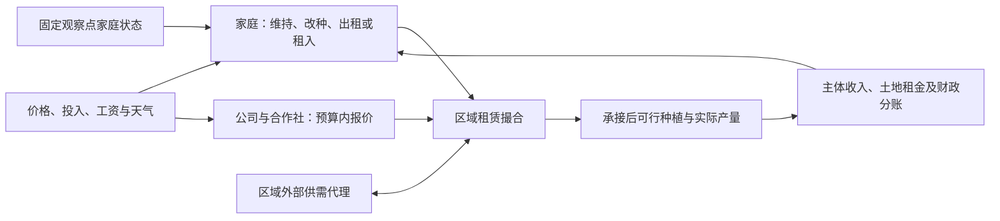
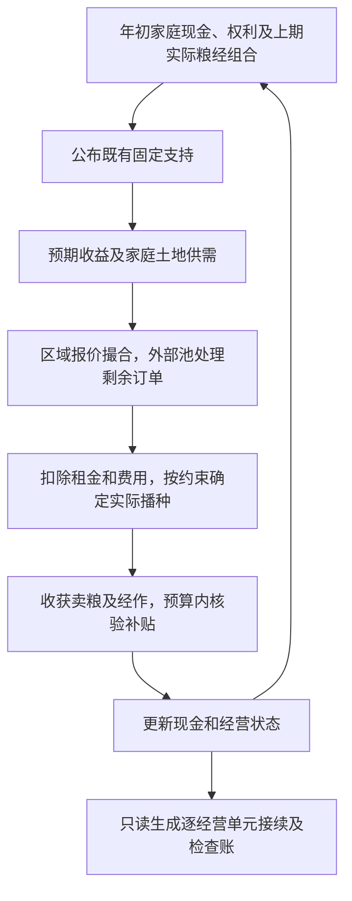
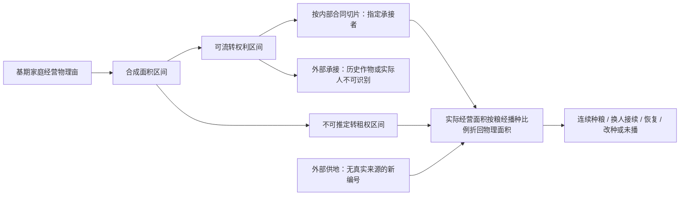
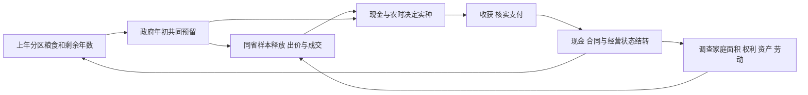

# 全国微观家庭经营接续候选：ODD+D

## 概述

**问题与尺度。** 在家庭的土地、劳动力和资金约束下，记录谁经营、谁签约、谁实际播种，辨别财政支付、签约和粮食收获三个不同的结果。真实数据支撑的是家庭年度经营，不支撑真实宗地追踪。600 个冻结家庭、60 个原有合成组织、区域边界账户，以 2010 年初始化，回放 2011 至 2015 年。组织构成 36 家公司、24 家合作社，是模拟配置而非全国组织普查；未设真实成员治理。

**主体和决策。** 家庭由基期经营面积、经核土地权利、历史粮经组成、劳动、收入和资金代理初始化；每年比较粮经备选、选择面积及租入租出，零经营是备选。经济作物和粮食的价格、单位成本、工资及外生冲击沿用 F1；当地供给与需求约束承接。组织以预期经营剩余、租地资金和经营能力决定是否报价；初始经营地为零。土地单元及区域外部池不学习。政府在历史路径只执行 F1 的固定支持基准，不读取合成地块接续作为行政信息。

## 年度运行

唯一经验候选入口为 `scripts/run_empirical_succession.py`，调用 `run_national_household_portfolio.run_area_structures`；家庭选择、撮合、生产与结转仍由 `MainModel._step_area_economy` 完成。新增 `SyntheticLandLedger.advance` 在 `model.step()` 后读取账面，不参与报价、产量、补贴或下一期决策。随机数沿用按家庭与年度生成的 F1 流；种子相同不意味着调查抽样误差归零。

**反馈与资源。** 上一期实际种植状态和期末现金进入下一年度，年租撮合不等于实际播种。支持按既有 F1 计发口径核算，向外部池不自动支付。区域外部池有净转入/转出和租金分账，不辨认外部交易对手历史。农忙劳动机会成本没有直接进入该路径的生产比较，此处不能把账面农业剩余解释为已经扣足家庭劳动机会成本后的效益。

## 土地单元与可观察量

在同一个合成面积区间上，严格接续定义为 **上年种粮、本年经营者改变且实际种粮**。只有获得合同不算接续。无外部历史身份的交易不计入严格接续。物理亩与年度播种亩次分别保存；田块上的粮经分配是确定的比例账及排序约定，不是地块级调查或真正驱动家庭选择的土壤、坡度、坐标信息。固定基期粮食面积用于说明同一模型单元的量变，不控制后期粮食种植。

## 输入、检验及启动边界

- [逐字段证据](逐字段证据.csv)：问卷、字典、调查覆盖、参数与口径，含直接观测、派生、条件估计及结构假设。留出规则见 [协议](validation_protocol.json)。
- 单一模型核查土地、经营者唯一性、合同有效期及价格区间、租金双方分录、播前资源、实际粮食生产及财政上限。P0 本身可运行；P1–P4 和 Q0–Q2 的经验候选正式实验按门槛未启动。旧 7a 各项机制结果独立在其原模型内读取，不是此候选第二个运行入口。
- 合成单元没有可外验的跨期地块 ID；复算通过与经验验证通过为两个不同判断。未推出全国总体参数、真实宗地接续或现实政策排名。

## 独立合成扩展：两个地区逐年分配

[年度分配协议](年度分配/design.json)并列运行两个原7a合成经济，各有24个权利家庭、8个潜在承接者、48宗4亩地。家庭依播前流动性、劳动力、非农机会与经营剩余选择，潜在承接者受同类资源约束并在本地竞租；地块记录合同、当期经营者和实际作物。不存在地区间流转、迁移或家庭学习。唯一跨区关系是政府年初为两区共同预留财政，两个预留的和不超过7,200元；随后各区释放土地、竞租、配置资源、种植与收获，并按资格和实际粮食作业支付。租赁与生产的顺序、租期和现金结转继承7a，末两年政策一律转为P0。

政府只能读取两区滞后粮食档、剩余支持年数和财政上限。固定策略在开发期枚举；同信息短视与有限期表格Q从相同开局估计，不读取主体私人状态。输出分别核对原地续种、换人同地续粮、签约未播、租金、支出及停补收获。现金关闭实验保留冻结策略，仅关闭现金跨年结转。[协议、参数和结果](年度分配/README.md)均为合成证据，与上文的全国历史回放入口分开。

## 真实家庭队列与共同财政的统一运行

新环境用F1冻结600户的调查经营面积、权利及粮经记录初始化每户；基期现金和年度非农收入复用F1归档口径，劳动来自同户从业人数与分组工日代理。地块是守恒的合成经营单元，不是调查地籍；省级匹配不重建村级邻接和真实合同双方。此环境使用7a的年度规则，而不是将F1年度产量事后挂到账上。

每期先由单一政府按上年区域产量公布共同预算的各区份额和工具，然后各户比较自营与出租收益、同省经营者竞价、合同交割，再依据实得现金、农时及生产条件在种粮、种经或空置间选择。财政只向符合资格且实际种粮的面积兑现；产量、支付、经营权和可用现金在对应环节回写。第1至第8年政府均可重新配置，另在第六年期末同状态分叉比较停付后两年。在样本土地与农户上，产权、成交、耕作与支付分别核账；成交与实种分开。详见[统一运行与输入说明](统一共同预算/README.md)。

## 本轮决策与验证

农业环境最终仍为原四区M1。同一市场和生产资源下的备选搜索只作反事实开发诊断：先在原出价与交割后考察资源可行性，再比较纯粮、纯经、兼种和空置的目标。开发试验因为粮产缺口恶化未入选。因此本轮不改变农忙窗口、不补设多季生产、不增加样本外出租者，不将真实省级编号当成地理位置或地块相邻关系。[家庭诊断与数据—规则对应](统一共同预算/家庭修订与口径.md)记录各项假设。

政府的期初状态为剩余年数、上年四区粮食档与共同上限。训练先以开发随机路径寻找独立期初，每个公开状态按父路径顺序至多选十次，再对每个入选期初分叉全部21个政策动作。Q与短视看到完全相同的开局及当期出粮；Q另计下一期的拟合产量。覆盖只按不同父路径计，不按动作行数计；未见或支持不足的状态回退P0。八年累计实物量是主结果，承诺与实付、停补、严格合成接续分别列报，不作为私人状态或当期额外奖励。

同一政策自身的第六年末复制状态做停补；不能把不同策略历史写成同一个开局。另有首年同工具的地区投向对照，下一年起政策及随机冲击相同，读现金、合同与种粮留存，不用首年排序设训练门槛。[预登记](统一共同预算/sprint_protocol.json)和[裁决](统一共同预算/冲刺结果与裁决.md)分别列设计和证据。
