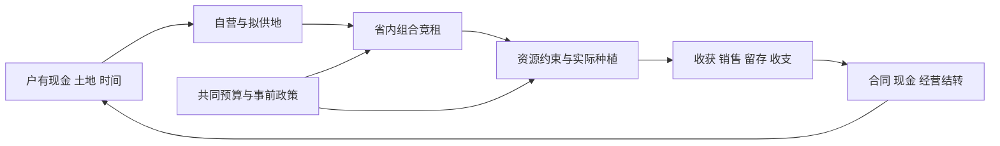

# 四区农业经济内核候选：ODD+D

## 目的、尺度和状态

研究问题不变：有限财政支持能否在土地经营者变更后留下实际粮食生产？本轮先检验支撑这一问题的决策和收支。600 户来自 F1 的 2010 年队列；29 个省级编码界定样本内交易，四个样本区用于汇总。地块是合成经营单元；一年最多安排一季，面积以物理亩计。不增设外部组织、信用市场或省际交易。

家庭结转现金和租约；耕地记录权利人、经营者、物理亩和上一期粮食面积。不可核出租权部分不入交易，暂沿用原自营口径。跨年收成沿用共同地区外生抽样，不模拟分作物风险或未经测量的家庭生产率。

## 年度决策

自营、竞租估价和交地后配置都调用同一线性规划：在固定物理面积内分配作物、非农劳动和可用雇工，最大化预期作物总价值、合格支持和实做非农收益，扣除现金投入和雇工工资。家庭农业投工加非农就业不超过可用劳动；雇工不能替家庭做非农工作。只有播前粮食投入抵减放松播种现金约束，产后支付、待售收获和未实现租金都不是播前资金。

家庭比较撤下某块地自营的边际损失和可得保留租金。没有成交且赶得上农时，原有经营者可把地纳回实际配置。候选交易限同省，从当前挂牌单元比较至多四块的前缀组合，按每亩折现经营增量排序，以公开保留价结算。新成交一块付一次交易费；有承租组合的家庭每年付一次管理费。未来按当期开初资源、不预支未来补贴和 0.95 的年度折现评估；届时违约仍取决于实际现金。这不是全局最优撮合，也不是估计的现实租金。

实际收获按分作物物理面积、技术及收成冲击计算，销售与留存价值分别入账，留存不是现金。没有合成单元内部的真实作物位置时，连续种粮重合面积下限为上期粮食亩加当期粮食亩减单元亩（不足零按零），上限为前后粮食亩的较小者。留任和换人分开。财政接口保留共同上限，未使用的额度不事后加价；本轮不启动策略比较。

## 数据与验证

2010 年非队列样本提供小麦、稻谷和玉米的报告产量、单位产值、可比投入和作物工日。具名蔬菜来自 2016–2017 年的生产和销售记录。早期谷物售出比例未识别，现金端采用全售结构上界；年度作物工日集中在一个生产窗是结构假设。主路径不启用雇工，另做固定期初资源下的有界雇工对照。问卷、字典、实际表与有效分母见同目录复算记录。生产期限、样本外交易、真实经营权和季次没有被同户历史拟合识别。
