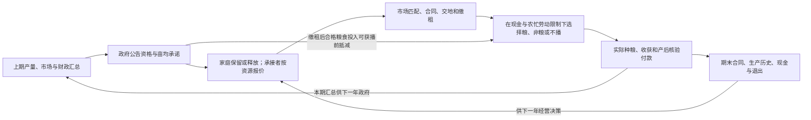
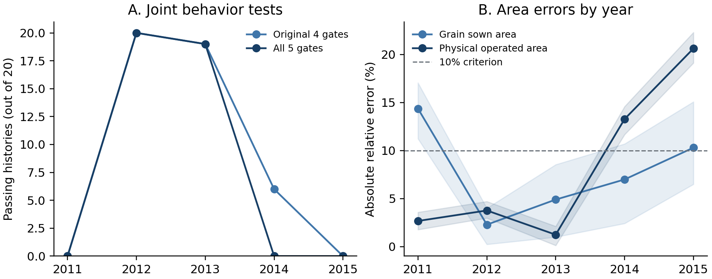

# 有限财政支持何时留下粮食生产能力？来自农户历史回放与土地经营接续模拟的证据

**摘要：** 原经营者缩减种植以后，财政支持既可能使其继续种粮，也可能帮助另一经营者接地并种粮，还可能主要改变收入和地租。本文用两组独立的证据考察这些结果发生的条件。首先，以全国农村固定观察点600户的经营记录检验2011—2015年的历史回放。统一候选在20个种子、五个年度逐户复现冻结基准F1的家庭经营结果，原四项联合通过45/100，加入期末物理经营面积后五项联合通过39/100。2014和2015年可比家庭的期末物理面积分别低估13.27%和20.61%。2015年，模型平均种植粮食或经济作物的家庭比调查多57.75户，粮食播种面积却少516.57亩次。在另一个464户的条件比较中，换入调查期末经营面积只补回该组35.3%的粮食面积缺口。其次，在独立的合成土地市场中逐地块比较租约、实种、产量和财政实付。八种搜寻及资源条件下，面向全部合格种粮者的播前支持每年增加同一经营者连续种粮10.61至10.98亩；面向新承接者的播前支持每年增加换人后连续种粮0.35至1.64亩，同时也增加有租约而未播种的面积。停止支持后，三年期合同相对一年期合同未表现出更持久的区域增产。旧合成政府Q策略评分高于透明规则，但未达训练覆盖标准，且低于用独立析因历史事后选定的固定对照。调查证据用于诊断家庭行为，合成实验用于比较财政传导条件；在缺少独立递归验证时，两者不构成全国政策效果估计。

**关键词：** 粮食生产；土地经营权流转；农业财政支持；播前资金；主体模拟

**When Does Limited Public Support Sustain Grain Production? Evidence from Historical Household Replay and Simulated Land-Operation Transitions**

**Abstract:** Public support can keep incumbent operators growing grain, help new operators cultivate released land, or change incomes and rents without a corresponding production gain. We examine these possibilities using two separate sources of evidence. Using a fixed cohort of 600 households from China's National Fixed Observation Points, the integrated candidate reproduces the frozen F1 benchmark's household outcomes over 20 seeds and five years (2011–2015). It meets all four original behavioral criteria in 45 of 100 year-by-seed comparisons, and all five in 39 comparisons when end-of-year physical operated area is included. For comparable reporting households, operated area at year end is underestimated by 13.27% in 2014 and 20.61% in 2015. In 2015 the replay has 57.75 more households planting grain or cash crops than the survey, yet 516.57 fewer sown mu of grain. In a separate conditional comparison of 464 households, substituting observed end-of-year land for simulated post-market land closes only 35.3% of that group's grain-area gap. Separate synthetic experiments track leases, planting, harvests, and fiscal disbursements plot by plot. Across eight search and resource conditions, broad pre-planting support increases continuous grain cultivation by incumbent operators by 10.61–10.98 mu per year. Targeted pre-planting support increases continuous grain cultivation on plots that change operators by 0.35–1.64 mu per year, while also increasing leased but unplanted land. Three-year leases do not yield a demonstrably more persistent regional output gain than one-year leases after support ends. The historical Q-learning policy outscores a transparent rule, but misses its training-coverage threshold and trails a fixed comparator retrospectively selected using separate factorial simulations. The survey diagnoses household behavior, while the synthetic experiments establish conditional model results. Without independent recursive validation, the findings do not provide a national ranking of policy effects.

**Keywords:** grain production; farmland rental; agricultural support; pre-planting liquidity; agent-based modeling

## 一、引言

原经营者减少种粮以后，粮食生产能否接续，取决于土地能否交给有能力耕种的人，也取决于承接者拿到地以后种什么。对一个已经转出土地的家庭而言，签订合同意味着获得租金；对承接者而言，合同只是获得了经营机会，还要支付租金、购买投入品并在农时内安排劳动。财政支出、签约面积和实际粮食收获因此是三个不同的结果。即便当年多产了粮，停止支持后是否仍能维持，还要看合同是否在履、谁还在种地以及经营者能否用自己的资金承担下一季投入。

中国的制度安排也要求区分这些对象。2021年《农村土地经营权流转管理办法》规定，出租等方式流转经营权不改变承包关系，并对合同、台账及受让方经营能力作出规定。2016年农业“三项补贴”改革将耕地地力保护和粮食适度规模经营列为不同用途：前者的对象原则上是拥有耕地承包权的种地农民，面积依据和标准由地方结合实际确定；后者向多种粮的经营主体倾斜，通知列举贴息、技术和服务支持，并不鼓励对新型经营主体直接发现金。2021年一次性补贴则明确以实际种粮农民为对象，并要求核实补贴面积。这些文件说明权利、生产活动和拨款资格并不天然重合，也不意味着各地实际执行同一个支付时点。本文用这些制度区分界定比较对象，不以2016年、2021年的政策倒填2011—2015年调查历史，也不把下文政策菜单对应到某项现实改革。[流转管理办法（农业农村部，2021）](https://www.moa.gov.cn/nybgb/2021/202102/202110/P020240519747710304189.pdf)；[三项补贴改革通知（财政部、农业部，2016）](https://www.mof.gov.cn/gkml/caizhengwengao/wg2016/wg201606/201610/t20161021_2440126.htm)；[实际种粮一次性补贴（财政部，2021）](https://app.www.gov.cn/govdata/gov/202106/30/472965/article.html)。

本文问的是，有限财政支持在什么条件下能够保留为持续的粮食生产能力，何时主要维持原经营者、何时帮助新经营者接续、何时转为租金或收入而少有当期增产。这里的生产能力指给定技术和资源下可实现并在后续年度有机会维持的生产，不是农户的一项固定生产率，也不等于某一年的实际产量。论文的第一组证据考察主体模型能否再现真实家庭的面积与作物选择；第二组证据利用合成地块独立比较支付条件改变后合同、播种与收获如何变化。前者提示哪些行为关系尚不能拿来推演现实政策，后者说明哪些中间环节会使同一预算上限产生不同的生产和分配结果。

## 二、文献与理论

### （一）相近研究与本文的比较

AgriPoliS将地块出租、农场投资及退出置于同一地区模型，按地块收益、邻接和运输成本形成报价，说明相同政策可以在不同农业结构下引起不同的调整（Happe等，2006，模型说明与政策试验）。在中国情境中，Tian等（2016，§§2.1—2.5、3.3—3.5）针对鄱阳湖地区，以家庭在稻作和外出务工之间的资源分配为基础，比较稻作补助与鼓励家庭长期**转出**经营权的补助；长期租赁先撮合，余下需求再进入年度租赁。本文考察的专项支持则给合格的**取得经营权者**，比较其在既有合同下是否付得起播种投入，以及在市场允许重配时能否真正接续种粮。代际接续研究关注农场是否有家内接班者及交接时间（Glauben等，2004，机构条目摘要）；本文的接续单位是地块，和亲属身份、整场继承或永久退出不是同一个概念。

资本化研究表明，补贴接受者未必得到最终收益，且地块与农场口径的估计可能不同（Kirwan，2009；Kirwan和Roberts，2016，均核对期刊摘要）。本文不沿用这些研究的地租传导率，而在同一合成市场内区分单位租金、租地面积和权利人收入，并对两种政策都出租的同一地块另查租金。家庭在不完全要素市场中面对的实际机会成本不能用一项通行工资替代（de Janvry等，1991）。Fink等（2020，试验设计和劳动配置结果）在赞比亚发现，缓解青黄不接时的流动性短缺能影响家庭劳动配置与农业产出。本文从这个区分出发，分别表示支付对预期收入和可用资金的影响；赞比亚贷款的效应和参数不移入中国土地情境。

在政策学习方面，Vinyals等（2023，表3及政策试验）研究模拟机构如何在只见汇总信息时诱导数字工具采用。本文同样限制政府的观察范围，但所比较的结果是土地经营调整后的多年粮食生产、接续和财政支出。Q学习的理论收敛条件包含对状态和动作的反复抽样（Watkins和Dayan，1992，第2—3节）；实际政府只见汇总量时，相同的观察状态还可能对应不同的现金、合同和经营结构。提高评分是否来自跨年决策，须与使用相同信息、只求当期表现的规则比较；与一条经验规则相比取得较高的评分，本身不足以区分两者。

### （二）经营、承接与不播种的条件

考虑地块 $j$ 和可能经营它的主体 $i$。作物 $k$ 可为粮食 $g$、非粮 $c$，也可以不种。预期销售额为 $V_{ijk}$，现金投入为 $C_{ijk}$，需要的农忙劳动为 $L_{ijk}$。自营的比较对象不是零收入，而是可实现的出租净收入及相应非农收入；承接者还要扣除租金 $r_j$、交易费和启动费用。设 $W_i(L)$ 为投工 $L$ 后仍能取得的非农收入，$B_i$ 为缴租并扣除前置费用后可用于播种的钱，$H_i$ 为农忙劳动上限，$s_j$ 为合格种粮后从财政获得的承诺金额。对已取得经营权的一块地，粮食方案须同时满足

$$
C_{ijg}\leq B_i+\mathbf 1\{\text{播前抵减}\}s_j,\qquad L_{ijg}\leq H_i .
$$

在可行方案中，比较 $V_{ijk}-C_{ijk}+W_i(L_{ijk})+\mathbf 1\{k=g\}s_j$。此处租金已支付，对同一合同的作物排序不重复扣租；在是否签约的比较中仍须扣租。多地块时把现金和劳动分别加总，某一块改种粮还能挤占另一块的投入。对实际到账金额及兑现条件相同、忽略两次到账之间利息的合同，如果粮食优于可行的非粮和不种方案，且 $B_i<C_{ijg}\leq B_i+s_j$，播前抵减能够使原不可行的粮食方案变得可行；同承诺的产后付款不会放松当期现金约束。如果现金本已足够、农忙劳动不足，或非粮收益仍更高，提前支付未必增加粮食。这个推导针对合同既定时的生产选择，不预设市场可以拿到相同的合同，也不要求所有实际支出相等。

在合同未定时，预期补贴可能提高竞租者愿付的租金；原经营者也可能因自营收益上升而减少向市场供地。单位租金因此可能上涨，而出租面积和总租金反而下降。相反，新承接资格可以增加竞租和成交，却不一定让承接者缴租后有钱、有工日完成播种。若原来已种粮的家庭即使不领补贴也会照常生产，收入变化也可能比产量变化大。区分这些情况需要把原经营者连续种粮、换人后连续种粮、闲置后恢复、改种、签后未播和未成交连到同一块地；仅使用农户的粮食占比或地区总成交额无法辨别这些结果。

停付后的产量取决于支持是否改变了仍有效的合同、经营者的现金和后续配置。更长的合同可减少重新寻找土地的成本，也可能保留已经取得土地但无力安排生产的经营关系。两类作用的方向相反。若改变查找交易对象的成本对专项效应没有影响，匹配就不是相应差异的解释；若使现金不再约束后时点差仍保持，则还须检查劳动、收益或兑现规则。对合同期限，直接比较两种期限下相对各自无专项路径的停付差额，而不根据某一组的区间是否跨零来判断期限差异。

## 三、数据与模型

### （一）农户资料、观测单位与资金口径

农户比较使用全国农村固定观察点（NFPS）2009—2015年授权户表和成员表，以2010年为初始化基期、2011—2015年为历史回放期。2010年源户表有20,545条，先按正经营面积等既有条件筛为15,450条，再核对户码唯一性和两个户码的一致性、家庭人数及已报告地权的取值范围，得到15,263条。以地区、粮经状态、规模、劳动力和转包身份分层，按各组记录比例无放回抽取600户。该队列覆盖29个省码，基期经营规模不足5亩的299户、5至不足15亩的217户、15至不足50亩的75户、50亩及以上的9户，594户转包身份未知。55户缺基期承包面积，对应277.20亩物理经营面积，缺报不等于无地权。源户表2015年有21,264条，但队列在2010—2015年六年都能合格连接的仅460户，逐年可比分母另列。回放汇总未使用全国抽样权重。主管部门将该体系称为农村社会经济典型调查，覆盖全国的来源不意味着本文队列构成概率代表样本。见[农业农村部公报的调查体系说明](https://www.moa.gov.cn/nybgb/2019/201912/202004/P020200410023357640054.pdf)及[队列与原表复核](双模型与数据证据.md)。

物理经营面积是年初或年末实际经营耕地的亩数，播种面积累计的是各作物的亩次，同一亩多季耕作可以贡献多个亩次。粮经参与指粮食或经济作物的播种面积为正，兼种指两者同时为正；只种其他作物单列，不能作为农业停产。粮食份额的分母是粮食与经济作物的播种亩次之和。转入和转出由有相应答卷的家庭分别报告：2015年62户报告转入、83户报告转出，分别合计之差是874.3亩；只有34户双报，两项相减为321.8亩。这两个数也不同于469个同户经营面积记录的年内存量净增963亩。不用两个不同报告群体的合计之差测算全队列净流入。缺报、结构性跳题、有效零，以及零经营面积和正播种同时出现，按记录性质分别处理。

[中国家庭追踪调查（CFPS）](https://www.isss.pku.edu.cn/cfps/index.htm)的2010年成人数据提供务农工日的分组参照；2012、2014年家庭经济问卷用于另样本描述种植或林业的停止情况。2012年记录剩余为自报种植、林业产品总值扣除自报总费用；仅在总费用为结构性不适用、四个费用分项全部可核时用其合计。它不是家庭农业净收入、完整经济利润或下一年的预期收益。NFPS纯粮停种核验则用字典标作“总收入”的各在种粮食品种 `inc_*` 减去相应列报费用；收入与费用口径都不同于CFPS。两库各自按户匹配，不互并、不合算停种率。2011年[中国家庭金融调查（CHFS）](https://chfs.swufe.edu.cn/dczx/dczx.htm)可用于核对流动资产量级，不把可观察金融资产全部当作播前可动用款；2015年CHFS回顾2014年生产，核实单位为亩且面积和产量为正的稻谷、小麦、玉米记录亩产中位数分别为500、400、500公斤，样本记录数为2,136、1,904和3,900。这些只是各作物量级参照，不用于把水稻历史能力扩展到其他作物。

### （二）经验回放与合成实验是两套模型

**F1经验回放。** 冻结F1的农业面积系统从调查构造家庭地权、经营土地组合、劳动力和作物历史。家庭比较零面积与可行的正面积方案，正面积且账面预期剩余为正的方案存在时，零面积不参加选择。粮经方向和条件调整幅度沿用非队列较早期的相邻年数据，最晚至2012年。家庭自有工日是用工约束，超过后以外生工资雇工；当年非农工资收入仍单列外生入账，未按可兑现的非农机会重新估值。材料、雇工、机械与补助口径分别核对，没有观测工序时不由机械费用推算服务覆盖或省工。内部订单先撮合，外部池再为符合条件的剩余订单提供有限交易机会；按地区与规模从历史实报流转构造容量代理，外部池土地、租金和产量另记，并非将调查队列当作一个封闭地区。36家农业公司和24家合作社为合成主体，2015年两类合计平均只经营2.77亩；名录和类型标签不能验证有效承接。现实农户是否仍种粮与同一地块有无换人种粮也是不同的可观测量。

F1先形成年度资源与家庭经营计划，经一次土地清算后按已成交土地和可用资源确定实种面积，随后收获并结算。历史回放实际调用的固定策略按已耕种的权利面积计发，在收获后按统一预算支付比例结算，样本外池不受补；它不是7a下文无专项的P0，也不是对历史逐户补贴计划的重建。单产以同作物历史和地区基准构造、以基期粮食品种组合汇总，天气冲击另计。家庭历史随实种结果结转。

**统一候选。** 统一候选沿用F1的家庭、市场、生产与财政函数，以家庭的年度经营土地组合为经验单位，保持固定队列、原外生抽取与固定历史支持。新增合成土地单元账在每年结算后记录模型内的经营归属、合同和实际种植，不反向改变报价、播种、补贴或以后年度决策，也未启用7a的多期限租约。正式回放读取F1实际运行留下的系数，核对拟合分组与样本数，并按SHA256校验，不以重新拟合的系数取代；运行沿用F1的单线程设置。外部交易缺少可追踪的原经营者时不判为严格接续，合成单元的核账不等于核实真实地块和交易双方。详见[统一候选的主体与决策说明](ODD+D.md)和[验证与裁决](验证与裁决.md)。

**7a合成机制实验。** 初始区域有24个权利家庭、8个外部潜在承接者和48块4亩的地，共192亩，经营者的现金、工日、经验和地块质量按实验设置生成。权利家庭既能自营或放租，也可竞租别家的土地。外部承接者在资源上有差异，不用公司或合作社标签赋予现实身份；模型没有独立的劳动力和农业服务市场，不在地块经营权变动中模拟出售、转租或抵押。地块每年种一种作物，粮、非粮和不播均可选。合同底价、交易费、名义支持标准、搜寻失败概率和资源倍率均为结构参数；调查农户未用于初始化或校准7a的地块、合同、资金、工日或产量。

**图1　合成实验的年度选择及结转**

既有合约先履行，释放后按能否进入搜索和竞价过程形成新约；新合同租金取合格竞价形成的边际成交报价与底价的中点。在租金和启动费用支付以后，经营者以剩余现金和农忙劳动选择作物组合，并将可兑现的非农工资差计入比较。收获取决于实际种植、作物基准亩产、地块质量和天气。经营者分账支付、销售、租金、费用和期末现金；持有土地权利、取得合同、实际播种和收到财政支付是四个不同事件。未成交回撤、合同提前解除及退出再进入采用实验明确写出的规则，不是对现实合同法定后果的模拟。按ODD规范分列初始化、调度、输入和子模型（Grimm等，2020），并在复算说明中列明经营者的决策过程。

## 四、历史验证与实验设计

### （一）家庭经营：总量误差、状态转换与条件复算

F1以301—320号配对种子复现五个历史年度。各年同户粮经参与率与兼种率误差分别不超过10个百分点，播种户粮食份额P25、P50和P75平均绝对误差不超过0.15，且总粮食亩次绝对相对误差不超过10%，才记一次联合通过。同一调查年和同一户在20条路径中重复出现，100个比较单元不是100个调查样本。100组原条件逐户复演与封存面积账最大绝对差低于 $6\times10^{-14}$ 亩次。历史回放用过的年份不能转称独立检验。

**表1　固定队列的同户播种与粮食面积对照**

| 年份 | 可比户 | 粮经播种户：调查／F1 | 兼种户：调查／F1 | 粮食面积：调查／F1（亩次） | 联合通过 |
|---|---:|---:|---:|---:|---:|
| 2011 | 569 | 539／540.55 | 293／312.30 | 5,179.30／4,435.46 | 0/20 |
| 2012 | 533 | 495／510.20 | 261／287.40 | 4,706.40／4,646.68 | 20/20 |
| 2013 | 537 | 474／511.75 | 255／291.05 | 4,383.00／4,590.93 | 19/20 |
| 2014 | 532 | 449／502.30 | 234／287.30 | 4,822.10／4,485.13 | 6/20 |
| 2015 | 534 | 445／502.75 | 207／287.60 | 5,017.70／4,501.13 | 0/20 |

注：F1为20种子均值，资料为F1 `annual_behavior.csv`、`acceptance.csv`。旧M0、R0、R3与F1的联合通过分别为50、31、46和45次；相应粮食面积绝对相对误差的平均值为9.13%、14.38%、8.47%和7.77%。单项总量更接近不等于四项联合改善。

粮食亩次可写作 $\sum_i D_i A_i K_i G_i$，其中 $D_i$ 表示粮经参与，$A_i$ 为物理面积，$K_i$ 为每物理亩对应的粮经亩次，$G_i$ 为粮食份额。置换四项并对次序平均，把调查与F1的面积差分到四个项目；因物理面积缺项或冲突而无法分解的部分仍计入完整差额。2011年调查比F1多743.84亩次，主要差异在播种强度（521.52亩次），并非总经营地不足。2015年的物理面积项为816.46亩次，参与、强度和份额分别为−13.74、−10.52和45.18亩次，无法分解的69户贡献−320.82亩次，完整差为516.57亩次。这里69户含64户期末面积缺报和5户期末零亩却报告正粮经播种；另有465户进入分解。分解说明误差出现在哪个量，不能从该项大小直接推断造成误差的经济机制。

**表2　给定调查面积的条件复算（粮食亩次）**

| 年份 | 同户数 | 调查 | F1成交后 | 换入调查期初面积 | 换入调查期末面积 |
|---|---:|---:|---:|---:|---:|
| 2011 | 545 | 5,148.80 | 4,349.13 | 4,012.32 | 4,000.97 |
| 2012 | 502 | 4,688.70 | 4,517.87 | 4,142.99 | 4,351.88 |
| 2013 | 485 | 4,356.90 | 4,326.77 | 3,901.60 | 4,008.77 |
| 2014 | 470 | 4,813.10 | 4,194.83 | 3,794.75 | 4,302.20 |
| 2015 | 464 | 5,004.40 | 4,166.28 | 3,857.69 | 4,462.49 |

注：F1有效性复查 `conditions_301/306/311/316.csv`。要求粮经播种记录可判、起末面积非负、正粮经播种对应正期末地。固定模型已有的资金、劳动、强度与成交费用，不重新租地，不把替换结果写入下一年度。期末面积在播前并不已知，因此不是预测输入。

2015年用期末面积替换，粮食亩次增加296.21，补回同口径838.12亩次缺口的35.3%，仍缺541.91亩次；用期初面积替换则减少308.60亩次。土地存量桥采用另一口径的469户（含5户已知矛盾记录），调查期初4,288.10亩、期末5,251.10亩，F1分别为4,299.00亩和4,382.31亩。期初总量接近，年内净增相差879.69亩。这说明规模差主要在年内形成，但调查存量变化不等于租赁净流量，不能据此向外部池补足同样数量的土地。

**表3　给定真实上年作物状态后，剩余的兼种偏差来自哪里（户）**

| 年份与条件 | 上年兼种 | 新增兼种 | 持续兼种 | 离开兼种 | 本年兼种 |
|---|---:|---:|---:|---:|---:|
| 2014调查，513户 | 241 | 20 | 208 | 33 | 228 |
| 2014 F1连续路径 | 279.20 | 30.85 | 247.40 | 31.80 | 278.25 |
| 2014换入调查上年状态 | 241 | 47.30 | 200.25 | 40.75 | 247.55 |
| 2015调查，512户 | 228 | 13 | 184 | 44 | 197 |
| 2015 F1连续路径 | 276.00 | 29.30 | 245.35 | 30.65 | 274.65 |
| 2015换入调查上年状态 | 228 | 49.45 | 188.35 | 39.65 | 237.80 |

注：F1有效性复查 `transitions_301/306/311/316.csv`。换入包括上年状态及份额，保留当期成交后的土地和 F1 的其他条件；这不是把所有期初状态改为真实值的一步预测。离开兼种含转向纯粮、纯经等，并非退出农业。

连续路径中，兼种超额主要来自沿袭已经偏多的兼种状态。但换入同一份调查上年状态后，2014和2015年仍分别多19.55和40.80户兼种，主要表现为从其他状态新增兼种。2015年条件组的持续兼种为188.35户，接近调查的184户；新增兼种却是49.45户，调查仅13户。状态回填减少了户数偏差，同时在相同转换样本上扩大了粮食规模缺口：2015年由534.04增至622.12亩次。仅调整兼种持续概率不能同时解释这些差异，且诊断保留的当期土地、资金及可行性也可能影响偏差。

### （二）停种事实与独立验证的范围

**表4　两套调查中的后续停种（各用本调查口径）**

| 调查口径 | 分母 | 后续停种 | 说明 |
|---|---:|---:|---|
| NFPS，2010—2014年纯粮且全列费用、作物和下年记录可核，正记录剩余 | 20户年 | 2户年 | 下年无播种，未观察到这两例可用就业时间 |
| CFPS，2012年正记录剩余 | 4,067户 | 444户（10.92%） | 2014年不再报告种植或林业 |
| CFPS，2012年非正记录剩余 | 242户 | 42户（17.36%） | 同上 |
| CFPS，正剩余且报告正工资／报告零工资 | 2,062／1,997户 | 206／237户 | 工资报告不等同于农忙期的非农就业机会 |
| CFPS，正剩余且2010年有／无有酬非农工作报告 | 422／1,721户 | 32／159户 | 限可唯一连接、观察到农业劳动的基期家庭 |

注：NFPS的836个纯粮户年中只有20个同时满足作物覆盖、费用与下年记录条件。CFPS的5,246个2012年农村可比收支家庭中有4,309个可追踪至2014年并判定去向；表中两个分组各自仍有状态不明，非总数的互斥分解。正剩余组的工资未知另有8户、1户停种。见有效性复查 `nfps_exit*`、`cfps_exit*` 和 `cfps_labor_reference.csv`。

两库都观察到上期有正记录剩余、后来不再播种的记录；这与“上期账面有剩余就一定续营”的说法不符。但F1的门槛使用本期给定资源下的**预计**剩余，并不是上期实现的剩余。CFPS 2010年个人参照中，有、无有酬非农工作报告者的年务农工日中位数分别为120和180日；这反映年度活动不同，并不测量农忙期可多做一天非农工作的收入。问卷没有同步给出退出后可兑现的工作机会和租地替代收益，两个CFPS分组也不支持简单的“有非农就业就更容易停种”排序。因此，不能把F1后期偏差直接归因于遗漏非农机会成本。CFPS提供外部行为参照，但它不含本文所需的同口径逐年经营、作物、合同和现金数据，不能作为统一候选的独立递归验证。

### （三）统一候选的正式历史回放

统一候选从2010年共同初态回放2011—2015年，采用301至320号种子，不以当期同户调查结果回填家庭的土地或作物状态。核对覆盖60,000条模拟家庭年度记录，即固定600户、五年和20个种子的组合。在同一种子下按户、按年与冻结F1逐项比对，经营面积、实种面积、租入、租出、粮食与经作亩次、粮食产量、财政实付和期末现金均在核验容差内一致，粮食亩次的最大绝对差小于 $3.56\times10^{-15}$。这是对候选是否复现冻结家庭行为的核查，不是对调查预测是否准确的判定。表1的家庭行为结果在候选中保持不变；表5按预先锁定的正期末面积分母另报第五项检验。

**表5　统一候选与冻结F1的同口径历史检验**

| 年份 | 起末面积可比且期末正面积（户） | 期末经营地：调查／候选（亩） | 候选面积误差 | 原四项联合：F1／候选 | 物理面积单项：F1／候选 | 五项联合：F1／候选 |
|---|---:|---:|---:|---:|---:|---:|
| 2011 | 544 | 5,111.20／4,974.70 | 2.67% | 0/20／0/20 | 20/20／20/20 | 0/20／0/20 |
| 2012 | 498 | 4,895.50／4,711.38 | 3.76% | 20/20／20/20 | 20/20／20/20 | 20/20／20/20 |
| 2013 | 480 | 4,586.30／4,529.43 | 1.24% | 19/20／19/20 | 20/20／20/20 | 19/20／19/20 |
| 2014 | 460 | 5,013.60／4,348.30 | 13.27% | 6/20／6/20 | 0/20／0/20 | 0/20／0/20 |
| 2015 | 451 | 5,251.10／4,168.74 | 20.61% | 0/20／0/20 | 0/20／0/20 | 0/20／0/20 |
| 合计 | 不跨年加总 | 不跨年加总 | 不跨年加总 | 45/100／45/100 | 60/100／60/100 | 39/100／39/100 |

注：以[预锁协议](validation_protocol.json)规定的同户口径计算。第五项要求调查期初经营面积非负（`area_b >= 0`）、期末经营面积严格为正（`area_e > 0`），期末物理面积总量的绝对相对误差不超过10%。候选面积和误差为20个种子的均值，通过次数逐种子判定；五项联合要求同一年、同一种子同时达到五项。2015年的451户不同于土地存量桥的469户，也不同于面积替换诊断的464户。候选逐种子数据和核验回执见[复算表](回放结果/candidate_historical_gates.csv)和[验证与裁决](验证与裁决.md)。

**图2　统一候选的历史行为检验与面积误差**

注：左图每年20个种子；右图为绝对相对误差的种子均值，阴影为第10至第90百分位，虚线为10%的面积误差上限。阴影表示模拟种子间波动，不是调查抽样置信区间。

增加经营面积判据后，2014年通过原四项的6条路径均未通过第五项；2015年20条路径也未通过该项，模拟平均期末面积低于调查。两年偏差都体现在调查期初、期末均有可比值且期末经营面积为正的家庭，因此不能仅归于零面积或缺项的处理。独立递归检验要求从共同首期开始，以模型生成的土地、合同与现金逐年更新，在每个预定独立评价组用全部20个预定种子达到适用的核心判据。2011—2015年已用于历史诊断，换种子不产生独立观察。NFPS的2016—2017年资料已用于作物预算等前期复核，而且对应总播种、粮食、经济作物和其他作物的总量字段没有可用记录，不能重建冻结的四项核心判据；也无经核实此前未接触的地区或村组可递归验证。见[留出与字段复核](双模型与数据证据.md)。因此本文保留经验诊断和合成反事实两套证据，不在经验候选上启动正式政策排序和政府训练。

### （四）合成实验如何构造对照

**表6　7a合成政策菜单**

| 方案 | 资格 | 财政执行 |
|---|---|---|
| P0 | 无新增专项 | 不支付 |
| P1 | 所有可核实种粮的合格经营地块 | 交地、缴租后，在实际种粮投入账上抵减 |
| P2 | 与P1同类 | 收获核验后支付 |
| P3 | 新签租入且承接者不同于上期经营者；实际种粮才兑现 | 交地、缴租后，在实际种粮投入账上抵减 |
| P4 | 与P3同类 | 收获核验后支付 |

P3、P4的资格含此前无经营者的租地，严格接续统计则要求上期也有种粮经营者且本期换人后确实种粮。同人续租、在履租约、非粮改种和闲置恢复分开。基线每年预算上限7,200元、公告名义标准85元/亩；每块保证额取名义金额、预算均摊保证额和相应粮食投入上限的较小者，实际基线为37.50元/亩。少于上限的资格面积不触发补发，未实现的承诺不记为支出。播前抵减不能拿去缴租，更不是按未来收成给一笔随意可支用的现金。

固定合同实验从每一年的P0状态分出当年对照，固定供地、接手者、租金、开期现金及同资格组的事前承诺；该分支不延续到下一年。内生市场实验从共同初始化出发，各政策在整个八年中自行形成报价、合同、播种和结转。八种核心条件由两档搜寻失败率（0.08、0.48）、现金倍率（1、0.56）及劳动倍率（1、0.60）构成，均为合成设定；每格使用301—400号种子的100条配对路径。搜寻、工资、现金、劳动和天气的外生取值按对应路径配对。停付与合同期限使用301—350号的50条配对路径，学习评价另用200001—200100号种子。正文的配对95%区间按路径内求差（多年结果先聚合），再由路径差的样本标准误构造双侧 $t$ 区间；它反映模拟不确定性，不是调查抽样区间，也不把八个年度当作独立抽样。7a存档完整核账覆盖186,800个模拟年度，独立重演的1,296个年度、62,208个地块记录逐行一致；这核实了实验执行和账目，而非中国现实的政策行为。

## 五、财政传导与收益分配

### （一）相同合同下，提前支持增加的是什么

固定合同后，P1比P2在八种条件下每年多收653.48至797.05公斤粮，实付多59.44至74.25元；P3比P4每年多收33.14至172.84公斤，实付多2.81至15.00元。在低搜寻失败、资金和劳动较充足的一格，同一份种粮资格下P1相对P2增加797.05公斤，95%配对区间为[669.03，925.08]，粮食面积增加1.98亩；P3相对P4增加172.84公斤，[115.75，229.93]，粮食面积增加0.45亩。两组实付款分别增加74.25元和15.00元，租约下未播面积分别少0.30和0.26亩。因为合同、租金和资格都已固定，这些差异发生在缴租后的作物和投入决策中。实付不同来自实际种粮之后的兑现，即使承诺相同，也不是同实付对照。内生市场下相应时点差为612至781公斤及51至212公斤；由于政策改变了合同、资源和以后年度状态，不能将两组实验的差直接定义为独立的地租效应。

### （二）允许重新竞租后，生产保留和严格接续分离

**表7　7a内生土地市场：低搜寻失败、资金和劳动较充足条件**

| 指标（区域年均） | P0 | P1 | P2 | P3 | P4 |
|---|---:|---:|---:|---:|---:|
| 粮食播种（亩） | 137.59 | 146.36 | 144.83 | 138.66 | 138.13 |
| 粮食产量（公斤） | 59,263.73 | 62,858.13 | 62,246.54 | 59,683.38 | 59,471.84 |
| 非粮播种（亩） | 15.63 | 11.69 | 12.36 | 15.42 | 15.61 |
| 同一经营者连续种粮（亩） | 104.43 | 115.41 | 113.45 | 103.58 | 103.66 |
| 严格接续（亩） | 6.74 | 6.34 | 6.34 | 8.38 | 7.67 |
| 上年无经营者、本年恢复种粮（亩） | 13.08 | 13.35 | 13.35 | 13.35 | 13.29 |
| 同一经营者由粮改种非粮（亩） | 8.69 | 6.74 | 6.90 | 8.57 | 8.70 |
| 释放未成交（亩） | 11.94 | 7.09 | 7.49 | 10.92 | 11.08 |
| 有效租约占用（亩） | 16.22 | 14.01 | 14.57 | 17.22 | 17.06 |
| 有租约、未播种（亩） | 3.28 | 2.61 | 2.98 | 3.34 | 3.51 |
| 有租约、播非粮（亩） | 3.31 | 2.60 | 2.84 | 3.05 | 3.23 |
| 权利家庭实种面积（亩，含租入） | 140.47 | 146.96 | 145.95 | 140.50 | 140.54 |
| 外部承接者实种面积（亩） | 12.75 | 11.09 | 11.24 | 13.58 | 13.20 |
| 财政承诺（元） | 0 | 6,934.31 | 6,919.13 | 579.19 | 560.63 |
| 财政实付（元） | 0 | 5,488.50 | 5,430.94 | 368.25 | 344.06 |

注：7a `annual.csv`、`world_means.csv`，八年、100条配对路径。每块地一年最多一季，所以这里亩与亩次在数值上相同，不与调查的实际多季亩次混用。实种规模不含缴租未播；严格接续与保留用同一192亩范围内的面积列示，若估保留率，使用预政策共同地块组作分母，不能以政策后不同的种粮面积作分母。续租不记为严格接续。

在表7条件下，P1相对P0增加3,594.41公斤粮食，95%配对区间为[3,246.00，3,942.81]，同一经营者连续种粮增加10.98亩，[10.13，11.82]；严格接续差为−0.41亩，[−0.88，0.07]。P3的增粮为419.65公斤，[262.70，576.60]，严格接续增1.64亩，[1.23，2.05]，同一经营者连续种粮却少0.86亩，[−1.08，−0.63]。P3相对P0租约占用增约1.00亩，签后未播仅多0.055亩、配对区间跨零；不同条件的均值范围为多0.06至0.36亩，不能概括为每个情景中都有明确增加。

这一区别并不限于表7这一格。八种条件中，P1每年多产3,314.30至4,099.47公斤，同一经营者原地继续种粮增加10.61至10.98亩，严格接续差为−0.54至+0.37亩；P2每年多产2,662至3,474公斤，也主要对应原地续种。P3每年多产187.65至471.02公斤，严格接续增加0.35至1.64亩；P4每年多产107至319公斤，严格接续增加0.23至0.93亩。这些范围是八种情景均值的极值，不是置信界限。P1年实付5,261.81至5,488.50元，P3为82.88至368.25元。共同预算上限并没有统一实际支出，更不表示两者覆盖同样地块。就表7而言，P1和P3相对P0每元新增实付分别对应0.65和1.14公斤的模拟增粮；这是本情景的总量差额之比，不是实际政策的边际回报，也不表示外推扩大专项仍能得到同一增量。

### （三）租金、补贴收款与净收益是三笔账

**表8　表7情景的租金和收益（元；单位租金为元/亩）**

| 指标（区域年均，单位租金除外） | P0 | P1 | P2 | P3 | P4 |
|---|---:|---:|---:|---:|---:|
| 以租约亩数加权的单位租金 | 151.86 | 164.35 | 160.42 | 162.72 | 159.58 |
| 总租金（亦为权利人合计收租） | 2,463.17 | 2,301.76 | 2,336.46 | 2,801.30 | 2,721.67 |
| 权利家庭领取支持 | 0 | 5,170.13 | 5,115.75 | 10.69 | 12.00 |
| 外部承接者领取支持 | 0 | 318.38 | 315.19 | 357.56 | 332.06 |
| 权利家庭经营净收益，支持前 | 67,029.99 | 69,005.25 | 68,665.89 | 66,986.79 | 66,994.86 |
| 外部承接者经营净收益，支持前 | −864.26 | −924.73 | −997.26 | −1,063.13 | −1,088.80 |
| 权利家庭净收入 | 94,200.26 | 99,956.96 | 99,671.28 | 94,495.65 | 94,413.10 |
| 外部承接者净收入 | −864.26 | −606.36 | −682.08 | −705.57 | −756.74 |

注：7a `annual.csv`、`transmission_accounting_summary.csv`。经营净收益为销售扣投入、所付租金、费用、启动和回撤成本；净收入再加财政支持、收租和非农收入，未扣消费。不是调查记录剩余或社会福利。全年无交易时没有单位租金，表中按租金总和除以有租约面积总和，不平均含零的账面价格。分项四舍五入可使加总末位不一致。

P1的单位租金较P0更高：表8的租赁亩数加权价差为12.49元/亩，限制在双方都有租赁的713个种子年度、先按种子配对再平均，价差为12.43元/亩。租地面积却少2.22亩，总租金少161.41元。按逐年配对、对称拆分价格和面积，总租金的价格部分增加204.48元，面积部分减少365.89元；一侧无租约时差额只归入面积部分。P3相对P0的总租金多338.13元，其中价格与面积部分分别为186.47元和151.66元；限定两臂均出租的同一地块，路径内配对后的平均单位租金差为9.44元/亩，[7.86，11.02]。这个交集比较说明租金差不只是观察到不同地块，但不能把所有总租金差认作财政资本化。P3下的权利家庭和外部承接者净收入分别多295.40和158.69元，不能把这两项解释为368.25元财政款的分割：组别净收入还包含经营、非农工作、租金和费用变化；尤其外部承接者的**支持前经营净收益**反而少198.87元。

以同一地块在配对P0下的产量为对照，P1在八格中约91.5%至92.8%的实付和P3约65.5%至77.4%的实付发生于当期没有正增产的地块。这一分类衡量的是当期产量附加性，不把已实际种粮且按规则合格的款项称为错付，也不把它直接视为无效：同一笔款可能同时改变经营者、收入或下年资源。新增粮食用公斤，租金及支付用元，本文不把这些量相加成为一笔财政归宿。

### （四）限制政策响应的是成交机会还是播种资源

在搜寻与资源均处于中间档的单独对照中，P3相对P0平均增加447.50公斤粮，[262.57，632.43]，严格接续增加0.88亩，实付205.12元。取消搜寻失败及交易费后，该政策增粮差额扩大329.39公斤，[30.90，627.89]；将承接者资金改为充裕，增粮差额缩小436.85公斤，[220.77，652.93]。前者是同时改变两项交易摩擦的结果，不单独归因于搜寻；后者表示支持在资金缺口更小的情景下少有新增生产，并非资金宽裕本身减产。单独放宽劳动后的政策增粮差变化区间跨零。无外部承接者时，权利家庭仍可相互承接，P3的增粮为146.13公斤；引入4、8、16个外部承接者后分别为509.66、447.50和396.50公斤，反应并不随承接者数单调上升。60、85和120元/亩的名义标准在7,200元预算下都被37.50元/亩的保证额压平；已经运行的三档结果相同，是承诺规则导致的实际支付强度不变，不是支付标准本身无效的证据。

## 六、停付后的生产与政府策略

### （一）在留约和留产之间作区分

在中间条件下，让P3只运行前三年，后续停止新增专项，并与同期限的始终P0路径比较。第4—6年两臂专项实付均为零。最后三年的差额既可能来自在履合同，也可能来自此前经营及资金积累；同一期预算没有新增支付，不能把剩余产量差当成同一年继续补助。

**表9　停止P3支持后相对始终P0的粮食产量差（公斤）**

| 合同期限 | 停付第1年 | 第2年 | 第3年 | 停付三年平均及配对95%区间 |
|---|---:|---:|---:|---:|
| 一年期 | +345.30 | +300.18 | +238.41 | +294.63 [103.43，485.84] |
| 三年期 | +127.53 | +129.25 | +240.46 | +165.75 [−99.86，431.35] |
| 三年期减一年期的政策差额 | −217.77 | −170.93 | +2.05 | −128.89 [−430.77，173.00] |

注：7a `annual.csv`，`duration`，两期限各自比较 `takeover_pre_y3` 与 `none`，相同50个种子、共同第4—6年。末行在每一相同种子内先求两个政策差额之差，再算三年均值区间，并非比较两组各自的显著性。两期限中停付后第2、3年的单年区间均跨零。

对每条路径锁定前三年实际领过P3的地块，同时跟踪这些地块在配对P0路径中的表现。50条路径在一年期、三年期下分别得到288和227条“路径×地块”记录。停付后第一年，平均每条路径仍由最后收款者经营的面积分别为2.08和4.56亩，到第三年分别为1.12和1.44亩；同一批受助地相对各自配对P0的年产量差，一年期由约+100公斤至+203公斤，三年期由约+158公斤至−74公斤。由于两种合同下受助地的构成不同，这一地块比较用于追踪，期限效应仍看表9的共同种子区域对照。较长合同在这一情形下保留了一些经营关系，但没有保证长期留下更多粮食。单独在年初重置现金后，P3的年度增粮差额由447.50降至321.19公斤，变化区间跨零，同时严格接续差由0.88升至2.58亩；这说明现金结转会改变经营结构，却不能由当前结果断定它是停付后产量差的主要来源。

### （二）7a旧政府学习的负结果

7a只让政府学习，农户和承接者依规则决策。政府每年在P0—P4中选择一次；初始Q规格使用剩余年数、上期低产、释放未满足、严格接续和高支出五项离散观察。各项来自模拟汇总，不包含家庭现金、潜在生产率或尚未实现的冲击。基准年度评分以粮食产量除以参考产量（192亩乘450公斤/亩），另加0.18倍严格接续面积比、减0.14倍财政实付占预算比。严格接续由程序读取同地经营者和作物，在现实中仍须有逐地块、跨年可核的资料；模拟评分不是完整福利，也不是现成的行政指标。透明规则在低产时按释放未满足程度在P1、P2中选择；非低产且达到接续阈值时按上期支出在P3、P4中选，其余取P0。它是经验规则，不是同信息下估计当期最优动作的短视规则。

三套奖励各五次独立训练。每次由2,048条路径扩至4,096条，再删去Q观察中的高支出位重训，透明规则仍可读取该位。常见状态指访问次数不低于当期训练路径数的1%（向上取整），该状态中的某个动作至少访问五次才计覆盖。最终覆盖84.90%至89.17%，15次重训都未达到95%。在三种未用于训练的合成参数条件上冻结评价，不再探索或更新；全15个策略的36,000次评价决策无回退，也不能补足训练覆盖。旧训练使用折现因子0.92，而原报告主表使用八年年度评分的算术平均；原比较没有按同一个折现目标预设主评价，也没有同信息短视对照。

**表10　7a基准奖励：旧 Q 与全部固定政策及透明规则**

| 评价情景 | P0 | P1 | P2 | P3 | P4 | 透明规则 | Q（五次训练均值） |
|---|---:|---:|---:|---:|---:|---:|---:|
| 资金与劳动较紧 | 0.6582 | 0.6010 | 0.5950 | 0.6613 | 0.6604 | 0.6477 | 0.6521 |
| 中间条件 | 0.6710 | 0.6084 | 0.6027 | 0.6720 | 0.6697 | 0.6601 | 0.6641 |
| 搜寻失败较高 | 0.6738 | 0.6071 | 0.6017 | 0.6731 | 0.6721 | 0.6610 | 0.6658 |

注：7a `annual.csv`，原评价定义是八年年度评分算术均值。在各情景按种子先平均五次训练策略，再以100个评价种子求配对区间。Q相对透明规则的均值差及区间依次为+0.00443 [0.00241，0.00645]、+0.00398 [0.00192，0.00604]、+0.00475 [0.00248，0.00703]。各情景事后最高得分固定政策分别为P3、P3和P0；Q比它们分别低0.00918、0.00788和0.00804，三个配对区间均在零以下。事后最高固定政策不是所有动态策略的上界。

为检查折现口径是否改变这一比较，用归档的每条路径年度基准奖励重新计算 $\sum_{t=1}^8 0.92^{t-1}r_t$，不重训。在评价种子之外，用八种析因情景的模拟历史按情景等权选定单一固定参照：P3折现总分4.08513，略高于P0的4.08187。选择未使用最终评价得分；整个比较是对旧档的事后回读，不是原实验预登记的主比较。在三种评价情景，Q相对P3的折现差依次为−0.05916 [−0.06575，−0.05257]、−0.04938 [−0.05667，−0.04210]和−0.04806 [−0.05464，−0.04148]；相对透明规则为+0.02075 [0.00932，0.03219]、+0.01802 [0.00651，0.02954]和+0.02136 [0.00844，0.03429]。因此折现复算未改变“高于透明规则、低于该强固定参照”的结果。区间只反映在已有五张Q表条件下的评价路径波动，不把五个训练重复当作500个独立世界，也不等于对学习算法的收敛检验。

相对于透明规则，Q的评分改善并不来自更多粮食。在三种情景下，Q平均每年分别少产28.78、169.76和77.25公斤，财政实付分别少225.98、297.79和286.13元，严格接续分别多0.389、0.167和0.088亩。以中间条件为例，Q、透明规则、固定P3的权利家庭净收入分别为93,416.60、93,744.57和92,840.53元，外部承接者净收入分别为−620.58、−648.30和−605.89元；收益排序也不与评分等同。旧实验给出了有限汇总信息下的策略比较，却没有隔离跨期学习相对于同信息短视决策的增量。全国调查候选未获独立递归验证，本轮没有启动新的政府训练，也没有把旧策略移植为经验模型策略。

## 七、结论

对财政支持的评价，首先要分清土地权利、合同和实际生产。统一候选逐户复现了冻结F1，也保留了同一偏差：原四项联合通过45/100，增加经营面积后五项联合通过39/100。2014和2015年的期末规模失配集中表现为经营面积不足，后一年模拟中的粮经播种家庭却更多。换入同户的调查期末面积只补回部分粮食缺口；换入上年调查状态虽减少兼种偏差，却留下过多的新增兼种。因而，纠正面积或上年作物构成中的一项，并不足以再现调查中的实际种植。两套调查还记录到上期有正剩余而后来停种的家庭或户年，但没有据此确定非农机会、资金和市场约束各自的贡献。

独立的合成试验解释了为什么增产、接续和收入可以分离。支持全部种粮者时，更多粮食主要来自原经营者继续种；支持合格的新承接者时，真正换人后连续种粮的面积增加较多，但有些已签合同仍无生产。单位租金上涨与总租金下降可同时发生；停付后原承接者在地上留下，也不必然留下更多粮食。这些结果提示，现实中若要区分增收支持与生产能力保留，应分别核对播前实际可用资金、土地实际交割、原经营者和新经营者的作物记录、单位租金及合同到期后的生产，而不是把拨款进度或签约面积当作实际种粮的替代指标。

政策能否随跨年状态调整得更好，仍待用可核实的行政统计、合格的独立递归数据及同信息短视对照检验。旧合成Q在训练覆盖不足时只超过一条透明规则，未超过强固定参照；其有限的评分改善也不是由增粮带来。本文据此将家庭资料的检验结果与合成反事实分别解释，不给出全国补贴排名。下一步最有辨识力的资料，是能连结同一地块上期作物、土地交接双方、合同与实际经营、本期播种及停付后若干年生产的记录，并与可核验资金和农忙用工信息对应。

## 参考文献与制度来源

- de Janvry, A., Fafchamps, M., and Sadoulet, E. 1991. “Peasant Household Behaviour with Missing Markets: Some Paradoxes Explained.” *Economic Journal*, 101(409): 1400–1417. [期刊题录](https://doi.org/10.2307/2234892)；项目原证据另核作者工作论文 §§II–IV，未当作期刊全文。
- Fink, G., Jack, B. K., and Masiye, F. 2020. “Seasonal Liquidity, Rural Labor Markets, and Agricultural Production.” *American Economic Review*, 110(11): 3351–3392. [作者公开正文](https://cega.berkeley.edu/wp-content/uploads/2021/03/Seasonal-Liquidity-Rural-Labor-Markets-and-Agricultural-Production.pdf)；核读试验设计与劳动配置结果。
- Glauben, T., Tietje, H., and Weiss, C. 2004. “Intergenerational Succession in Farm Households: Evidence from Upper Austria.” *Review of Economics of the Household*, 2(4): 443–462. [作者机构条目](https://research.wu.ac.at/en/publications/intergenerational-succession-on-farm-households-evidence-from-upp-3/)；仅用于摘要可判定的研究对象和问题。
- Grimm, V., et al. 2020. “The ODD Protocol for Describing Agent-Based and Other Simulation Models: A Second Update to Improve Clarity, Replication, and Structural Realism.” *Journal of Artificial Societies and Social Simulation*, 23(2): 7. [期刊正文](https://www.jasss.org/23/2/7.html)。
- Happe, K., Kellermann, K., and Balmann, A. 2006. “Agent-Based Analysis of Agricultural Policies: An Illustration of the Agricultural Policy Simulator AgriPoliS, Its Adaptation and Behavior.” *Ecology and Society*, 11(1): 49. [公开正文](https://www.econstor.eu/bitstream/10419/216735/1/Happe_2006_Agent_based_analysis.pdf)；核读拍卖机制、设计和结果比较。
- Kirwan, B. E. 2009. “The Incidence of U.S. Agricultural Subsidies on Farmland Rental Rates.” *Journal of Political Economy*, 117(1): 138–164. [期刊摘要](https://www.journals.uchicago.edu/doi/10.1086/598688)。
- Kirwan, B. E., and Roberts, M. J. 2016. “Who Really Benefits from Agricultural Subsidies? Evidence from Field-level Data.” *American Journal of Agricultural Economics*, 98(4): 1095–1113. [期刊题录与摘要](https://doi.org/10.1093/ajae/aaw022)。
- Tian, Q., Holland, J. H., and Brown, D. G. 2016. “Social and Economic Impacts of Subsidy Policies on Rural Development in the Poyang Lake Region, China: Insights from an Agent-Based Model.” *Agricultural Systems*, 148: 12–27. [作者机构公开正文](https://krasnow.gmu.edu/socialcomplexity/files/2017/12/Tian.1-s2.0-S0308521X16302244-main.pdf)。
- Vinyals, M., et al. 2023. “Toward AI-designed Innovation Diffusion Policies Using Agent-Based Simulations and Reinforcement Learning: The Case of Digital Tool Adoption in Agriculture.” *Frontiers in Applied Mathematics and Statistics*, 9: 1000785. [期刊正文](https://doi.org/10.3389/fams.2023.1000785)。
- Watkins, C. J. C. H., and Dayan, P. 1992. “Q-Learning.” *Machine Learning*, 8: 279–292. [公开正文](https://www.ece.uvic.ca/~bctill/papers/learning/Watkins_Dayan_1992.pdf)。
- 农业农村部，2021：《农村土地经营权流转管理办法》，农业农村部令2021年第1号，[公报正文](https://www.moa.gov.cn/nybgb/2021/202102/202110/P020240519747710304189.pdf)，重点核第2—3、6—11、15、17—19及23条。
- 财政部、农业部，2016：《关于全面推开农业“三项补贴”改革工作的通知》，财农〔2016〕26号，[财政部公报正文](https://www.mof.gov.cn/gkml/caizhengwengao/wg2016/wg201606/201610/t20161021_2440126.htm)，核耕地地力保护与粮食适度规模经营的对象、面积标准及支付方式。
- 财政部，2021：《中央财政对实际种粮农民发放一次性补贴》，[中央政府门户转载原文](https://app.www.gov.cn/govdata/gov/202106/30/472965/article.html)，核对象及面积核实要求。

## 附录　数据、关键参数与复算索引

**表A1　数据测量与参数的证据等级**

| 对象 | 资料与字段口径 | 等级、用途与限制 |
|---|---|---|
| 家庭身份及队列 | NFPS 2010年`hhid/id`交叉核对；`smgen`地区、家庭人数、经营规模、粮经和转包身份分层 | 直接观测及样本构造；只报去标识汇总，不公布户名、匹配键或逐户账。 |
| 实际经营及承包面积 | NFPS `area_b/area_e`期初期末，`area_b1/area_e1`其中承包地；物理亩 | 可用记录为直接观测；固定队列兼顾缺报，不能替代逐地块权利链。 |
| 流转、粮经及其他作物 | NFPS `area_in1/area_de2`（NH2-7、NH2-10）；`sow_food/sow_cash/sow_oother`播种亩次 | 各自答卷为观测；同户双报才净计，粮经总份额按正粮经亩次。分作物量不能从总播种缺项补零。 |
| 农忙用工与非农收益 | NFPS `hhlabornum`及成员活动、作物实际投工和雇工；CFPS 2010成人 `qh1–qh4`，2012工资 `wage_2` | NFPS可核家庭投工为总工日扣雇工；CFPS 2010分组参照不是农忙期影子工资。F1外生工资120元/日为所用参数，不是当地所有劳动交易的实价。 |
| 收支与停止种植 | NFPS分作物总收入 `inc_*` 与所列费用、下年亩次；CFPS 2012 `fl2/fl3/fl4`（必要时`fl401–fl404`），2014 `fl3/fk1l` | 调查计算、不同问卷口径；不确定记录不进入停种分类，不把未答当无生产。这里的剩余既非完整利润，也不是下一期预期收益。 |
| 作物能力、资金和外部市场 | F1 `production_parameters.csv`、`liquidity_parameters.csv`、`pool_capacity_sources.csv`；CHFS 2015 `B1004d/e/f` | 同作物早期历史与地区基准是样本构造依据，CHFS亩产、资产为跨库量级参照；历史转包容量是外部代理，不能测得真实未成交的市场深度。 |
| 合同与资格 | 7a 每块4亩、一年或三年合同、每年基线预算7,200元，名义标准85元/亩、保证37.50元/亩 | 结构设定，统一采用实际运行的费用和承诺规则。不得转为调查户实际补助、样本预算或法定亩均标准。 |
| 地块和政府信息 | 7a 同地上一经营者与作物、期末收款、释放和未成交汇总 | 合成账可识别严格接续；现实中的年度可观测性、及时性及覆盖未核。 |

**可复算材料。** 冻结版本是F1 [`cc7eaabd2f4aa49686878afd5487ecd54b2c05ed`](https://github.com/DCCAISSON/agricultural-policy-abm/commit/cc7eaabd2f4aa49686878afd5487ecd54b2c05ed)及7a [`7a304a8ab33af8b2ca9ee3225428c900c8f5d02d`](https://github.com/DCCAISSON/agricultural-policy-abm/commit/7a304a8ab33af8b2ca9ee3225428c900c8f5d02d)。下列目录以项目根目录的 `results/diagnostics/` 为起点。调查数据需要授权；公开复核用去标识汇总及合成账。

| 文中表或说明 | 数据、程序和对应产物 |
|---|---|
| 表1、面积分解与规模差 | `national_abm_v41_final_economic_closure_20261124/run_01/` 的 `source_receipt.csv`、`additional_input_receipt.csv`、`annual_behavior.csv`、`acceptance.csv`、`paired_20.csv`、`area_shapley.csv`、`land_stock_bridge.csv`。冻结 `scripts/prepare_nfps_v3.py` 构造队列，`scripts/run_national_household_portfolio.py` 设置 `area_economy`，`core/model.py::_step_area_economy`、`core/v4_household.py::farm_batch`、`modules/land_clearing_house.py` 对应运行行为。所用波次的具体问卷映射见 `national_abm_v4_data_driven_20261124/run_01/field_mapping.csv`。 |
| 表2—4 | `f1_validity_20261126/conditional_audit.py`、`exit_evidence.py` 与 `conditions_*.csv`、`transitions_*.csv`、`receipts_*.csv`、`nfps_exit*.csv`、`cfps_exit*.csv`、`exit_sources.csv`；替换诊断逐个种子按年度取均值。 |
| 表5及图2 | 统一候选运行 `scripts/run_empirical_succession.py`，核验 `scripts/verify_empirical_succession.py`，绘图 `scripts/plot_empirical_succession.py`。[复现首页](README.md)列输入、线程设置和命令；公开证据为[候选回放核验回执](回放结果/validation_receipt.json)、[逐户比对汇总](回放结果/recursive_replay_checks.csv)、[逐种子历史指标](回放结果/candidate_historical_gates.csv)及[验证与裁决](验证与裁决.md)。 |
| 图1、表6—8及敏感性 | `land_succession_transmission_final_20261126/worktree/` 中 `core/land_succession.py::Succession.step`、`_market`、`_annual`；`scripts/run_land_succession.py::fixed_contract`检查相同合同、开期余额与承诺。`../formal/manifest.json` 列执行、配置及种子，`annual.csv`、`paired_effects.csv`、`mechanism_contrasts.csv`、`transmission_accounting_summary.csv` 给结果和配对差。租金和主体收支可回查 `transactions.csv.gz`、`operators.csv.gz`，承诺及兑现查 `fiscal.csv.gz`。 |
| 表9—10 | 同版 `formal/annual.csv`、`cessation_paired_effects.csv`、`cessation_cohort_members.csv`、`training_checkpoints.csv`、`policy_choices.csv`。`scripts/succession_q.py` 规定观察、透明规则、评分和训练；折现复算先按 `condition/seed/strategy` 聚合八年，再在种子内对五个 `q_base_*` 重复取均值。停付、折现和单位租金口径另见本稿同目录[7a回读](7a回读/复算说明.md)。 |
| 核账与运行说明 | 7a `formal/execution.json`、`ledger_verification.json`、`reproduction.json` 记录程序及账目复核；同版 `worktree/docs/土地接续理论模型/ODD+D.md`、`参数来源.csv` 和 `复现与结果.md` 列明实际调度、结构参数及正式复现命令。F1 `run_01/README.md` 列授权数据、入口和测试前提。 |
