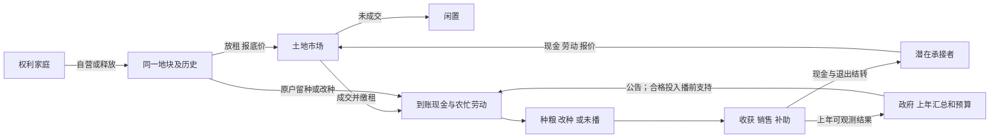

# 土地经营接续模型 ODD+D

## 概览

**目的。** 在含不完全交易和农忙资源约束的经济环境中，区分土地经营权成交、换人生产与持续种粮；比较相同额度上限下的支付资格和支付时点。模型只说明给定设定下的机制，与F1经验样本并列，不解释中国的真实政策因果效应。

**实体与尺度。** 一个人工区域，24个原经营家庭各有两块4亩权利地；8个潜在承接者以资金和农忙能力区分，无预设的合作社或公司效率差异。承接者不是600户样本的扩大；土地无真实空间坐标。每地每年最多一个经营者及一种作物。按年调度八期，一年租约不改变权利人。退出指原户停止直接经营某些地块（可保留权利），或承接者资金低于周转门槛后永久退出竞租；不建模死亡、迁移、承接者再进入、信用或服务市场。

**过程和调度。** 年初政府选择并公告规则；权利户比较自营、出租或不经营；承接者按预期成本和收益出价、给定现金和预计工日决定最高单数；市场统一租金清算；先支付租金、搜寻费用及承接启动成本；实现农忙工日和可动用资金；逐块选择播种，符合资格的投入款在开支时支付；收获销售并结算收获后补助；兼业工资、消费和现金结转，更新承接规模及退出；政府最后读取本年可见汇总用于下年。

## 设计概念与决策

**家庭。** 使用地块预计产量乘价格，减物质投入、实际放弃的非农机会，加可预期支持；保留零值。非农机会成本是农忙可用时间因农业减少时，与有酬岗位上限共同决定的损失。油价、劳动、资金限制不作为统一退出概率。依确定地块顺序为家庭扣减计划投入和工日。某地直接收益小于可预期租金（底价乘搜寻成功比例）或无正收益可行方案则释放；若最终未成交，当年不再自营，解释为农时已过的结构假设，不能由现有调查验证。没有释放的土地在产前也可因资源冲击闲置。

**承接者。** 报价按平均质量的预期作物收入减预计投入、经营启动费分摊和交易成本，同时受资金约束；预计可承接的地块数受现金和计划工日共同限制。市场优先低底价、高买价，采用仓库冻结的区域边际报价中点。成交后承接者对各地块按同一顺序重算，不能以收获后补助提前拿到投入款。净收益和支出结转会改变次年可竞得的地块数；承接者有可能因低收成、固定成本或未种而缩减、退出，不承诺盈利。

**地块状态。** 记录权利人、本年和上一年经营者、现在和以前用途、搜寻或失败原因、租期、播种及收获。区分（1）出租失败；（2）租入但没有播种；（3）租入并改种经作；（4）租入且种粮；（5）经营者真实更替且上期和本期都种粮。第4项包括续租，不能用它替代第5项。如果上年无人经营，则当年恢复不计为直接经营者交接。地块平均质量随机但固定，年度天气共同冲击产量；不拟合地区气候。

**财政与学习。** 年度共同支出上限为7,200元，85元/实际种粮亩为名义标准；稀缺时按同资格面积比例配给。无专项基准无专项支付。产后生产支持覆盖所有核实粮食面积；承接播前支持只覆盖实际签约承接者购买粮食投入。播前按合格可经营地预留额度，在确认粮食方案后立即抵减投入付款，不能用于先付地租，也不是自由现金；未播不支付、不滚存；续约承接者符合相同资格。P1的产后支付不进入当年播种现金账。额外两种时点/对象对照仅在机制组，不进入政府动作菜单；完整参数见[参数表](参数来源.csv)。

观察由上一年四个公开量构成：粮产是否低于常年理论总产量的55%、释放地未成交率是否超35%、释放地上承接种粮是否至少30%、实际支出是否超预算70%。初年给定合成公开初态。奖励为粮食实收产量/基准粮产上限 + 0.18×承接种粮面积/总面积 − 0.14×实付金额/预算。动作见三项主政策。Q采用已有Bellman更新，学习率0.14、折扣0.92、探索率从0.55下降至0.08；独立评价冻结Q表，对未见状态使用透明规则。无新增支持世界的配对差由研究者计算，不进入观测或奖励。政府并不观察当年天气、家庭现金或任何反事实。报告奖励、粮食、接续、收入与支出，不以一个训练奖励替代所有指标。

## 细节与验证

初始化和年份随机流以 `seed, year, stream` 定位，政策不会改变随机调用顺序。搜寻摩擦用地块能否进入当年竞租表示，既有搜寻费用为独立参数；去摩擦同时设搜索失败和费用为零。各地块顺序、竞争和预算均确定。无动态反馈每年重置开初资金和经营资格，保留实际上一年的经营者和作物用于结果统计，但不上溯影响年度选择；随机数和年度清算规则也不变。不能把这种差分说成现实结构效应。

正式训练先通过内部测试：土地面积、经营者唯一、合同付款、现金和工日不透支、地块产出与年度账加总、财政预算；另检查零摩擦、无承接者、无人释放、资金和劳动在成交后不足、先观察后决策和冻结评价。
