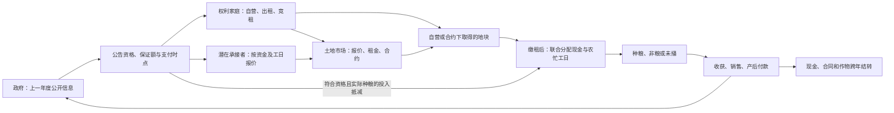
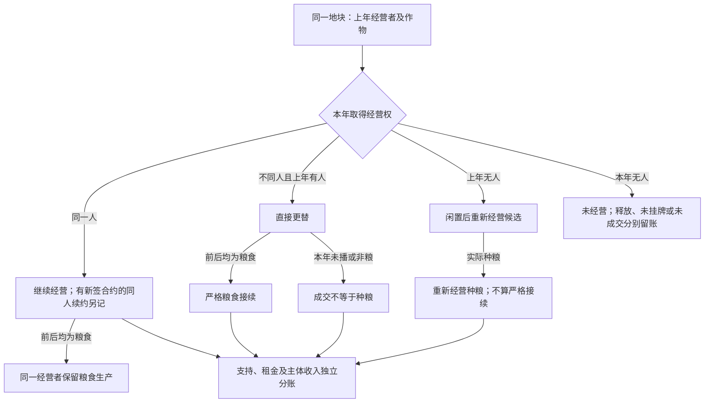

# 土地经营接续与财政传导：ODD+D

## 概览

**目的。** 在不完全要素市场中，财政支持改变可行经营方案和土地报价。本文跟踪支持是否带来新增粮食、维持原有粮食生产、改变租金和收益归属，或因交易与生产约束而未形成增产；另检验停止支持后这些变化能否持续。支付时点和政府学习分别是传导机制和决策比较，不替代总研究问题。

**主体和尺度。** 一个无真实地理坐标的合成区域，基准24个权利家庭，每户两块4亩地，另有8个潜在承接者。权利家庭既可供地，也可竞租他人的地。承接者按资金、工日及经营经历区分，不给农业公司或合作社加行政标签。地块不是决策者，始终有唯一权利人，并分别记录承接合同、生产经营者及作物。研究期8年，一块地一年限一种作物。没有土地出售、抵押、转租、独立雇工或农机服务市场；农业投入按给定预算核算，非农工资和可获得岗位工日外生。

**年度顺序。** 政府按既往公开信息公告资格、支付时点和单位保证额。先履行仍有效的土地合同；家庭把可自营地和持有租约地纳入联合计划，评估继续经营、放租和不种。交易按底价、农忙能力、预期收益和现金限额排序，合约成交后先付租金与启动费用。农忙劳动、可动用现金实现后，经营者在全部可经营地块上联合选择粮、非粮或闲置。播前支持在投入账上抵减，应付余额来自经营者现金；未播不核拨。收获后据实际粮食生产核拨产后款，结算销售、收入与消费。次年继承现金、合同、经营者及作物历史；政府只使用公共汇总。

## 设计与决策

**释放和报价。** 对每块自营候选地，生产贡献为预期产值减投入、可预期租金与放弃的非农岗位收入，加符合资格的预计支持；保留不种选项。出租可得收入以底价乘搜寻成功概率近似，不把计划等同于实际成交。租地时先根据剩余工日和资金计算可报价块数；对每块挂牌地比较其质量、作物净收入、非农机会代价及承接资格。根据最高可成交报价、既定底价及买方块数上限匹配，不允许租自己的土地。新成交合同租金为共同底价与边际成交报价的中点。该局部市场的数量单位是块，成交各价先按元/4亩地块运算，再换算元/亩；已有合同沿用签约租金。报价按配额分摊年度启动费用，以保守可负担成本计算，不声称达到全局均衡或对所有地产组合穷举竞价。

**联合作物分配。** 对已获得经营权的全部地块，在总现金和总农忙工日两个约束下最大化预期经营剩余，零种植仍可行。家庭机会成本为务农前后能兑现的非农工资差，受岗位工时上限约束，不另重复扣除家庭工资。对同等单位成本、支持额度和回撤费用的一组地块，按质量排序后枚举粮、非粮份数；固定份数下，收入斜率更高的非粮先分配较优地块。再合并各组计划，在共同现金、工日和非农机会成本下取最大值。排序只用经济属性与稳定ID拆解平局，不取决于输入顺序。产量为实际种植亩数乘作物基准单产、地块质量及当年天气冲击。

**农时与合同。** 基准未成交不回撤；备选允许播种截止前以120元、2工日/块的组织成本重新选择，仍须满足可行性。基准合同一年到期，三年情景在有效年不得重新竞租，年度租金固定，每年先核可付租金及经营启动成本；租方付不起整个存续租约组合或已退出，则解除组合、将地还给权利家庭本年重新决策。不模拟罚款、押金、补偿、转租或重新协商；合同期限对未来转手与成本的影响不依赖隐含未来租金预测。承接者本年有租入但年末现金低于启动成本、参考底价及搜寻费用之和，退出以后竞租。重入敏感性要求至少一个完整空档年，并将现金恢复到初始禀赋，注资单列，不计补贴或经营收入。现金结转和退出状态可独立关闭，仍保留合同和作物历史。

**财政承诺。** P0无专项；P1/P2对全部核实粮食地块，P3/P4只对新签且不同于上一经营者的租入地块，包含有上任经营者的直接更替和此前无经营者的闲置流入。P1、P3为播前；P2、P4为产后。每块保证金额是名义标准乘亩数与预算按全区地块数折算的固定额度的较小者，上限不超过粮食投入。用同一金额作公告、竞价预期、承诺与每块核验支付；低预算提前统一配给，资格少或申领少不补发上调。该保证制度有意保留可能未使用的预算，不解释为效率最优。每一已取得可经营地块的承诺与实际到账分列，零播和非粮未完成承诺自动取消；播前资金不得先付地租。实验A对每个年度使用同一P0状态、合约和事前承诺，只比较时点；实验B对每项政策内生重新形成合同与现金状态。同承诺一般不等于同实付。

**地块接续。** 同一经营者连续种粮归入留存；新任与上任不同且两年都种粮是严格接续。同一承接者重新竞得同一地块和未到期续履分别记录，不新增承接资格。若上年没有经营者，本期种植是重新经营，不计严格接续。成交后未播仍保留合约占用，未播地不能进产量；因此合同占用、实际播种和粮食接续是三个指标。

**政府决策与评价。** 固定政策、透明规则与政府Q更新走同一个年度环境及P0至P4菜单，观察同样的上期行政汇总：粮产、释放后未成交率、严格接续、预算执行，另观察本期剩余年数。学习的目标是粮产标准化值、严格接续亩数相对区域面积和财政执行成本的加权和；粮产和接续目标重叠但不相同，不等于社会福利。政府不得读取当年冲击、潜在生产率、家庭现金或模型反事实差。只在内部核验通过后训练，冻结评价，未见状态回退到透明规则；分开比较产量、接续、支出及收入。有限期状态和训练阈值见同版 `manifest.json`。

## 细节与可核查性

播种、收获、核验与付款分账；以地块ID、主体ID以及实验、种子、年份和策略联结事件。所有实算记录均合成，与真实调查无关。初始化沿用父版抽取；年内天气、搜寻、工资、现金和工日各用独立种子流，匹配前按稳定ID排序。不同承接者数量情景保持共有家庭和地块的外生抽取。脚本按配对世界计算区间，不能拿同一路径8年作为8个独立样本。

内部核验针对土地与经营权、租金、现金、实际播种与作物产量、财政、预算与数据表加总，另以边界及多地块枚举测试核验决策。参数逐项见[来源表](参数来源.csv)。本模型用于说明何种资源和制度条件使传导关系成立，不作中国政策因果估计或全国排名；F1行为门槛未通过的结论不变。
