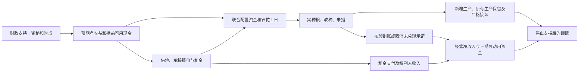

# 财政支持、经营权重新配置与持续粮食生产

本文考察有限财政支持经过经营者选择、土地交易、农忙投入和跨年经营之后，何时保留为粮食生产能力。对照结果区分原有生产的保留、真正换人后的种粮、地租资本化、主体间收入变化，以及没有实现作物生产的环节。

[模型与年度调度](ODD+D.md) · [参数及证据等级](参数来源.csv) · [文献对照与论文结构](文献与参数证据.md) · [既有理论对照及参考全文](https://github.com/DCCAISSON/agricultural-policy-abm/tree/3ed46a9d62c644d26709775a0e55c197bf229ee7/docs/reference_project)。

## 实验与比较

| 政策 | 合格生产对象 | 支付规则 |
|---|---|---|
| P0 `none` | 无新增专项 | 不支付 |
| P1 `grain_pre` | 所有核实种粮地块 | 成交及缴租之后抵减播前投入 |
| P2 `grain_post` | 所有核实种粮地块 | 收获核验后支付 |
| P3 `takeover_pre` | 新签、与上一经营者不同的租入地块；实际种粮才可兑现 | 成交及缴租之后抵减播前投入 |
| P4 `takeover_post` | 同P3 | 收获核验后支付 |

P1至P4构成资格×时点的2×2比较，共用每年预算上限。内生市场下不同政策各自决定报价、租约、生产与现金结转，实际支付不强求相等。固定合同实验逐年分叉同一P0期初状态，锁定已形成的供地、承接、合同租金和事前承诺。只改变到账时点，让粮经面积、实付和收入响应。这是对同等承诺的流动性检验，不是同实际支出或包含市场反馈的政策总效应。

机制关闭与敏感性覆盖八种搜寻、资金与劳动组合、市场费用、底价、工资、启动成本、不同承接者数量、预算和支持标准、未成交回撤、退出后重进、现金与退出两类结转、合同期限和停止支持。停止支持的地块追踪从支持期内实际领款的固定地块集合出发，后期不按是否继续生产重选样本；解读保留率时同时比较同地块P0路径，避免把领款者筛选误作政策持久性。续租、严格粮食接续、重新经营及成交后未种分别计量。



## 复现

公开表和完整地块、主体账的对应入口见[正式结果索引](../../results/experiments/land_succession_transmission_final_20261126/README.md)。

```powershell
python -B -X utf8 -m pytest -q -p no:cacheprovider tests/test_land_succession_transmission.py tests/test_land_succession.py
python -B -X utf8 -m scripts.run_land_succession results/transmission_replay --formal --workers 8
python -B -X utf8 -c "from pathlib import Path; from scripts.succession_analysis import analyze; analyze(Path('results/transmission_replay'))"
python -B -X utf8 -m scripts.replay_land_succession results/transmission_replay results/transmission_replay/reproduction.json
```

正式运行要求全新输出目录，记录实际种子、参数、输入与执行源码指纹。地块、主体、交易与财政账均为合成，使用实验组、情景、种子、年度、策略和稳定地块/主体编号联结。训练与评价严格隔离；评价不更新Q表。比较的区间对应模型内部配对路径，不是调查抽样或现实预测区间。

固定观察点等材料仅作为解释范围的外部参照。本模型未以真实地块、租约或财政支付重新校准；全国F1先前四项联合行为检验45/100仍独立保留，未进入全国政策排序或政府训练。

## 原有生产保留与真实经营者接续

下表报告八种搜寻、资金、劳动组合中各情景的均值范围。每个情景均有100条配对、各跑8年；每条路径先算年度均值。严格接续仅指同一地块经营者实际更换、前后都种粮，并非租入地上所有种粮面积。

| 内生市场，相对P0 | 粮食产量变化（公斤/年） | 同一经营者连续种粮面积变化（亩/年） | 严格接续面积变化（亩/年） | 实付财政（元/年） |
|---|---:|---:|---:|---:|
| P1 全部种粮者播前 | +3,314至+4,099 | +10.60至+10.98 | −0.54至+0.37 | 5,262至5,489 |
| P2 全部种粮者产后 | +2,662至+3,474 | +8.41至+9.02 | −0.42至+0.52 | 5,204至5,431 |
| P3 新承接者播前 | +188至+471 | −0.86至−0.04 | +0.35至+1.64 | 83至368 |
| P4 新承接者产后 | +107至+319 | −0.77至−0.05 | +0.23至+0.93 | 78至344 |

普遍支持增加的主要是同一经营者继续种粮，不意味着通过土地转手增加了粮食生产。新承接支持增加了严格接续，却也使成交后未播面积上升：P3每年多租入0.44至1.42亩，租约下未播面积仍多0.06至0.36亩。补贴改善报价能力不等于解除交割后的全部现金和用工限制。

**固定合同的时点效应。** 保持期初资源、实际承接、租金、资格和核定承诺金额不变，将P2提前至P1，每年多收653至797公斤粮；将P4提前至P3，每年多收33至173公斤。两组实际支出分别增加59至74元、3至15元，因为一些原本未播的地块完成投入并取得付款。该变化来自合约之后的生产配置，不含政策重新改变报价和经营者的作用。内生市场中，相应时点差额分别为612至781公斤、51至212公斤，不能用它们减去固定合同差额、便视为独立的地租效应。

## 地租与收益归属

以低搜寻摩擦、资金和劳动较充足组为例，按亩数加权的P1租金比P0高12.49元/亩，但区域年租金总额反而少161.41元。逐年作对称价格—面积分解后，价格部分为+204.48元、租地面积部分为−365.89元。P3则分别为+186.47元与+151.66元，合计多338.13元；在两种政策都租出的同一地块上，P3租金平均高11.84元/亩。若一侧没有租赁，单位价格无从比较，租金差全部归入面积变化，并报告这种观测覆盖。

该组P3实付368.25元/年，其中权利家庭领取10.69元、外部承接者领取357.56元。权利家庭的年净收入平均多295.40元，外部承接者多158.69元；两者均包含作物、租金、费用和非农工资的变化，不是财政金额的两个分割比例。农户也能竞租，不能把获得支持与是否拥有其他地块的权利混为一谈。

在八种核心组合中，P1约91.5%至92.8%的实付发生在配对P0下已经有同等粮食产量的地块；P3对应65.5%至77.4%。这些金额标记“当期该地块没有正增产”，并非未播时违规拨款，也不直接等于无效支出。同期可以保留原有生产或改变经营者、租金与下一年资源。新增产量、原有生产、租金、收入和未用预算分别核算，不将不同单位强行合成一笔财政残差。

## 市场摩擦、资源与跨年反馈

中间情景每项有50个配对种子。P3相对P0增加447.50公斤粮/年（配对95%区间262.57至632.43）和0.88亩严格接续/年，平均实付205.12元/年。去掉搜寻失败和交易费后，P3的增粮差额扩大329.39公斤/年（30.90至627.89）；承接资金充裕时差额缩小436.85公斤/年（缩小220.77至652.93）。这一区别说明两类障碍作用不同：土地找不到接手者时，补助也难以到达；承接者本来已负担得起播种时，增加流动性未必再带来产量。单独放宽承接者劳动，P3的增粮差额变化区间跨零，不能据此否认劳动会限制个别合同的履行。

年初重置现金、保留退出状态后，P3的增粮差额由447.50变为321.19公斤/年，差值区间跨零；严格接续差额由0.88变为2.58亩/年。单独重置退出状态在该情景的上述指标不生效；现金和退出反馈同时关闭是另一组明确的比较。允许未成交地回撤后，P0平均有0.38亩/年回到原户生产，P3相对P0的增产没有明显扩大。没有外部承接者时，权利家庭仍可相互承接，P3增粮146.13公斤/年；4、8、16个外部承接者的相应差额为509.66、447.50、396.50公斤/年。不能把外部经营者数量增加等同于补贴增产单调增加。

合同延为三年时，P3新签亩数由8.83降至5.37亩/年，另有8.89亩/年是在履租约；租约占用但未播从1.84增至4.32亩/年。三年期P3相对P0平均增粮395.59公斤/年，与一年期的政策增粮差额之差的区间跨零。较长租约稳定了部分经营权，但限制土地重新竞租，不能保证播种资源或更高接续。

基准预算7,200元、192亩下，60、85和120元/亩的名义标准均受37.50元/亩保证额约束，三档实际路径一致。调整预算上限改变有效承诺：中间情景P3的年增粮在360元预算下为63.25公斤，20,000元预算下为1,146.10公斤；实付分别为8.29与635.80元。不能拿这两点反推最优补贴或将名义率的零变化解释为补贴本身无效。

## 停止支持后

在中间情景中，将P3只运行三年后停止。相对于同合同制度的P0，停付后第1至3年的区域粮食产量均值分别为：

| 合同 | 第1年 | 第2年 | 第3年 | 三年均值及配对95%区间 |
|---|---:|---:|---:|---:|
| 一年期 | +345.30 | +300.18 | +238.41 | +294.63（103.43至485.84） |
| 三年期 | +127.53 | +129.25 | +240.46 | +165.75（−99.86至431.35） |

单位为公斤；后两年单年区间都跨零。三年停付设计的三年均值提示一年期情景中的部分生产差异可以延续，但不能宣布每年都有稳定增产，也不能据此认为三年租约延长了政策效应。一次性支持下，停付后第2年配对均值已略转负；持续八年支持和同一批受助地的跟踪另列于结果表。

另锁定每条路径前三年实际领过P3的地块，在自身路径和配对P0同时跟踪。50条路径中，一年、三年合同下分别形成288和227个“路径×地块”记录。停付后的第一年，仍由最后领款者经营的面积分别为每条路径2.08和4.56亩，第三年降为1.12和1.44亩。同一批受助地相对P0的产量差，一年期由+100公斤/年变为+203公斤/年，三年期由+158变为−74公斤/年。两种合同下进入追踪的地块并不相同，不能把两组留存率之差解释为合同的独立因果效应；三年期提高了最初的经营者留存，但并未保证这些地块随后继续多产粮。

## 政府学习的独立评价

每个奖励口径五次独立训练。初始训练2,048条路径，覆盖不足则扩展到4,096条；仍不足才聚合非核心财政执行状态，重新运行4,096条。15次训练最终的常见状态—动作覆盖率为84.9%至89.2%，均未达到预设的95%；保持此失败结论。冻结后的学习策略只在达到访问门槛的动作中择优；独立评价的36,000次学习决策未触发透明规则回退，但这不等于训练覆盖充分。剩余期数始终保留。

每种未参与训练的参数情景使用100个独立配对种子。下表以同一世界对五个基准奖励策略的结果取平均，再作世界间配对；不把15次训练或八个年度当作独立评价种子。

| 独立情景 | Q平均奖励 | 透明规则 | 奖励最高的固定政策 | Q相对透明规则（配对95%区间） | Q相对该固定政策（配对95%区间） |
|---|---:|---:|---|---:|---:|
| 资金与劳动较紧 | 0.6521 | 0.6477 | P3，0.6613 | +0.00443（0.00241至0.00645） | −0.00918（−0.01024至−0.00811） |
| 中间条件 | 0.6641 | 0.6601 | P3，0.6720 | +0.00398（0.00192至0.00604） | −0.00788（−0.00909至−0.00667） |
| 高搜寻失败 | 0.6658 | 0.6610 | P0，0.6738 | +0.00475（0.00248至0.00703） | −0.00804（−0.00916至−0.00692） |

Q在基准奖励下改善了透明规则，但三个情景均不如对应的最高奖励固定政策。这个固定政策是各情景比较后的基准，不表示政策制定者事前知道最优选项；各固定政策和训练重复的单独比较均保留。改变严格接续或财政权重会改变部分固定政策的相对表现；不因个别训练的微小分差声称学习整体胜出。

## 验收与边界

| 判断 | 状态与依据 |
|---|---|
| 资金、土地、租金和财政规则 | 已实现；财政保证额不因成交结果变动；新承接与同一经营者续租分开；合同面积、投入、财政预测与核验支付均可通过账表复核。 |
| 地块输入顺序 | 在一年和三年合同各50个配对种子下，比较原始、倒序与三个随机顺序；以同户同地的完整账而非均值检验顺序不变。 |
| 一年与三年租约、无回撤与有回撤、永久退出与可重新进入 | 结构假设。运行制度敏感性，不将模拟时点、费用和重入概率描述为实测制度常数。 |
| 学习的状态—动作覆盖 | 已训练并完成独立比较，95%门槛未通过；按预设流程完成续训和聚合，但不继续调奖励或查找有利种子。 |
| 全国校准及因果识别 | 数据无法识别本模型所需的同地连续合同、真实播前资金、农忙用工和逐笔支持；合成结果不能用于全国政策排序或代替F1经验验收。 |
| 遗留全国学习测试 | 冻结父版已缺两项该测试导入的历史脚本，不改写历史。该文件未能纳入本次回归收集，不调用它的全国环境；本次土地接续专项及选定相关回归另有回执。 |

原理论基准从 `25dae88d` 复跑17,088个实验年度，九份结果、训练和统计文件逐字节相同；清单仅记录不同 NumPy 与 pandas 版本。新模型的程序和参数变更按独立分支记录，两代结果不能混为同一干预的前后差。

独立核账覆盖186,800个年度、8,966,400条地块、5,969,600条主体、1,128,746条交易及2,821,002条财政记录，未发现失败。预先指定的28组情景路径锚点重新执行，1,296条年度、62,208条地块、41,472条主体及对应交易、财政和停付记录逐行一致。27项训练前专项、60项相关回归全部通过。原始账、输出指纹、测试与独立核验入口一并归档。
