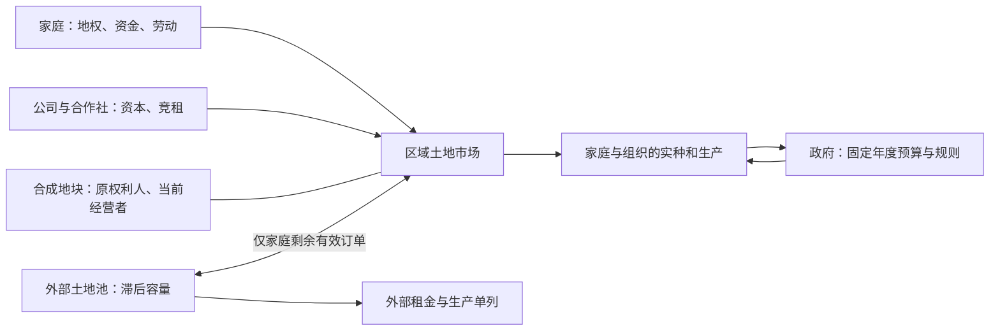
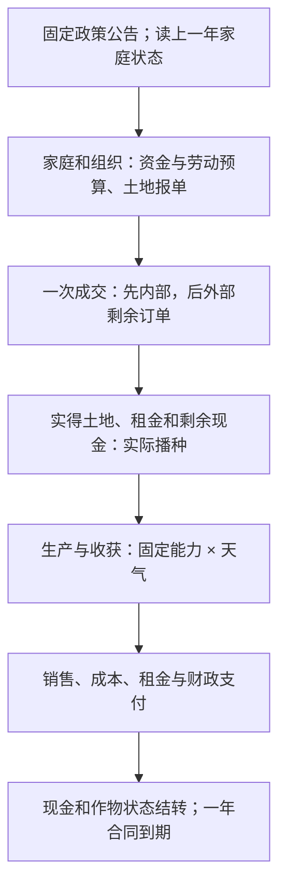

# 最终候选 F1：ODD+D

**概览。** 模型以年为步长，比较家庭经营参与、作物面积和土地转移如何形成粮食生产。运行范围为固定600户家庭、60家合成农业公司与合作社、地区内部市场及聚合外部交易池。每个家庭运行权重1。外部池没有虚拟家庭、空间坐标或直接补贴；其生产与样本生产分账。没有真实地理或全国扩总含义。

## 图1：主体与市场边界

内部地块采用既有合成八邻接，邻接影响候选交易和交易摩擦，不代表真实地理距离。公司和合作社保留原有成本与退出条件，无虚构成员、投票、分红。农业工资、非农工资收入和农产品价格外生；收购、农业服务和信用没有独立清算。外部池的供需容量来自NFPS非队列历史实报，解释为下界代理，不能补齐调查缺失。

## 图2：家庭状态转移

`farm_batch` 先在每个粮经组合下求家庭劳动不足点、地权补贴拐点、现金上限和零面积的可行经营；季前开支由非劳动投入与雇工工资构成，租赁扩张同时支付预期租金。有正面积、正剩余时，仅在这些方向中选择；无收益可行解时选零。农户不接受额外无条件退出抽签；无地家庭需有竞租且成交后才有实际经营。作物方向与幅度仍取原非队列历史拟合，未按2015结果改概率。独立退出摩擦未经识别，未增加。

## 图3：一次年度运行

农时、工序及劳动力市场尚未单列。劳动力上限结合NFPS劳动力与就业时间、CFPS参照，不用家庭总人口或当年已实现投工作上限。实际家庭工日不超过预算；雇工只补正的劳动缺口，支出等于雇工日乘冻结农业日工资。机械作业费用包含在旧非劳动预算内，现有金额不能唯一拆成机械、人工服务和覆盖面积；不做省工折减，不虚构托管覆盖，不把省下工日变成非农收入。

**生产与政策反馈。** 各粮食作物先分别估计历史亩产偏离和地区基准，再以基期种植结构形成家庭粮食组合亩产。稻谷信息只用于稻谷分项；未挪作劳动效率、风险、工资或经作能力。代表性非粮作物及地区外部池采用原组别预算和亩产；年度天气与能力分开，不增加随机永久能力或技术趋势。政府继续观察样本内主体的产量和财政，不包含外部池生产。F1仅用于固定支持下的行为回放。
