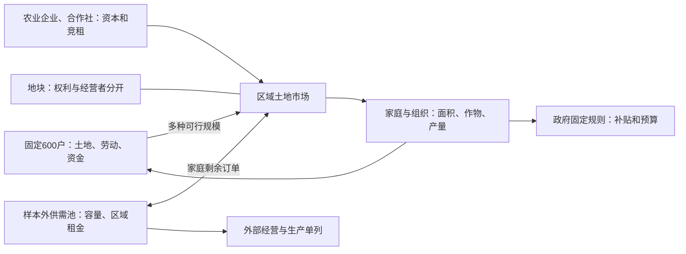
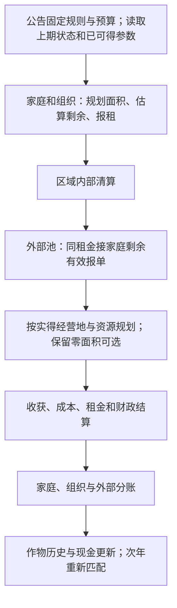

# V4.1 模型说明（ODD+D）

**目的与尺度。** 模型按年追踪粮食生产是由原家庭维持、由经营者调整面积，还是由土地转移后继续承担。采用NFPS固定600户与60个合成经营组织，匹配2011–2015年家庭调查，范围不是整村普查。现有年度运行以 `MainModel._step_area_economy` 为准。固定支持，政府只做公告与核验结算；政策排序与学习未运行。

**主体与状态。** 家庭持有土地权利、物理面积、劳动、季前资金及上年作物结构。农业企业和合作社保留原资本、管理费、报价和退出规则；没有成员表决或分红推演。地块是有权利和经营关系的资源。每区外部池只是汇总的供需与经营账户，无虚拟户、坐标、学习或补贴。

**决策与过程。** `farm_batch` 比较含零面积在内的候选方案，现金和劳动限制可行面积；R2/R3采用选出的经济方案，不再对结果套用未以可行正面积条件估计的参与概率。无地家庭须有租入需求并成交才有实际生产，正地权也不保证生产。粮经方向、幅度和进入条件概率保留父版。企业与合作社仍向内部市场报价。原市场先交易，区域外部池再按本区清算租金匹配跨界订单；无内部成交时用既有区域参考租金。合同一年，所有权不变，外部租入没有内部图上的地块位置。

**空间与调度。** 内部地块仍使用父版合成格网和八邻接交易搜索，权利地块租出采用不重叠物理切片。外部池只有区域键，因此不能计算跨界的空间距离；合成格网不当作真实地理，邻居信息不估计为模仿效应。

**对账与证据。** 供给池可释放面积在每年开初定义：期末外部经营亩数 = 当年可释放面积 − 租给样本家庭 + 从样本家庭承接。它不是完整区域外部耕地；一年合同结束后按当期可得资料重新给定供需容量。外部运营面积乘区域播种强度、粮经构成与单产，和区内主体使用同年天气；计算租金收付、作物销售与可追溯成本代理。它不进入家庭现金，不申请补贴，不并入既有政府观测口径。行为验收只针对同户家庭。代码、估计来源和接续核账见 [参数表](parameters.csv)、[逐年比较](annual_behavior.csv) 与[账户](accounts.csv)。
