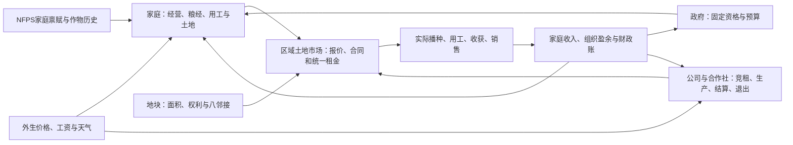
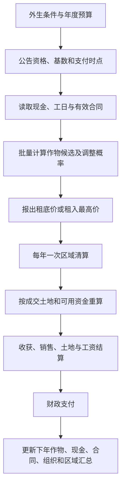

# V4 模型说明：全国农业经营与土地配置

## 目的、实体与时间

本文考察不同家庭禀赋下，经营收益的变化如何通过种植调整和土地流转改变粮食生产的承担者及实际产量。比较单位为同一初始队列、同一外部冲击下的模型路径。模拟从2010年末起步，每次运行2011至2015年。家庭的土地、劳动力、流动性、历史作物结构和收入是连续属性；不以固定生计标签替代决策。

| 实体 | 有效状态和行为 | 数量与依据 |
|---|---|---|
| 家庭 | 权利与经营面积、可用工日、余额与维持开支、作物份额、作物别历史产出；选择自营、租赁、粮经组合和雇工 | 固定600户，复用V3来源行，不把权重乘入户内面积 |
| 公司 | 以经营收支和资本约束竞租，条件具备时生产，余额不足以支付开支时退出 | 基准36家；合成，不外推组织数 |
| 合作社型联合经营 | 联合经营的组织账本，和公司使用相同的基础工价和技术 | 基准24家；不模拟入股、投票和分红 |
| 地块 | 物理面积和权利人、经营者及合同片段、区域和合成格点；不自行优化 | 600个家庭基期经营面积账；不从合成坐标推断真实地理关系 |
| 政府 | 公告并按核实权利和耕作面积支付，观察区域产量、租金、流转、组织、家庭收入和预算 | 单一政府；本轮未开启学习 |

## 设计概念与决策依据

训练集为固定队列之外、身份经户表和成员连续性检查的2009至2012年相邻户年。值为下降、维持或上升；退出方程取全部作物是否仍实播。转入、转出模型用实报面积是否为正，作为意愿信号代理，不声称观测到家庭主观意愿。采用多项或二项Logit、地区和校准年度控制、户聚类标准误。未来不读取调查年度截距。同期相对收益变异不足，未估计因果系数；以每播种亩3,000元作为正向收益信号尺度，执行半倍、两倍敏感性。这是连续概率的缩放，不是统一的收益门槛。

家庭从上期实际份额和规模取得两种调整幅度。纯粮、纯经有独立端点概率；内部变化以相对剩余可调整份额表示。组内有效样本不足时退回同方向总体。每种份额候选可缩减面积并雇工补足，先计算可兑现的经营剩余，再用方向概率抽取一个方案。随机流按主体、年份、种子派生；成交前后使用同一个随机数。上年没有粮经播种用训练样本中位数作起始参考，不把其他作物户写成永久退出。

NFPS年末存款与持有现金是初始流动性代理，双分量缺失才采用CHFS农业参与家庭的现金、活期中位数；负债不产生新信用额度。CFPS务农工日上四分位做代理，结合NFPS劳动力和外出时间得到可用农业劳动上限。工资收入外生，农业工时减少不自动产生非农收入。工资、物料和已含机械作业的预算分开记账；机械费不换工日。V4未单独启用历史服务市场。

作物别产量先取地区中位数，历史家庭差异向地区收缩；仅在2009输入预测2010产量优于地区基准时应用该作物的家庭差异。粮食合计按本户基期的实报作物面积比例汇总；不把稻谷残差外推给其他作物，不称TFP。能力只改预期和实际农业产出，不改劳动或工资。基准作物价格及成本继承V3，低中高预算另按成套的销售额、亩产、成本和工日试验。经作已经使用出售额，不重复扣除未售比例；粮食价格由元/斤乘2换为元/公斤。

## 运行顺序和关系图

**图1：主体与经济机制。**

**图2：年度运行。**

**图3：[八邻接合成地块和成交图](space.png)。** 格点是合成空间；颜色由运行账按物理占用分配，不是调查地块图。社会模仿关闭，不画不存在的信息传播。

## 调度、子模型与观察

只有核实权利内可以自愿出租；在区域内搜索八邻接，按实际交易扣除空间费和租金。可接受成交集合维持一个共同报价区间，区间中点是统一租金。成交保留面积分片，不允许重复出租。没有可比期限资料，合同一年。组织以原线性经营预算出价，且拟承租的全方案预期剩余必须能覆盖开支；部分成交后的实际盈余仍按真实账户结算。比较30、60、90家时固定总资本，另改变资本看约束。退出源于余额不足以支付开支，不靠人为绩效优势制造承接。

家庭选择、约束与生产批量计算，CSR保存地块邻接；清算冲突按确定性次序处理，组织竞租仍用原求解器。主体对象承担状态初始化、合同及账户写回。M0关闭V4新逻辑；M1切换作物选择；M2加参与、劳动和流动性；M3增加作物别历史亩产；M4加入八邻接，V4是综合配置。实际生效入口与逐项证据见本目录结果及研究说明。
